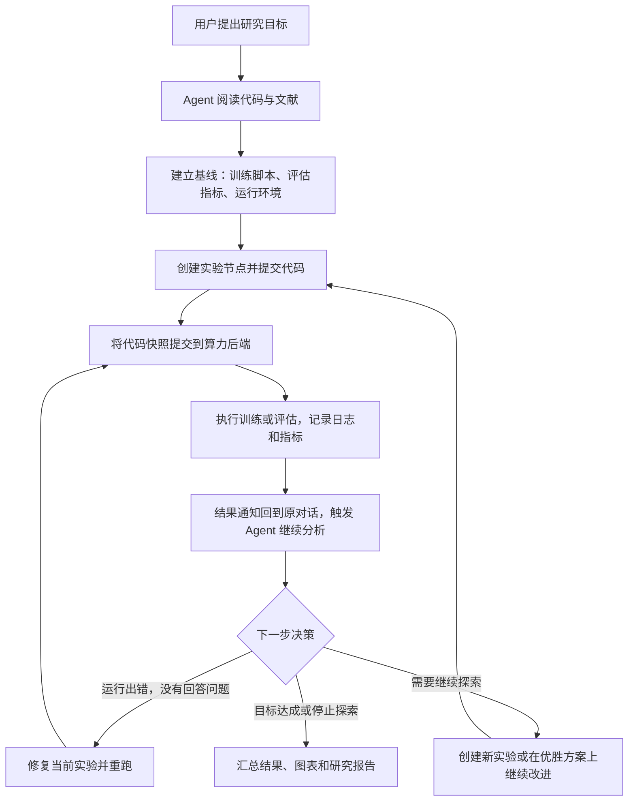

# OpenResearch 研究与模型训练工作流解读

本文基于当前仓库 `opensource/OpenResearch` 的源码、架构文档和 Agent 工作指南整理，没有实际启动训练验证。

OpenResearch 的核心工作流是：**让编程 Agent 负责研究决策和写代码，让 OpenResearch 负责实验记录、算力执行、状态追踪和结果回传。**



## 1. 从一个项目和研究目标开始

用户创建或导入代码项目，在对话中提出目标，例如：

> 训练一个小语言模型，对比几组学习率，选出验证集效果最好的方案。

每个对话有独立的 Git worktree。OpenResearch 启动用户配置的编程 Agent，并向它注入项目状态、算力配置、研究工作指南和技能。Agent 可以阅读代码、查文献、设计实验和修改训练脚本。

“先做什么研究、下一步改什么”主要由 Agent 根据目标和证据决定。

参考：[Agent 架构](opensource/OpenResearch/arc/agents.md)、[系统提示词](opensource/OpenResearch/SYSTEM_PROMPT.md)。

## 2. 先跑基线，再建立实验树

它区分三个对象：

| 对象 | 含义 |
|---|---|
| Project | 整个研究项目 |
| Experiment | 一个基线或待验证的假设，对应 Git 分支 |
| Run | 对该实验的一次实际执行，绑定具体 commit |

例如：

```text
基线模型
├── 学习率 2e-5
└── 学习率 3e-5 ← 本轮胜出
    ├── 增加 warmup
    └── 改用 cosine schedule
```

同一轮的候选方案是兄弟节点；下一轮建立在上一轮胜出的方案上。

它给 Agent 的规则是：**运行命令和环境约定保持固定，实验差异写进已提交的代码或配置。** 一旦实验已经回答了它要验证的问题，就保留该节点，后续修改创建子节点。这些是工作指南中的约束，不能一概理解为数据库强制限制。

参考：[实验树工作指南](opensource/OpenResearch/agent-skills/orx-experiment-tree/SKILL.md)、[CLI 总览](opensource/OpenResearch/SKILL.md)。

## 3. 提交代码快照，异步执行训练

Agent 修改并提交代码后，调用：

```sh
orx exp run <experimentId> --backend <backend>
```

实际执行链路是：

```text
Agent → orx CLI → orx up API → Run Engine → 算力后端 → 训练脚本
```

服务端归档该实验的具体 commit，记录 Run，再交给本地、SSH、Slurm、Kubernetes、Ray、Modal 等后端执行。未提交的代码不会进入运行快照。

**训练任务与 Agent 对话进程分离。** 提交后 Agent 可以结束当前轮次；后台引擎负责监控。服务重启后，会根据保存的任务句柄和执行凭据恢复追踪。

引擎和实际执行训练的进程也是分离的：任务由独立包装进程或托管平台运行。控制服务暂时退出不等于训练任务退出；服务恢复后再读取任务状态并追赶更新。

参考：[实验执行架构](opensource/OpenResearch/arc/experiments.md)、[算力工作指南](opensource/OpenResearch/agent-skills/orx-compute/SKILL.md)、[提交实现](opensource/OpenResearch/src/engine/submit.rs)。

## 4. 训练结束后，用消息驱动下一轮研究

这是自动闭环的关键：

1. 运行进入完成、失败等状态时，引擎记录结果通知。
2. 通知投递到发起任务的对话。
3. 对话空闲时，以内部消息触发 Agent 继续处理。
4. Agent 读取日志，通过 `orx metrics` 查看已记录的 Trackio 指标，并与父实验比较。

接下来有四种选择：

| 决策 | 场景 |
|---|---|
| 修复（Repair） | 缺依赖、代码错误等导致实验没有回答问题，修复同一节点后重跑 |
| 补充候选（Refill） | 当前结果一般或不确定，继续本轮其他方案 |
| 晋级（Promote） | 确认某个方案更好，以它作为下一轮的父节点 |
| 停止（Stop） | 达成目标，或继续探索已不值得 |

指南还设置了停止参考：同一节点连续两次运行没有回答问题时询问用户；约三次连续失败或退步后停止探索。**这些研究判断由 Agent 执行；运行引擎本身不判断科学结论。**

结果不能只凭 Run 状态推断。工作指南要求检查有效配置、最终指标、结果摘要，以及长任务的指标轨迹，再报告结论。

参考：[实验树工作指南](opensource/OpenResearch/agent-skills/orx-experiment-tree/SKILL.md)、[结果解读指南](opensource/OpenResearch/agent-skills/orx-results/SKILL.md)、[状态与通知实现](opensource/OpenResearch/src/engine/reconcile.rs)。

## 5. “训练完成”与“研究完成”分开判断

这里有三层完成：

| 层次 | 完成的含义 |
|---|---|
| 运行完成 | 训练或评估进程结束，执行引擎记录状态 |
| 实验完成 | 日志和指标足以回答该实验的假设 |
| 研究完成 | Agent 判断用户目标已达成，整理结论、证据、图表和报告 |

模型权重是否保存、保存在哪里、能否断点续训，由项目训练脚本和存储配置负责。例如仓库的 nanochat 示例有 checkpoint 保存逻辑，但演示证据包明确不包含大型权重和优化器状态，通常留在运行工作目录。

**不能把界面上显示运行完成，等同于模型权重已经下载到本机。** 日志、指标、报告与模型权重是不同产物，需要分别确认其保存位置和可用性。

参考：[nanochat 产物说明](opensource/OpenResearch/demo/nanochat/evidence/README.md)、[示例训练脚本](opensource/OpenResearch/demo/nanochat/base/scripts/base_train.py)。

## 6. 自主运行与人机协作

它提供两种自主程度，通过每轮注入的指令实现：

| 模式 | 行为 |
|---|---|
| Agentic | 按上述研究闭环推进，根据结果决定后续动作 |
| Copilot | 要求 Agent 在启动实验、改变方向及处理失败前征求用户意见 |

研究自主程度与底层 Agent 的工具权限是不同机制；这里描述的是研究决策方式。

参考：[autonomy.rs](opensource/OpenResearch/src/local/autonomy.rs)。

## 7. 各组件的职责

| 组件 | 职责 |
|---|---|
| 编程 Agent | 阅读文献与代码、形成假设、修改代码、分析结果、撰写报告 |
| Git 分支和 commit | 保存每个实验的代码，并确定一次运行使用的精确版本 |
| 本地数据库 | 保存实验树、运行记录、对话和通知等状态 |
| Run Engine | 提交、恢复、监控、取消任务，记录状态并安排通知 |
| 算力后端 | 在指定机器或平台执行训练和评估 |
| 训练脚本 | 实际执行数据处理、训练、评估和 checkpoint 保存 |
| 日志与 Trackio | 提供运行输出和已记录的指标证据 |
| 项目 artifacts | 保存报告、图表、CSV、PDF 等研究输出 |

该系统通过“实验树保存研究路径、commit 固定执行代码、后台引擎运行任务、结果消息触发 Agent 决策”串起整个流程。研究质量和完成判断依赖 Agent、训练评估代码以及实际记录的证据。
