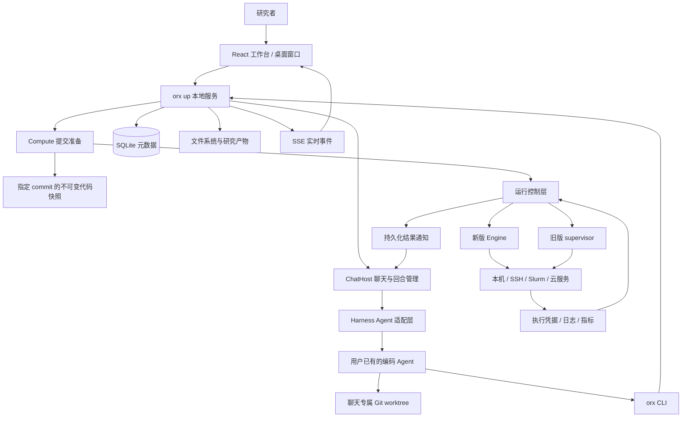
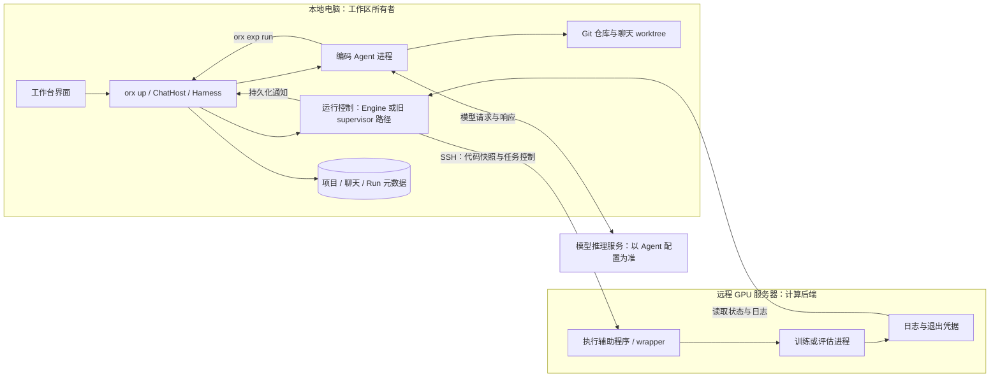
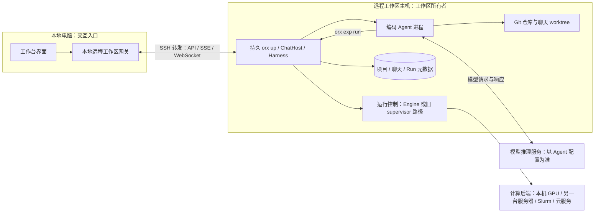

# OpenResearch 项目深度解读

分析对象：当前工作区 `opensource/OpenResearch`。

分析日期：2026-11-06。

版本依据：本地 `Cargo.toml` 标注版本为 **0.2.24**。

本文基于本地源码及 `arc/` 架构文档进行静态分析，没有实际启动应用或验证各家云服务。文中的默认行为与能力范围以这份本地代码为准，不代表上游最新版本。

## 1. 项目定位与整体架构

OpenResearch 的核心价值，是把“编码 Agent 的一次操作”变成“有代码版本、有执行记录、能回收结果、能继续迭代的研究过程”。

从代码组织看，它可以理解为四个系统的组合：

- **Agent 工作台**：接入 Claude Code、Codex、OpenCode 等工具，管理聊天、权限、上下文和委派。
- **实验管理系统**：用 Git 分支表达实验，用 commit 固定每次运行的代码。
- **任务控制系统**：向本机、SSH、Slurm、云服务提交任务，处理断连、取消、日志和恢复。
- **研究材料工作台**：提供文献检索、指标读取、图表报告、LaTeX、Overleaf 和项目分享。



最关键的职责边界是：**Agent 负责研究决策，OpenResearch 负责把决策落实成可管理、可恢复、可追踪的操作。**

模型能力来自用户使用的 Agent 和模型服务；任务状态、代码快照、聊天记录、日志回收由 OpenResearch 管理。

### 新旧运行路径并存

新版 Engine 已占据很重要的代码位置，但在 stable 和 development 构建中，默认不使用它启动新运行，Canary 强制使用。普通构建可以通过设置或 `ORX_RUN_ENGINE` 切换。这个开关选择新任务的启动和管理路径；关闭时 Engine 仍运行，导入旧路径的结果与唤醒，并恢复已有 Engine 任务。因此，不能只阅读 `src/engine/` 就认为理解了全部实际运行行为。

上图表达逻辑依赖，不表示所有组件部署在同一台机器上。Agent、任务控制器、模型推理服务与训练进程的部署边界，见第 19 节。

依据：

- [Cargo.toml](opensource/OpenResearch/Cargo.toml)
- [引擎开关解析](opensource/OpenResearch/src/config.rs)
- [API 提交入口](opensource/OpenResearch/src/commands/up/api_v2.rs)
- [实验运行架构](opensource/OpenResearch/arc/experiments.md)

## 2. 入口和服务模块：main.rs、commands/

项目以 Rust 二进制 `orx` 为中心。CLI、后台服务、桌面窗口、MCP 服务等能力都从这个程序进入。

| 入口 | 职责 |
|---|---|
| `orx up` | 启动 API、聊天宿主、运行控制和后台任务 |
| `orx app` | 创建原生窗口，加载工作台 |
| `orx exp ...` | 实验运行、查询、取消及结果唤醒 |
| `orx compute ...` | 配置和检查计算后端 |
| `orx discover`、`orx paper` | 检索和读取论文 |
| `orx mcp` | 给 Agent 提供委派及聊天协作工具 |
| `orx remote-host ...` | 管理远端持久服务 |

`src/commands/up.rs` 是系统的主要集成点：它既提供 HTTP API，也启动必须常驻的组件，例如 Agent 进程管理、PTY 终端、运行引擎、事件流、远程工作区和清理任务。

**CLI 的实验运行最终也进入 `orx up`，由服务统一接收提交。** 终端、桌面页面和 Agent 发起实验时，可以共用状态管理和并发控制。

这里采用“一个部署单元、内部模块划分”的架构。它降低了本地安装和版本分发的复杂度，但也让 `up.rs` 等集成文件承担较多职责。

阅读入口：[main.rs](opensource/OpenResearch/src/main.rs)、[up.rs](opensource/OpenResearch/src/commands/up.rs)。

## 3. 领域模型：Project、Experiment、Run、Chat

| 实体 | 表达什么 | 关键关联 |
|---|---|---|
| Project | 一个研究项目 | 仓库路径、默认命令、论文、GitHub 设置 |
| Experiment | 一个实验想法或变体 | 父实验、实验分支、说明、运行命令 |
| Run | 实验的一次实际执行 | commit、后端、状态、退出结果、日志 |
| Chat | 一段研究协作过程 | Agent、worktree、消息树、权限、队列 |

例如，“换一种优化器”可以是一个 Experiment；针对它执行三次，则对应三个 Run。

这种拆分让“研究想法”和“执行尝试”有各自的生命周期。一次运行失败，不必删除实验；同一个实验也可以保留多次执行记录。

Project 和 Experiment 的主要结构体在 [model.rs](opensource/OpenResearch/src/local/model.rs)，Run 的持久化定义在 [store.rs](opensource/OpenResearch/src/store.rs)。

## 4. 项目与 Git：projects.rs、git.rs、experiments.rs

这是研究可追踪性的基础。

项目可以关联用户已有的本地仓库，也可以使用 OpenResearch 克隆和管理的仓库。数据库记录仓库位置，代码仍由普通 Git 管理。

它使用两种不同的隔离方式：

- **聊天隔离**：普通聊天拥有各自的 Git worktree，Agent 在自己的目录中修改代码。
- **实验组织**：实验节点对应 `orx/<slug>` 分支，子实验从父实验分支的当前提交创建。

**聊天 worktree 是工作现场，实验分支是研究变体，Run 记录的 commit 是实际执行依据。**

实验树可以表达这样的过程：

```text
基线
├─ 改优化器
│  ├─ 调整优化器实现
│  └─ 加入另一项改进
└─ 改模型结构
```

树的父子关系保存在数据库中，Git 保存代码历史。重新挂接实验节点会修改逻辑树关系，并不自动重写 Git 历史。因此，界面中的父子关系不能始终等同于提交祖先关系。

**worktree 隔离的是工作目录，不是操作系统权限。** Agent 能访问哪些其他路径、能执行什么命令，仍取决于 Agent 的权限模式和运行环境。

主要实现：[projects.rs](opensource/OpenResearch/src/local/projects.rs)、[git.rs](opensource/OpenResearch/src/local/git.rs)、[experiments.rs](opensource/OpenResearch/src/local/experiments.rs)。

## 5. 实验规范：代码保证与 Agent 约定的边界

OpenResearch 的技能文件强调：

- 实验回答了研究问题后，应冻结节点。
- 子实验继承相同运行命令和环境。
- 参数变化进入提交的代码或配置文件。
- 每轮比较后沿选中的方案继续向下探索。

这些约定有助于让实验之间保持可比较性，但需要区分研究规范与程序约束。

源码中，`create_experiment_locked()` 仍允许显式传入 `run_command`，命令选择顺序是：

```text
显式命令 → 父实验命令 → 项目默认命令
```

“所有节点命令一致”主要依靠技能指导，没有在这个创建入口被强制锁死。同样，Git 分支本身也不是不可修改的归档介质。

| 层次 | 保证方式 |
|---|---|
| 某次 Run 执行了哪个代码版本 | commit 记录与代码快照 |
| 实验是否只改一个变量、是否冻结、命令是否可比 | Agent 规范与研究者监督 |

这是评价该项目时非常重要的界限。

依据：[根技能文件](opensource/OpenResearch/SKILL.md)、[实验创建与命令继承](opensource/OpenResearch/src/local/experiments.rs)。

## 6. 聊天：local/chat/

聊天层承担大量编排工作。一个回合的大致过程是：

```text
保存用户消息
→ 预留本轮执行权
→ 启动或复用 Agent
→ 发送输入
→ 将原生事件转成统一消息结构
→ 持久化回复并广播
→ 处理排队消息或结果通知
```

### 6.1 数据库保存正式聊天记录

Agent 原生 session 用来恢复上下文；界面展示和跨 Agent 切换依赖 OpenResearch 自己的记录。这样可以减少对某一种 Agent 原生存储格式的依赖。

### 6.2 消息是树形结构

重试回答、编辑早期消息会产生分叉。消息内部由文本、推理、工具调用、提问、状态等 part 组成，还可以嵌套子 Agent 内容。

但**切换聊天分叉不会同步回滚文件**。不同回答分支仍可能面对此前操作留下的工作目录状态，这对理解“重试”非常关键。

### 6.3 持久化消息队列和执行租约

用户在 Agent 工作期间发送的新消息，要么直接作为 steering 输入，要么先进入持久队列。每个聊天通过带心跳的 lease 保持单个活跃回合，并识别进程死亡后的遗留状态。

### 6.4 恢复区分“重试”和“继续”

| 输入交付状态 | 恢复思路 |
|---|---|
| 尚未发送、明确拒收 | 可以重试原输入 |
| 已接受、是否接受不明 | 继续原任务，避免重复执行操作 |

这种区别比统一提供一个“重试”按钮更符合 Agent 的实际风险：重发自然语言指令，可能重复产生外部副作用。

核心实现：[chat/mod.rs](opensource/OpenResearch/src/local/chat/mod.rs)。设计说明：[agents.md](opensource/OpenResearch/arc/agents.md)。

## 7. Agent 适配：local/harness/

Harness 层把不同 Agent 的能力转成统一接口，包括：

- 安装与登录状态检测。
- 模型和权限选项。
- 执行一个聊天回合。
- 处理中途输入。
- 上下文压缩。
- 提问和权限审批恢复。
- 原生技能目录与安装方式。

注册表包含 Claude Code、Codex、OpenCode、Cursor、Antigravity，以及动态注册的 ACP Agent。

| 进程方式 | 典型实现 | 需要处理的问题 |
|---|---|---|
| 每个聊天一个常驻子进程 | Claude、Codex、ACP | stdio 请求、进程恢复、活跃审批 |
| 每个聊天一个常驻服务 | OpenCode | HTTP 请求、事件订阅、服务版本 |
| 每轮启动一个进程 | Cursor、Antigravity、旧 Codex | session 恢复、退出码、无法实时交互 |

“支持某 Agent”不代表所有交互能力完全相同。是否支持中途输入、原生压缩和实时审批，都需要按能力暴露。

本地模型通过 OpenCode 合并本地推理连接，探测可用模型，并限制地址范围。它接入已有推理服务，模型推理本身不由 OpenResearch 实现。

源码：[Harness 接口与注册表](opensource/OpenResearch/src/local/harness/mod.rs)、[本地模型连接](opensource/OpenResearch/src/local/local_models.rs)。

## 8. 提示词、技能与自主程度

`SYSTEM_PROMPT.md` 提供每轮都需要的上下文：

- 当前项目身份与状态。
- 工作目录和产物目录。
- 计算环境信息。
- 研究证据引用规则。
- 技能路由和委派说明。

`agent-skills/` 把具体流程拆开，包括文献综述、实验创建、计算执行、日志读取、结果解释、图表、报告和论文等。

这些技能被嵌入二进制，并按 Agent 原生机制写入会话工作区，使技能内容随应用版本更新。

**研究流程的一部分写在 Rust 中，另一部分写在供 Agent 执行的技能里。** 分析功能时，必须同时阅读两边。

自主程度同样如此。`Copilot` 会向每轮输入加入“行动前解释并等待批准”的上下文；默认 `Agentic` 不添加这段限制。它与 Agent 自身的工具权限模式是两个维度：

- 自主程度表达“应当何时询问用户”。
- 权限系统决定“工具实际上能否执行”。

源码：[SYSTEM_PROMPT.md](opensource/OpenResearch/SYSTEM_PROMPT.md)、[agent_skills.rs](opensource/OpenResearch/src/local/agent_skills.rs)、[autonomy.rs](opensource/OpenResearch/src/local/autonomy.rs)。

## 9. 多 Agent 协作：MCP、delegation、news

Agent 通过 `orx mcp` 使用 `models`、`delegate`、`answer`、`subscribe`、`send`、`status`、`read`、`cancel`、`wait` 等工具；MCP 进程把调用转交给当前 `orx up`。

这里的子 Agent 本质上是一个有明确归属关系的聊天：

- 记录委派者和嵌套深度。
- 以任务内容启动。
- 权限不能宽于委派者。
- 委派者自动订阅问题和结果。
- 停止上层聊天，会停止其下的委派任务。
- 请求重试尽量找回同一个委派聊天。

**默认委派是共享原聊天 worktree 的 side chat。** 请求独立工作区时才获得自己的 worktree。因此，并行阅读通常容易安排，并行修改相同文件仍需要协调。

`news.rs` 负责把订阅聊天的结果和问题送回来，并处理投递竞争和循环唤醒。例如两个聊天互相订阅时，不能让“回答对方通知”继续无限生成新通知。

模型路由将不同 Agent、供应商对同一模型的命名映射到规范 ID，再选择可用通道。

源码：[agent_tools.rs](opensource/OpenResearch/src/commands/up/agent_tools.rs)、[delegation.rs](opensource/OpenResearch/src/local/chat/delegation.rs)、[news.rs](opensource/OpenResearch/src/local/chat/news.rs)、[model_routes.rs](opensource/OpenResearch/src/local/model_routes.rs)。

## 10. 计算提交：compute.rs

计算层分成两段：

| 接口 | 管理范围 |
|---|---|
| `ComputeBackend` | 提交前检查、代码准备、生成 LaunchSpec |
| Engine 的 `Backend` | launch、recover、observe、cancel、日志读取 |

前者处理“如何把实验准备成可运行任务”；后者处理“任务提交之后如何持续管理”。

`SourceSnapshot::create()` 会：

1. 解析实验分支的 commit。
2. 用 Git archive 导出该提交。
3. 计算归档的 SHA-256。
4. 按摘要保存归档。
5. 必要时额外生成 Ray 使用的 zip。

**未提交的工作目录修改不会进入快照。远端收到的是指定提交的代码归档，无需克隆整个实验仓库。**

提交过程还包括后端预检查、产物锁和实验提交锁，默认阻止同一实验同时存在多个未结束运行，显式 `--force` 可以突破这项限制。

当前注册的后端包括本机、Tinker、Hugging Face Jobs、Modal、Kubernetes、SSH、Slurm、Ray、Vercel 和 OpenResearch 托管机器。

这里提供很强的代码版本可追踪性。完整复现还需要固定数据、依赖、镜像、随机种子和硬件行为，无法仅靠 Git archive 保证。

源码：[compute.rs](opensource/OpenResearch/src/compute.rs)。

## 11. 运行引擎：engine/

这是项目最值得深入学习的部分。

| 文件或模块 | 职责 |
|---|---|
| `submit.rs` | 提交意图、提交栅栏、未知结果恢复 |
| `reconcile.rs` | 根据观察证据推进持久状态 |
| `runtime.rs` | 启动观察循环和后台工作 |
| `adapters/` | 各计算后端生命周期适配 |
| `transport/` | SSH 连接和请求调度 |
| `handle.rs` | 可持久化任务定位信息 |
| `legacy.rs` | 与旧版 supervisor 协作 |
| `notify.rs` | 任务主动通知处理 |

核心思想是：**状态必须由证据推进；连接失败不能代替执行结果。**

### 11.1 Phase 与 Contact 分开

| 维度 | 示例 |
|---|---|
| Phase：任务阶段 | submitting、starting、running、done、failed、cancelled、lost |
| Contact：联系状态 | live、unreachable、needs-auth、unreconciled、stopping |

例如，“running + unreachable”表达“最后确认在运行，现在无法联系”，并不等于 failed。

### 11.2 提交意图先持久化

系统先持久化运行意图，再进行外部操作，并记录提交 fence。若外部任务可能已经启动、回复却丢失，恢复逻辑会区分：

- 找到了原任务：接管。
- 有证据证明没有任务：允许重新提交。
- 无法确认：保持不确定状态并向用户呈现。

它不会把所有失败统一当作可以重试的网络错误。

### 11.3 取消需要停止证据

取消区分“记录取消意图”“请求送达”“确认停止”“还有残留进程”。Abandon 可以结束界面上的未完成任务，但在缺乏停止证据时仍保留后续清理义务。

### 11.4 结果通知与日志回收是持久义务

运行状态、终态通知和日志回收义务通过事务协调，减少“数据库显示完成，却永远没有结果通知”的空隙。

通知投递使用固定批次和回合标识进行去重；这不应被扩大理解为模型后续所有工具副作用都具备 exactly-once 保证。

源码：[engine/mod.rs](opensource/OpenResearch/src/engine/mod.rs)、[submit.rs](opensource/OpenResearch/src/engine/submit.rs)、[reconcile.rs](opensource/OpenResearch/src/engine/reconcile.rs)、[runtime.rs](opensource/OpenResearch/src/engine/runtime.rs)。

## 12. 执行宿主：orx-host、orx-host-proto

Engine 管理任务，真正运行负载的是独立 wrapper 或外部平台。

| 角色 | 生命周期与职责 |
|---|---|
| `orx-host serve` | 随 SSH 会话存在，接收 RPC、读取任务状态和日志 |
| `orx-host wrap` | 每个 Run 一个，独立于 SSH 和控制端存活，执行任务并写结果凭据 |

这让笔记本休眠、SSH 中断、工作台重启时，远端训练仍有自己的执行所有者。

任务目录保存 `launch.json`、`wrapper.json`、`started`、`exit.json`、取消标记等文件：

- `launch.json` 固定首次接受的启动意图。
- `started` 独占创建并 fsync，防止同一 Run 再次启动。
- `wrapper.json` 保存节点、启动周期和进程身份。
- `exit.json` 保存最终结果及进程检查证据。

这里选择的是 **at-most-once start**。代价也明确：如果写入 `started` 后、启动子进程前崩溃，系统可能无法证明任务真正运行过，但仍拒绝重复启动。这是在“重复执行昂贵任务”和“保留一次不确定结果”之间作出的取舍。

Slurm 需要特殊证据链：共享目录退出凭据、`squeue`、`sacct`。登录节点无法仅凭自己看不到某个 PID，就判断计算节点任务结束。

相关磁盘和协议契约集中在 [FROZEN.md](opensource/OpenResearch/crates/orx-host-proto/FROZEN.md)。这是理解运行可靠性时最重要的文件之一。

源码目录：[orx-host](opensource/OpenResearch/crates/orx-host/src/lib.rs)、[orx-host-proto](opensource/OpenResearch/crates/orx-host-proto/src/lib.rs)。

## 13. 远程访问与 SSH

这里存在两种不同需求：

| 需求 | 远端承担什么 |
|---|---|
| 远程计算 | 执行某次实验任务 |
| 远程工作区 | 保存项目、运行 Agent、管理聊天和任务 |

远程工作区通过本地网关和 SSH 转发访问远端 `orx up`。UI 由笔记本提供，远端处理对应 API；每个工作区绑定自己的机器。

远端持久服务通过 Unix socket 管理控制连接，检查同用户身份，并使用随 attachment 心跳有效的访问凭证。浏览器不直接持有这个远端凭证。

运行引擎的 SSH 传输强调：

- 每个主机根目录复用连接。
- 控制、事件、日志和上传分队列。
- 大日志和大归档不能挤占取消操作。
- 网络失败允许退避重连。
- 认证失败打开 breaker，等待用户 Connect。
- SSH 路由配置改变后重新确认。

Windows 无法使用同样的 OpenSSH 多路复用机制，因此另有 detached SSH service 保存登录连接。

这部分解决实验室环境中非常实际的问题：MFA、跳板机、共享目录、长任务和笔记本离线。

设计说明：[remote.md](opensource/OpenResearch/arc/remote.md)。主要入口：[up_remote.rs](opensource/OpenResearch/src/commands/up_remote.rs)、[remote_host.rs](opensource/OpenResearch/src/commands/remote_host.rs)、[transport/ssh.rs](opensource/OpenResearch/src/engine/transport/ssh.rs)。

## 14. 存储：SQLite、文件系统、锁与兼容性

| 数据 | 存储位置 |
|---|---|
| 项目、实验树、Run、聊天、通知、UI 状态 | SQLite |
| 代码与实验分支 | Git |
| 日志 | 追加文件 |
| 图表、报告、PDF 等产物 | 普通目录 |
| 设置与凭据 | 配置目录 |

日志不写入数据库，避免训练输出持续争用数据库写锁。

SQLite 使用 WAL 和 busy timeout；跨进程协调使用文件锁、数据库 lease 和 claim。工作台、CLI、Agent、旧 supervisor 都可能同时运行，只有进程内 mutex 不足以保护共享状态。

兼容性被视为持久约束：

- 数据库字段尽量只增不改。
- 新字段必须考虑旧程序仍在写入。
- 设置保存要保留未知字段。
- 持久化 handle 不能悄悄丢弃不认识的数据。
- 必要时用 `min_reader_version` 拒绝过旧读取器。
- 用历史 fixture 检查格式。

数据目录迁移不只是复制文件，还要修复 Git worktree 链接、项目路径、Agent session 路径，并在验证后切换配置。

这种设计适合“升级后旧进程还在跑、远端任务几天后才结束”的使用方式。代价是迁移和兼容代码会持续积累。

源码与文档：[store.rs](opensource/OpenResearch/src/store.rs)、[datadir.rs](opensource/OpenResearch/src/local/datadir.rs)、[storage.rs](opensource/OpenResearch/src/local/storage.rs)、[storage.md](opensource/OpenResearch/arc/storage.md)。

## 15. 前端：ui/

前端使用 React、TypeScript、TanStack Router、TanStack Query、Tailwind 和 Paraglide。

页面和组件覆盖聊天、实验树、运行状态、代码与 diff、终端、日志、产物、论文预览、模型设置和远程机器管理。

### 15.1 每台机器对应独立 Workspace

Workspace 包含自己的 API 客户端、查询缓存、事件连接、草稿和布局状态。切换机器不会把一个远端请求错误地绑定到另一台机器。

### 15.2 服务端状态集中在 Query 缓存

API 查询负责基线，SSE 负责更新；写操作按 URL 映射触发相关查询失效。

### 15.3 事件丢失后重新查询

SSE 不作为持久事件日志。断线重连、订阅落后或收到 `resync.required` 时，客户端重新拉取相关数据。

服务端保留数据库轮询差异，因为 CLI 或旧进程可能直接修改数据库，这些变化无法只靠当前进程内事件总线发现。

聊天回复采用持久化整条 assistant message 后替换客户端副本的方式，减少前后端重复合并复杂增量的负担。

入口：[workspace.tsx](opensource/OpenResearch/ui/src/workspace.tsx)、[events.ts](opensource/OpenResearch/ui/src/events.ts)、[查询失效映射](opensource/OpenResearch/ui/src/queries/invalidation.ts)。架构说明：[dashboard.md](opensource/OpenResearch/arc/dashboard.md)。

## 16. 文献、指标与论文产物

| 模块 | 作用与边界 |
|---|---|
| `discover.rs`、`paper.rs` | 多来源论文检索与内容读取 |
| `alphaxiv.rs`、`alphaxiv_mcp.rs` | alphaXiv 登录、资料库和研究工具代理 |
| `trackio.rs` | 查询训练指标、运行序列和汇总 |
| `files.rs` | 管理项目产物、文件展示和路径约束 |
| `latex.rs` | 调用本机 TeX 工具链编译 |
| `overleaf.rs` | 通过 Git 同步 |
| `overleaf_live.rs` | 通过编辑器通道同步文本修改 |
| `share.rs` | 导入、导出研究项目包 |

文献检索提供独立原语：alphaXiv 关键词和语义检索、OpenAlex、bioRxiv、PubMed。查询怎么拆分、论文怎么比较、结论怎么形成，主要由 Agent 和文献综述技能完成。

结果层类似：日志和 Trackio 提供观测，Agent 负责解释；系统不会因为 Run 成功退出，就自动证明研究假设成立。

LaTeX 编译使用本机已有工具链，支持引擎选择、参考文献和多轮编译，并关闭 shell escape。

Overleaf 实时同步使用浏览器会话 cookie 和编辑器协议，源码明确指出该协议未文档化，属于维护敏感点。实时通道主要同步文本，图片等仍通过 Git 同步。

`.orx` 分享包可以包含 Git bundle、实验树、已完成运行、日志、产物和所选聊天。导入后形成新项目，历史运行标记为 `imported`，避免被当作真实远端任务管理。

源码：[discover.rs](opensource/OpenResearch/src/commands/discover.rs)、[paper.rs](opensource/OpenResearch/src/commands/paper.rs)、[trackio.rs](opensource/OpenResearch/src/local/trackio.rs)、[files.rs](opensource/OpenResearch/src/local/files.rs)、[latex.rs](opensource/OpenResearch/src/local/latex.rs)、[overleaf_live.rs](opensource/OpenResearch/src/local/overleaf_live.rs)、[share.rs](opensource/OpenResearch/src/local/share.rs)。

## 17. 安全、桌面与工程验证

### 17.1 本地 API 的安全边界

本地 API 默认无登录，因此安全边界主要建立在 loopback、Host、Origin 和特定路由凭证上：

- Host 校验防止 DNS rebinding。
- 修改请求及 WebSocket 检查来源。
- `/api/internal/`、`/api/v2/` 等入口叠加专用凭证。
- HTML、SVG、XML 等项目内容通过 sandbox CSP 限制。
- 文件路径检查考虑符号链接后的实际位置。

这些措施很必要：Agent 生成的 HTML 如果能以工作台同源权限执行脚本，就可能调用本地 API。

“本地优先”不能理解为所有数据都不会外发。使用远程计算、模型服务、论文检索、Trackio、Overleaf、遥测或发布时，都有各自的数据流；项目把这些边界列在存储架构文档中。

相关实现：[file_serve.rs](opensource/OpenResearch/src/commands/file_serve.rs)、[up_remote.rs](opensource/OpenResearch/src/commands/up_remote.rs)。外发边界：[storage.md](opensource/OpenResearch/arc/storage.md)。

### 17.2 桌面与更新

桌面端使用 **tao + wry + 系统 WebView**，加载同一套工作台。原生层负责窗口、菜单、单实例、链接、缩放和更新。

关闭窗口与停止任务分开处理；更新通过暂存、验证和重命名替换，并协调正在运行的服务。

源码与设计：[app.rs](opensource/OpenResearch/src/commands/app.rs)、[updates.rs](opensource/OpenResearch/src/updates.rs)、[desktop.md](opensource/OpenResearch/arc/desktop.md)。

### 17.3 验证体系

验证体系覆盖 Rust 测试、UI 渲染测试、历史格式契约、真实 SSH 故障测试和 Playwright E2E。

E2E 使用真实服务、数据库、Git worktree 和执行链路，只替换外部 Agent、网络及服务。

这说明项目重视恢复和兼容性；本次没有运行测试，不能据此判断当前所有路径均通过验证。

测试设计：[e2e/README.md](opensource/OpenResearch/e2e/README.md)。契约示例：[store-schema.json](opensource/OpenResearch/tests/contracts/store-schema.json)、[run-descriptors.json](opensource/OpenResearch/tests/contracts/run-descriptors.json)。

## 18. 架构评价与阅读顺序

### 18.1 最值得吸收的设计

| 设计 | 解决的问题 |
|---|---|
| 实验节点与执行记录分开 | 想法、失败尝试和重跑能够分别追踪 |
| 按 commit 生成不可变快照 | 避免远端运行漂移到另一份代码 |
| Phase 与 Contact 分开 | 不把断网、认证失败误判成任务失败 |
| 持久意图、恢复检查和执行凭据 | 降低重复启动与遗失任务的风险 |
| 事务通知与持久投递 | 让长任务完成后能够重新进入研究对话 |

### 18.2 主要架构成本

- **兼容负担大**：新 Engine、旧 supervisor、多种 Agent 版本及远端协议同时存在。
- **研究约束部分依靠提示词**：实验冻结、变量控制和自主程度并非全部由程序强制执行。
- **外部协议维护频繁**：Agent CLI、OpenCode 版本、Overleaf 编辑器协议和云平台都可能变化。
- **集成模块较重**：聊天、API 和存储包含大量状态转换，修改时需要理解故障恢复与跨进程并发。

### 18.3 建议的源码阅读路线

沿一条真实业务链推进：

```text
local/model.rs
→ local/experiments.rs
→ compute.rs
→ commands/up/api_v2.rs
→ engine/submit.rs
→ engine/reconcile.rs
→ crates/orx-host
→ local/chat 的结果通知
→ ui/src/events.ts
```

这条路径能把“一个研究想法怎样变成代码、任务、证据，再回到下一轮研究”完整串起来。阅读运行链路时，同时留意当前引擎开关以及旧 supervisor 的兼容路径。

## 19. 部署架构澄清：Agent、模型推理与 GPU 训练分别在哪里

本节澄清“智能体引擎运行在本地还是 GPU 服务器”的问题。以下为当前源码支持的部署方式，不表示已在用户环境部署或连接过服务器。

### 19.1 先拆开五种组件

“智能体引擎”容易把不同职责混在一起。应分别讨论以下组件：

| 组件 | 具体实现 | 职责 | 部署规则 |
|---|---|---|---|
| 交互界面 | React dashboard、桌面 WebView | 输入、展示、审批 | 这里讨论的桌面远程工作区模式中，界面由本地提供 |
| 工作区控制服务 | `orx up`，内部含 ChatHost、Harness、运行控制 | 管理聊天、Agent、实验和运行状态 | 在该工作区所属机器上 |
| 编码 Agent 运行时 | Claude Code、Codex、OpenCode、ACP 子进程或服务 | 驱动模型与工具循环，读写工作区代码 | 由该工作区的 `orx up` 在其机器上启动 |
| 模型推理服务 | Agent 配置的云端服务，或 OpenCode 接入的本地推理服务 | 生成模型响应 | 云端或另行配置的推理位置，不能由 Agent 进程位置推断 |
| 实验执行进程 | `orx-host wrap`、训练脚本或平台任务 | 实际训练、评估、占用 GPU | 用户为此次 Run 选择的计算后端 |

**选择工作区决定 Agent 和项目状态归属；选择计算后端决定训练任务去哪里。二者是不同选择。**

`src/engine/` 的 Engine 管理实验运行生命周期，并不实现编码 Agent 的模型与工具循环。`orx-host` 则是执行辅助程序，也不是远程 Agent 服务。

### 19.2 方式 A：本地工作区，GPU 服务器只执行实验



流程：

1. 用户在本地工作区发送消息，本地 ChatHost 驱动本地 Agent。
2. Agent 在本地聊天 worktree 修改并提交代码。
3. Agent 调用 `orx exp run`，请求进入本地 `orx up`。
4. 本地服务归档实验 commit，经 SSH 后端提交到 GPU 服务器。
5. GPU 服务器运行代码快照中的训练程序，不需要因此安装或启动完整聊天工作台。
6. 本地运行控制层收集状态和日志，将结果通知交给本地聊天。

启用新版 Engine 时，SSH 后端使用 `orx-host serve` 通信和独立 `wrap` 执行；旧路径仍使用对应 launcher、supervisor 和执行机制，不能把新引擎进程结构套到全部运行上。

本地工作区的聊天、实验树和 Run 元数据保存在本地。远端保存本次执行所需代码快照、运行目录、日志和凭据。日志回收有专门机制，其他产物如何传回仍取决于运行流程，不能理解为远端目录自动全量同步。

### 19.3 方式 B：远程工作区，服务器拥有 Agent 与研究状态



流程：

1. 本地工作台通过网关和 SSH 转发连接远程工作区。
2. 远程机器上的持久 `orx up` 保存项目状态并启动 Agent。
3. Agent 在远程 worktree 修改代码、运行工具和提交实验。
4. 实验由远程工作区选择的后端执行；后端可以是该服务器本机，也可以是另一台机器或集群。
5. 本地界面订阅远程状态，承担展示和交互。

**远程工作区主机不必有 GPU。** 它可以是常在线的开发服务器或允许承载这些服务的集群入口；GPU 计算节点承担训练。是否允许在 Slurm 登录节点运行 Agent 和持久服务，需要遵循集群管理策略。

切换远程工作区不是把本地项目自动迁移到服务器，也不是将两端数据库实时双向同步。每个工作区绑定其机器和数据目录。账号与论文资料库等部分路由仍由本地网关处理；远端 Agent 的安装、登录和执行环境需要在远端准备。

### 19.4 模型推理位置是第三个独立维度

Claude Code、Codex 等 Agent 进程运行在服务器上，并不意味着模型权重也在这台服务器上。Agent 可以向其配置的云端模型服务发请求，服务器仅执行模型返回的工具动作。

当前 OpenResearch 的 OpenCode 本地模型连接要求 loopback 地址，且 loopback 相对于**运行该工作区 `orx up` 的机器**解释：

- 本地工作区的 `127.0.0.1` 指本地电脑。
- 远程工作区的 `127.0.0.1` 指远程工作区主机。

因此，不能直接把另一台 GPU 机器的内网推理地址填入这个本地模型入口，就认为当前实现天然支持。若要通过隧道或其他代理暴露在 loopback，需要另外设计、配置和验证；这不属于本次已验证行为。Agent 自身已有的其他供应商配置，应与 OpenResearch 这个入口分开分析。

GPU 用于“训练研究模型”和 GPU 用于“给研究 Agent 提供推理”也是两项资源需求。若共用设备，应额外考虑显存、吞吐与资源调度。

### 19.5 断连后哪些部分还能工作

| 事件 | 方式 A：本地工作区 | 方式 B：远程工作区 |
|---|---|---|
| 仅关闭桌面窗口 | 应用可能隐藏并继续后台工作，不能等同于退出服务 | 远程服务独立存在 |
| 本地电脑休眠或本地 `orx up` 真正退出 | 本地 Agent 无法继续工作；已独立启动的远端训练可继续 | 本地展示断开；远端服务、Agent 和训练可继续，前提是无其他故障或审批阻塞 |
| 工作区到计算后端的 SSH 中断 | 已独立启动的训练可继续；控制和日志回收等待恢复 | 若使用外部 SSH 后端，同样等待恢复；本机后端不走该连接 |
| GPU 训练进程结束 | 本地控制层存活并可达时回收结果，否则等待恢复 | 远程控制层可以回收结果并继续研究，不依赖本地界面在线 |
| Agent 正等待用户审批 | 等待用户处理 | 即使服务器在线，也仍可能等待用户处理 |

“任务可继续”不代表服务、主机、容器、调度器或租赁资源发生故障后任务必然存活。训练存活与自动研究循环持续运行也必须分开判断。

### 19.6 部署选择的工程建议

以下是根据组件边界给出的建议，不是项目强制默认：

| 使用场景 | 可考虑的部署 |
|---|---|
| 人在电脑前交互，希望本地持有项目 | 本地工作区 + 远程 GPU 后端 |
| 电脑经常休眠，希望长时间自动研究 | 常在线远程工作区 + GPU 后端 |
| 多台 GPU 或 Slurm 集群 | 稳定工作区主机承担 Agent 与运行控制，计算后端承担训练 |
| 希望 Agent 模型也自行托管 | 另行部署推理服务，并明确 OpenResearch 本地连接限制和资源隔离 |

### 19.7 源码依据

- [聊天与 Agent 部署、原生进程模型、本地模型地址约束](opensource/OpenResearch/arc/agents.md)
- [远程网关、持久工作区主机与 orx-host 的区别](opensource/OpenResearch/arc/remote.md)
- [Engine 与旧 supervisor 分工、快照、结果回传](opensource/OpenResearch/arc/experiments.md)
- [桌面关闭、隐藏与退出的行为](opensource/OpenResearch/arc/desktop.md)
- [Workspace 客户端隔离](opensource/OpenResearch/ui/src/workspace.tsx)
- [新任务运行路径开关](opensource/OpenResearch/src/config.rs)
