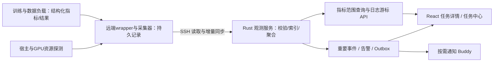

# uTrainerBuddy UI 交互设计方案

日期：2026-11-06  
状态：交互与观测设计稿，用于页面设计、接口细化和开发验收；线框、数据、刷新间隔均为设计示例或目标，不代表现有功能已经实现。  
关联：[产品定位与实施方案](产品定位与实施方案.md)、[技术架构设计方案](技术架构设计方案.md)。

> 2026-11-08 更新：新增论文与代码仓库复现交互；默认远程工作区及实施顺序以 [OpenResearch 实施方案](基于OpenResearch的智能体模型研发实施方案.md) 为准。本文早期将远程工作区列入后期的安排不再适用。新增界面均为待实施设计。

## 1. 设计目标

桌面端采用 Electron，在现有 React UI 上二次开发。界面需要同时支持“与 Buddy 共同开展模型研发”和“持续管理数小时至数天的任务”。

用户在任何阶段都应能找到以下答案：

1. 当前目标是什么，哪些条件已经具备，哪些仍待明确？
2. Buddy 正在做什么，为什么做，依据是什么？
3. 哪些数据构建、训练和评测任务正在运行，在哪里运行？
4. 已完成多少，质量怎样，资源和预算消耗怎样？
5. 状态是什么时候确认的，是否需要干预，下一步可以做什么？

核心界面组合：

> 聊天协作 + 结构化工作区 + 全局任务中心 + 统一观测与证据详情。

中心始终承载与 Harness Agent 的协作，长期任务在独立对象模型和右侧工作台管理。不同入口引用同一任务身份和状态，不让聊天气泡变成另一套任务数据库。根据用户明确要求，默认采用“左侧项目与会话 / 中间 Agent / 右侧上下文工作台”，替代早期业务页面居中、Buddy 居右的原型。

## 2. 目标入口、复现研究与渐进式信息收集

| 入口 | 首屏重点 | Buddy 帮助补齐的内容 | 首个有价值的结果 |
| --- | --- | --- | --- |
| 提升指标 | 模型、数据、评测协议、资源 | 当前表现、错误分布与候选策略 | 诊断报告或可执行实验 |
| 适配业务 | 业务场景、现有模型和少量案例 | 任务规范、评测标准与数据缺口 | 初步业务评测与数据计划 |
| 从零构建 | 业务描述、输入输出示例、约束 | 模型选择、数据来源与技术路线 | 可行性方案和最小验证任务 |
| 探索方向 | 研究想法、已有证据、预算 | 可检验问题与候选假设 | 假设列表和最小探索实验 |
| 复现研究 | 论文、代码仓库、目标结果与资源约束 | 复现范围、方法与代码关系、数据/环境缺口、可比条件 | 来源分析、复现约定草稿和最小验证计划 |

允许直接输入自然语言创建项目，也允许拖入文件或绑定远端资产。只有在具体动作需要某项资产时才提示补齐，不能以“所有字段必填”的向导阻止探索。

目标页分别标注已确认要求、暂定假设、待补充条件；可以修订，保留版本。没有复现目标不显示阻断性错误。探索项目不强制进入部署阶段。

### 2.1 统一输入与材料卡片

入口是开始任务的快捷方式，不是互斥项目类型。用户可在同一输入框输入业务目标、想法、论文链接或 GitHub URL，拖入 PDF，引用已有仓库、远端数据与模型；材料类型与用户目标分别识别，允许组合和后续补充。

材料卡片显示名称、类型、来源、版本/commit、读取状态及可定位的原文；关联仓库显示官方/第三方及依据。无法访问、PDF 解析不确定、缺少权重或数据分别展示，不以空摘要冒充读取成功。私有仓库缺少访问条件时说明缺口，沿用工作区认证入口，不要求在聊天中粘贴密钥。

示例输入：“复现这篇论文表 2 的主要结果；仓库在此，只有一张 24GB GPU，先评估能做到哪一部分。”系统先提供来源摘要与条件分析，仅在下一步确需信息时提问。

### 2.2 复现约定与过程展示

Agent 的首份计划卡包含：目标表格/主张、原报告值、拟使用数据和模型、评测方式、重复与容许偏差、可用算力、预算、允许替代及未知条件。用户可在卡片或对话中修订，正式比较绑定约定 revision；已有授权内的分析、试跑和迭代不逐步重复审批。

右侧工作台新增复现详情，继续使用中心唯一 Agent 输入框：

| 视图 | 内容 |
| --- | --- |
| 来源与目标 | 论文原文定位、仓库版本、待复现目标及逐项状态 |
| 方法与实现 | 公式/方法对应代码、缺失细节、假设、兼容修复和算法改动 diff |
| 实验与证据 | baseline、复现/消融/改进分支，Run、日志、指标及产物引用 |
| 比较与报告 | 原报告值、实测值、差异、条件、重复口径、可比性及结论 |

过程可显示分析材料、准备环境、最小试跑、复现评测、分析结果等当前活动；允许回退修复和提前结束，不把动态研究显示为固定百分比。进程状态、连接状态和研究结论分别呈现。

### 2.3 复现结论与异常体验

工程跑通、方法实现、指标复现、结论验证采用独立状态。作者权重评测、重新训练、缩小规模验证和替代条件清楚标记；不可比结果不显示“超过论文”或进入同一排名。

报告逐项显示目标、实际条件、证据链接、已支持/未支持/不确定及未解决问题。仅部分目标完成时显示覆盖范围，不把整体标为成功。修复原实现与改进算法分别展示，切入改进时创建关联实验，保留复现 baseline。

缺失数据、依赖安装失败、预算耗尽、材料读取失败等均给出事实、已完成内容和恢复入口。缺少数据时仍可阅读代码、整理方案；不伪造运行结果。允许以负面结果或证据不足结束研究，无需进入部署页。

交互验收覆盖论文/仓库/组合输入、材料错误与不可访问、约定修订、证据定位、不可比提示、暂停恢复、窄窗口和中文；完整研究行为按 OpenResearch 方案第 14.1 节验收。

## 3. 信息架构与桌面布局

### 3.1 导航层级

| 范围 | 导航项 | 作用 |
| --- | --- | --- |
| 全局 | 工作区切换、项目列表、任务中心、待办通知 | 跨会话查找工作与异常，始终标明本地或远程工作区 |
| 项目 | 概览、Buddy、数据、实验与训练、评测、模型与服务 | 生命周期主要对象与证据 |
| 基础设施 | 算力与连接、扩展、设置 | SSH/GPU、引擎、Skill/MCP、偏好与诊断 |

训练 Run 属于实验的执行记录，评测 Run 关联评测报告，数据 Run 关联配方执行；任务中心聚合三类任务，不再另建彼此独立的状态系统。

首版任务中心按当前工作区汇总项目，清楚标明范围。尚未连接的远程工作区不能出现在“已汇总全部运行”的承诺里。

### 3.2 Agent 为中心的自适应三栏

**中间始终是 Harness Agent 对话；左侧负责组织工作，右侧负责观察与操作对象。** 点击数据、训练和评测卡片，只在右侧定位详情，不替换当前会话。窗口内只有一个 Agent 输入框。

推荐初始尺寸为设计值：左栏 220–260px，右侧工作台 380–440px，中心占剩余空间。右侧可拖动、展开或收起，常规展开仍保留可用的中心会话。密集表格与长报告可按需进入独立详情窗口，不自动覆盖聊天。窄窗口先将右侧改为按需抽屉，再将左侧改为抽屉。

```text
左侧：项目与会话          中间：Harness Agent          右侧：上下文工作台
─────────────────────   ─────────────────────────   ─────────────────────
项目切换                 用户目标与补充约束            计划 / 运行 / 资产 / 记录
新建与搜索               Agent 回复与行动解释          当前对象与来源会话
项目会话列表             工具调用组与结构化输出         指标、GPU、日志、检查点
项目资源索引             计划、任务与结果卡片           样本审核、配置与报告预览
后台任务                 业务提问与必要权限请求         跟随 / 固定 / 调宽 / 收起
算力与扩展设置           引用上下文、输入、发送/停止     引用给 Agent、对象操作
────────────────────────────────────────────────────────────────────────
底部：项目活动任务、连接状态、需要关注的变化
```

全局状态条不持续闪烁；面板收起不取消任务。对象支持 ID 深链，保留 Tab、过滤和时间范围。后文“页面”“详情页”默认指右侧对象视图或独立详情窗口，不再表示替换中心会话。

### 3.3 左侧栏：项目、会话与找回工作

左栏依次包含项目切换、新建与搜索、项目会话列表、资源索引、后台任务、算力与扩展设置。会话按业务问题命名，例如“构建售后数据集”“长尾场景优化”，不按模型供应商拆成多套导航。引擎选择主要放在中心输入区，避免将切换引擎误解为切换项目。

切换会话恢复消息、草稿与明确引用；同项目 Run、资产和观测订阅独立保留，不重建训练任务。资源索引只负责找对象，点击后打开右侧；任务中心聚合跨会话工作，查看任务不强行跳回创建它的会话。大量资源按数据、实验、评测、模型分组折叠，优先展示近期或固定对象。

### 3.4 中间：持续的 Harness Agent 协作流

中心按“目标 → 行动解释 → 计划/问题 → 工具活动 → 任务/结果 → 后续讨论”组织。工具活动默认折叠，保留身份、执行状态和可检查的输入输出。训练日志与每次指标采样不持续灌入消息流；任务卡片引用 Backend 权威快照，点击后在右侧展开。

输入区提供附件、`@` 对象引用、引擎、项目授权范围、发送/停止回复。打开对象和引用对象是两个动作：打开只改变观察位置，明确引用才将有界证据带入下一回合。切换引擎仅影响后续回合，历史消息保留原始运行身份；是否可以续接原生上下文由适配器声明。

计划草稿可继续讨论或调整；长时任务提交卡展示输入版本、预算、停止条件与验收协议，复用既有授权，不增加逐步骤审批。业务提问、原生权限请求和工具失败分别呈现。停止回复仅影响当前回合；取消训练必须定位 Run 并展示远端确认过程。

### 3.5 右侧栏：上下文工作台

| 页签 | 默认内容 | 与会话联动 |
| --- | --- | --- |
| 计划 | 目标、步骤、依赖、变量、预算、停止条件 | 调整草稿、引用讨论、提交并绑定 Run |
| 运行 | 任务列表；数据/训练/评测的指标、资源、日志、检查点 | 点击任务卡定位；引用有界观测 |
| 资产 | 数据版本、配方、样本审核、配置、报告、权重与血缘 | 人工审核、只读预览、显式引用 |
| 记录 | 任务事件、断线/重连、人工动作和重要状态变化 | 回到原对象与消息，不展示模型内部推理 |

右栏有“跟随当前会话”和“固定观察对象”两种模式。跟随时恢复所选会话的对象与 Tab；固定后跨会话持续观察一个任务，标出对象 ID 和来源会话。Agent 产生新卡片或告警时不抢走已固定视图，先显示新结果入口。用户显式选择其他对象可以更新观察目标。

折叠面板、切换 Tab 和切换会话不取消后台任务。正式 React 实现让项目级宿主跨同项目会话保留，按对象管理查询和订阅，隐藏时按可见性降采样；不能以组件卸载控制远端作业。

### 3.6 frontend 复用与交互状态

已对照本地 `Layout.tsx`、`ProjectPanelHost.tsx`、`Preview` 和 `SendBox`：复用会话主区域、可调侧栏、项目级面板宿主、预览和输入扩展能力，在右侧宿主增加领域对象检查器，不为每个领域再挂一个聊天实例。原组件的“最大化预览隐藏聊天”不作为产品默认行为，常规查看和展开保持中心对话。

导航状态与业务状态分开：`projectId / conversationId / inspectorTab / objectId / pinned / width` 属于 UI；Workflow、Run、取消确认、指标和资产版本由 Rust Backend 提供。项目切换隔离缓存与引用；关闭窗口后能否继续研究取决于实际 Backend 和远端工作区部署。

新版：[Agent 中心三栏 HTML 原型](prototypes/trainer-buddy/preview.html)。旧版保留作对照：[业务页面原型](prototypes/trainer-buddy/lifecycle-preview.html)。全部为模拟状态，不代表 frontend 已完成改造。

## 4. 智能体协作交互

### 4.1 一轮工作的交互过程

> 用户表达目标 → Buddy 整理当前理解和缺口 → 提出下一步行动 → 按已有授权与策略执行 → 返回对象卡片和证据 → 继续探索或交付。

计划以可展开卡片呈现：目标、已知条件、假设、拟执行步骤、资源与成本估算、完成判断。用户可以编辑尚未提交的参数或补充约束。普通诊断和已授权动作不要求每一步都点击“确认”；只有缺少必要信息或实际权限策略要求时才出现待办。

提交任务后，聊天显示简洁的绑定卡片，例如“训练 Run-042 已接受，当前排队”。状态取自 Backend，不能把 Agent 文本中的“已开始训练”当作启动证据。

### 4.2 消息与卡片类型

| 类型 | 展示内容 | 操作 |
| --- | --- | --- |
| 目标理解 | 已确认、假设、缺口 | 修订目标、补充案例 |
| 行动计划 | 步骤、依赖、资源与验收方法 | 修改草稿、查看差异、按策略执行 |
| 活动摘要 | 正在读取资料、修改配置、提交任务等可观察行为 | 展开工具输入输出、关联对象 |
| 任务卡片 | 阶段、主机、进度、更新时间、Run ID | 打开监控、查看日志、取消该任务 |
| 提问卡片 | 问题、选项、自由文本、是否阻断 | 回答或明确暂缓，保留状态 |
| 权限卡片 | 具体动作、作用域、原生请求标识 | 按引擎能力答复；不与业务提问混用 |
| 证据与结果 | 指标、差异、来源、局限 | 对比、引用、创建下一轮实验 |
| 失败与恢复 | 已知原因、已完成部分、不确定内容 | 查看证据、诊断、受支持的重试/续跑 |

默认折叠重复工具调用与大量输出，保留关键步骤。展示简明的行动解释与观测证据，不要求暴露模型内部推理，也不生成虚假的“思考过程”。

### 4.3 Agent 状态与任务状态分开

Agent 可显示准备中、执行中、等待工具、等待任务结果、等待回答、回合结束、连接异常。若训练已提交但 Agent 结束本轮，显示“Buddy 等待训练结果；训练仍在运行”，不能让整个项目看起来已经完成。

输入框旁展示引擎、模型、作用域和待发送队列。能力支持时，新输入可中途补充；否则清楚显示“将在本轮结束后发送”。切换引擎明确提示创建新原生会话并交接摘要，不承诺完整私有上下文迁移。

### 4.4 选择对象作为上下文

从图表选取时间段、从数据表选择样本、从日志选取片段后，提供“交给 Buddy 分析”。输入框显示可移除引用，例如 `Run-042 / step 1200–1500`，并记录来源版本和范围。

自动带入的页面上下文应可见，跨项目切换不静默保留错误对象。优先传证据引用与有界摘要，按需读取详细内容，不自动把整份数据集或全部日志粘贴进模型请求。

### 4.5 停止、暂停与取消的动作语义

| 动作 | 影响范围 | 必须展示的反馈 |
| --- | --- | --- |
| 停止 Buddy 当前回复 | 当前 Agent 回合 | 已提交远端任务继续运行 |
| 暂停自动推进 | 当前 Workflow 的后续可停止调度 | 当前正在运行的步骤通常继续；明确支持边界 |
| 取消当前任务 | 指定 Run | 已记录请求、是否送达、是否确认停止 |
| 保存检查点并结束 | 支持该能力的训练任务 | 检查点完成与进程停止分别确认 |
| 从检查点续跑 | 创建关联的新 Run | 选择检查点、配置差异和新执行身份 |

不提供没有负载支持的通用“暂停训练”按钮。运行中修改训练参数默认生成新实验或新 Run，不暗示已改变当前进程。

## 5. 全局任务中心与项目概览

### 5.1 全局任务中心

任务表支持按项目、类型、主机、阶段、联系状态和需处理情况过滤。推荐列：名称、项目、任务类型、执行阶段、联系状态、进度、最近确认、运行时长、资源、下一步。

任务分为进行中、需要处理、已结束三种视图，可收藏长期任务。等待权限、数据审核、资源、认证与结果不明分别解释；“需要处理”不只统计失败任务。

列表或卡片点击进入同一详情页。批量操作列出作用范围与可执行项，不把不可取消或已结束任务混入成功数量。通知点击回到对应对象，而非仅打开聊天首页。

### 5.2 项目概览

显示当前目标与缺口、最新可信结果、活动任务、待办、数据与模型版本、预算和最近证据。生命周期按已具备/进行中/待补齐表达，不将开放研究强行显示为“上线进度 20%”。

研究模式额外显示假设列表和证据关系；业务模式突出验收要求与达标状态。没有独立评测时，明确标注“尚未验证业务效果”。

## 6. 统一任务详情与状态表达

### 6.1 通用结构

所有数据、训练和评测任务共享详情框架：

- 固定头部：任务名称与 ID、执行阶段、联系状态、最近确认时间、操作。
- 概览：阶段路径、进度、耗时、资源、预算和重要事件。
- 专属工作区：数据样本/训练指标/评测对比。
- 通用 Tab：日志、事件、配置与输入、产物与来源。
- Buddy 入口：分析当前问题，引用当前对象。

生命周期路径随类型配置，例如数据读取→清洗→合成→验证→发布，而不是所有任务共用“训练中”。

### 6.2 状态与文案

| 情况 | 建议显示 | 禁止误导 |
| --- | --- | --- |
| 已接受但未启动 | 已提交／排队，显示资源或依赖 | 显示运行中 |
| 运行且可联系 | 运行中，最近确认时间 | 仅用绿色圆点代替状态 |
| 断网 | 最近确认运行中；当前无法联系 | 直接显示训练失败或任务停止 |
| 指标未更新但宿主可联系 | 任务运行中，指标更新延迟 | 将无指标直接判定卡死 |
| 取消请求未确认 | 正在请求停止／等待连接后停止 | 点击即显示已取消 |
| 程序成功退出 | 执行完成，效果待验收或报告状态 | 自动显示业务达标 |
| 结果部分可用 | 已回收部分结果，列出缺失项 | 将部分结果冒充最终完整结果 |
| 数据不可读或缺指标 | 暂不可获取／未提供 | 填充为 0 或空集 |

任务阶段、连接状态、指标新鲜度和业务验收是独立维度，界面需要同时表达。数据过期时保留最后已知值并标注时间；无法联系期间不继续播放假进度。

### 6.3 进度和剩余时间

显示具有明确分母的阶段进度，例如“已完成评分 800/1000 条”。动态扩行、不断发现输入或开放探索时显示当前阶段计数与吞吐，不伪造整个项目百分比。

剩余时间只在计划规模已知、吞吐趋于稳定时给出估算与更新时间；排队、模型加载、重试和生成扩行分别解释。无可靠依据显示“暂无法估算”。更改任务规模或进入新阶段后重新估计。

## 7. 数据集构建工作区

### 7.1 配方设计与试运行

导入页面支持本地文件、远端资产引用和已有数据版本，显示实际位置、字段、样例、大小、来源。字段映射后进入配方页：

> 输入与用途 → 字段映射 → 来源组与数据划分 → 算子配方 → 小样本试运行 → 检查结果与成本 → 批量执行。

首版以可排序步骤列表和节点详情为主，满足选择、启用、参数编辑、输入输出检查；可视化连线作为辅助，不在能力未实现时提供任意分支调度操作。

每个算子展示输入输出契约、行数关系、局部/全局范围、模型与 Prompt 版本、失败策略。更改配置产生配方草稿差异；试运行结果只适用于该配置版本。

### 7.2 数据任务监控线框

```text
数据构建 / DataRun-018         合成阶段运行中 · GPU-B · 最近确认 5 秒前
[概览] [步骤] [样本] [质量] [日志] [配置] [产物与来源]

原始输入 1,000 条    当前阶段已处理 680/1,000    已生成候选 1,940 条
待重试 12 条         当前速率 / 预计剩余         Token与费用估算

读取 ✓ → 清洗 ✓ → QA合成 ● → 验证 ○ → 审核 ○ → 发布 ○
选中步骤：QA合成    输入字段 / 输出字段 / Prompt / 模型 / 状态分布

左：来源文本与来源ID       右：候选问答、检查结果、审核记录
[仅看失败] [低分] [重复] [展开来源] [交给 Buddy 分析]
```

所有数字为示例。原始记录、处理输入和生成候选是不同口径，扩行后输出大于输入是正常情况。

### 7.3 可观测指标与样本排查

| 维度 | 内容 |
| --- | --- |
| 流程进度 | 阶段、输入已见/已处理数量、待处理、成功、失败、跳过/复用 |
| 数据变化 | 输出数量、扩行关系、过滤数量与原因、来源组覆盖 |
| 数据质量 | 结构合法率、重复信号、标签/长度/难度分布、人工抽检结果 |
| 模型调用 | 请求成功率、错误分类、限流、重试、延迟、Token与成本估算 |
| 资源与恢复 | CPU/GPU、内存、读写、最近提交批次、可重放范围 |

阶段计数按算子契约定义，不将“处理成功”和“样本留存”混为一谈；重试次数与最终失败记录数分开。全局重复率只在实际完成全局检查后展示，不能使用批内去重数冒充。

失败列表支持来源定位、输入输出对照、解析错误、尝试记录和过滤原因。只在能力支持且配置未变化时提供“仅重放失败记录”；模型、Prompt或解析器改变时创建新执行，不默默混入旧结果。

### 7.4 审核与发布

样本状态包含待审核、通过、拒绝、已修改；提供批量筛选、来源对照与修改记录。批量通过展示实际选中范围，不默认选中全部未加载样本。

发布页汇总来源、划分、数量、质量检查、审核覆盖、配方版本与外部文件完整性。发布形成不可变 DatasetVersion；审核或修改已发布内容要生成新版本。

训练与验收按来源组隔离。候选合成数据的质量评分不等于事实正确或模型收益，界面提供“创建训练对比实验”，把数据策略交给下游独立评测验证。

## 8. 实验与训练工作区

### 8.1 实验计划与提交

实验页首先表达假设、希望改善的指标、已知参照、改动和预算；再展开基座、数据版本、训练配方、环境、资源及输出。标准路径使用模板表单，自定义研究路径提供代码与配置 diff。

提交前显示即将固定的版本与资源预检结果；尚未指定外部复现目标不阻断。若缺少评测，可允许训练但明确“训练可执行，效果尚缺独立验收”。

提交按钮防止重复点击，收到 Run ID 后转任务详情；提交超时显示“正在核对提交结果”，通过幂等身份查证，不直接提供无条件再启动。

### 8.2 训练监控线框

```text
实验：补充长尾样本 / Run-042     运行中 · 服务器 GPU-A · 最近确认 4 秒前
[概览] [指标] [资源] [日志] [检查点] [配置与差异] [产物]

阶段：训练    step 1,200 / 3,000    epoch 0.8 / 2    已用 2小时14分
loss 0.83     eval结果最近一次…    tokens/s …       剩余时间：估算…

训练loss / 验证指标                  每卡GPU利用率 / 显存 / 吞吐
横轴：[step|已用时间]                 主机与任务归属明确
[原始值/平滑] [对比运行]               [异常时段] [交给 Buddy 分析]

最近事件：检查点保存完成 → 验证开始 → 验证结果到达
[停止 Buddy 回复] 与 [请求停止训练] 为独立入口
```

### 8.3 指标与比较

| 维度 | 建议内容 |
| --- | --- |
| 优化过程 | train loss、学习率、梯度范数、step/epoch，仅展示负载提供的数据 |
| 验证效果 | 验证 loss、任务指标、最近验证时间与对应检查点 |
| 性能 | tokens/s 或 samples/s、step时长、数据等待，仅在单位口径一致时比较 |
| 资源 | 每卡利用率/显存、CPU/内存、磁盘与网络，标明主机或任务范围 |
| 成本 | GPU时长、模型调用量、估算费用及预算使用；实际账单另标来源 |
| 健康 | 非有限值、OOM证据、长时间无进展、保存失败及明确的检测条件 |

曲线支持 step 和运行时长切换，横轴和缺口明确；平滑可选且标注窗口，原始值始终可查。验证点稀疏时不伪装连续实测曲线；断连缺口不默认线性补齐。

多 Run 对比默认按任务指标比较，同时展示基座、数据、训练与推理预算、评测协议差异。不同协议的分数不能自动排成同一可信榜单。训练 loss 下降只表达优化过程，不自动标成业务效果改善。

### 8.4 检查点与恢复

检查点列表区分正在写入、完整可用、校验失败和不可访问，显示位置、大小、step、来源 Run 及相关评测结果。不能仅发现目录就宣称可恢复。

“从检查点续跑”打开新 Run 草稿，展示继承配置和修改项；是否支持优化器状态等完整恢复由负载能力决定。失败页保留日志、最后有效指标和已保存产物，并提供有证据的诊断入口。

## 9. 评测工作区

### 9.1 评测创建与协议

选择模型或检查点、评测数据版本、任务切片、推理参数、评分方法/裁判模型、资源与预算。表单标明目标模型与裁判模型，避免混淆。协议固定后执行，变更创建新版本。

支持基座与候选模型在同一协议下对比；没有标准答案的任务需要先确定评分规则、人工评审或可验证条件，不能默认所有业务只用模型打分。

### 9.2 评测运行与中间结果

分开展示等待生成、生成中、生成失败、待评分、评分中、评分失败和已完成；进度按生成与评分分别计算。回答错误是效果结果，调用失败或评分异常是执行问题，不能混在同一失败率里。

运行中显示“当前已完成 N/总样本，分数为中间结果”，附覆盖范围与尚未完成切片。不能把先完成的简单样本结果当最终整体分数。全部终止后仍有失败样本时，报告说明完成覆盖率及分母处理规则。

```text
评测 Eval-027   生成完成 900/1000   评分完成 760/1000   最近确认 3 秒前
[概览] [模型对比] [切片] [逐样本] [评分质量] [日志] [协议]

             基座          候选         差异        覆盖/说明
整体指标     …             …            …          中间结果 / 完整结果
长尾场景     …             …            …          同一协议、样本配对

样本详情：输入 | 参考/规则 | 两模型输出 | 分数 | 评分理由与来源
[仅看退化] [执行异常] [人工复核] [引用到 Buddy]
```

### 9.3 诊断、结论与下一步

提供总体与切片对比、提升/退化样本、执行异常、模型裁判与人工结果分歧。按任务适用性展示波动、重复运行或区间估计，缺少证据时不宣称差异显著。

评测完成后输出三层结论：程序是否完成、证据是否完整、指标是否达到目标。保留“不确定”“部分达标”“缺少验收条件”等结果。

“创建补数据任务”只使用获准用于开发的数据与错误类型。受保护测试集及其答案不直接回流训练；可基于一般错误分类构造新的独立训练案例。报告访问与引用遵守评测数据作用域。

## 10. 研究探索、模型与部署视图

研究视图以假设卡片、实验关系、证据与结论组织，支持探索中修订问题、保留负面结果。关系图支持来源合并，不能把界面父子关系当作完整代码祖先关系。列表和对比视图应同样可用，避免必须操作大图。

模型页展示基座、数据、训练 Run、检查点、导出格式、评测证据和部署兼容性。发布向导以实际产物验收结果为依据，进入 Deployment 后提供服务状态、延迟、错误率、吞吐、版本与回滚。

“训练完成”“评测达标”“服务健康”分别展示。桌面关闭不取消服务，暂停研究也不停止已有线上服务。

## 11. 统一可观测性体验

### 11.1 分层展示

| 层级 | 用户主要关注 | 默认展示 |
| --- | --- | --- |
| 全局 | 哪些任务在运行，哪里需要处理 | 状态、异常、最近确认、预算提醒 |
| 项目 | 当前目标推进和效果证据 | 活动任务、最新结果、缺口与待办 |
| 任务 | 进度、质量、资源、失败原因 | 专属指标、阶段与重要事件 |
| 诊断 | 具体请求/批次/worker发生了什么 | 日志、原始指标、调用记录、来源 |

普通用户先看可解释摘要，研究者可以展开细节。关键摘要引用实际样本、指标点或日志，不仅给出 Agent 的判断。

### 11.2 统一时间线与日志

时间线记录配置固定、排队、启动、阶段切换、重试、检查点、断连、取消、结果回收和人工动作；关联 Workflow、Run、会话与请求身份。支持从指标异常点跳到相关时间段日志，再交给 Buddy 分析。

日志按源、级别、worker/rank、时间范围与关键字筛选，采用分页/游标及虚拟列表。追随尾部是显式开关；用户滚动阅读历史时不强制拉回底部。支持跳到首个错误、复制有界片段和导出。

为相关性展示采集时间与源时间，时钟偏差或乱序有标记。没有结构化级别时显示原始文本，不把任意包含 error 的字符串自动当任务失败。

### 11.3 新鲜度与断线体验

展示 UI 到 Backend、Backend 到 GPU 宿主、指标采集三种链路的状态。事件通道掉线但 HTTP 可读时，可降级查询并说明；Backend 不可达时保留只读缓存，显示最后确认时间，停止展示可提交成功的假反馈。

重连先核对权威对象状态和事件版本，再恢复增量订阅；出现事件缺口时重新查询。进入任务页先展示快照，再逐步补指标与日志。回到应用时提供“离开期间变化”的摘要，不逐条弹出历史通知。

### 11.4 告警与待办

| 类别 | 示例 | 交互 |
| --- | --- | --- |
| 完成 | 数据、训练或评测结束 | 合并通知，打开结果，不等于业务达标 |
| 需要决策 | 数据待审核、关键问题待答 | 项目待办与原卡片双向定位 |
| 可恢复异常 | 限流、暂时断连、指标延迟 | 持续状态条，去重后提醒，展示重试状态 |
| 需介入异常 | 认证失效、提交结果不明、停止未确认 | 明确对象、证据、影响与可执行操作 |
| 资源与预算 | 磁盘不足、运行时长接近上限 | 提示阈值与来源，按已配置策略处理 |

每个告警有首次/最近发生、严重性、证据、确认和解决状态；相同原因按项目/Run聚合并去抖。确认收到不等于问题已解决，静音不改变任务状态。

默认以规则产生状态与告警，Agent 按需分析解释，避免每个指标采样都调用模型。允许配置关注任务、阈值、安静时段和通知方式；首版使用应用内与已授权的系统通知，不默认发送邮件或消息到外部服务。

本地 Backend 停止时无法持续生成本地通知；再次连接后补充变化。需要全天候告警与自动研究时使用后续远程工作区，不能仅凭托盘图标承诺关机监控。

## 12. 观测数据与前后端契约

### 12.1 权威来源



Rust 后端补充 Observability Service：保存采集进度、查询索引、时间窗口聚合和告警状态。负载适配器上报结构化指标；日志解析只能作为显式可追踪的兼容来源，不由 Renderer 猜测训练状态。

远端执行所有者独立于 SSH 连接采集指标和日志，在桌面离线时仍记录。重连后按游标回收；若采集本来未运行，则如实标缺口，不能补造历史 GPU 数据。

### 12.2 数据契约

| 数据 | 必要信息 |
| --- | --- |
| 任务快照 | 身份、配置版本、阶段、联系状态、取消状态、修订号、最近确认时间 |
| 阶段进度 | 阶段ID、分母是否已知、计数口径、处理与输出数量、更新时间 |
| 指标点 | run/series/worker身份、指标名、值、单位、step或源时间、接收时间、来源与质量 |
| 日志片段 | 文件身份、源、游标范围、内容、截断/缺口标记 |
| 观测事件 | event_id、对象、类型、发生/接收时间、证据引用、严重性 |
| 能力 | 可取消、可检查点、可续跑、可重放、可中途输入及不可用原因 |

多 worker 指标区分原始 rank 值与聚合值，声明平均/求和等规则。不同任务类型的 loss 不自动合并，资源指标区分主机和任务归属。费用标记为估算、供应商报告或未知。

### 12.3 查询与订阅

建议补充以下拟定接口，具体以实现契约为准：

```text
GET  /api/v1/tasks                         当前工作区跨项目列表
GET  /api/v1/runs/{id}/progress            阶段与计数
GET  /api/v1/runs/{id}/metrics             series、范围、粒度、点数上限
GET  /api/v1/runs/{id}/events              时间线与游标
GET  /api/v1/runs/{id}/checkpoints         产物状态与恢复能力
GET  /api/v1/dataset-jobs/{id}/records     分页、状态与来源筛选
GET  /api/v1/evaluations/{id}/results      分页、切片与配对结果
GET  /api/v1/attention-items               待办与告警
POST /api/v1/attention-items/{id}/ack      确认收到，保留实际解决状态
GET  /api/v1/workspaces/current/changes    离开期间变化
```

WebSocket 主要推送状态变化、失效提示和有界增量；历史曲线与大表格按范围查询，不广播全部日志与每个样本。重要事件持久化，高频序列单独存储并索引。

### 12.4 采样与性能目标

初始设计目标：任务/阶段重要变化尽快推送；资源采样约 5–10 秒；可见曲线约 2–5 秒合并刷新；后台列表降低刷新频率。具体按负载与实测调整，不作为当前性能承诺。

查询设置点数上限和降采样，长周期采用多分辨率视图并保留异常极值。原始值按保留策略可查；生命周期事件不能为了降采样丢弃。后台 Tab、隐藏窗口和不可见曲线减少渲染，但不停止后端采集。

状态缓存按 workspace/project/run 和配置修订隔离，订阅到期释放。高频指标使用有界缓存，不让整个页面树随每个采样重渲染。首版复用现有 SWR 与虚拟列表基础；图表库通过曲线能力和性能验证后单独确定。

## 13. 现有 React UI 的复用与新增

| 已有基础 | 二次开发方向 |
| --- | --- |
| Layout / Router / 可调分栏 | 项目导航、任务持久入口、任务详情与 Buddy 分栏 |
| MessageList / 工具调用组 | 任务对象卡片、活动摘要、结果证据与去重更新 |
| MessageQuestion / 权限面板 | 分离业务提问与原生权限，恢复未完成请求 |
| 文件差异与预览 | 训练配置/代码差异、数据前后对照与来源预览 |
| Agent / Skill / MCP 设置 | 能力状态、项目绑定、版本与诊断 |
| SWR / react-virtuoso 依赖与现有 hooks | 对象缓存、分页和大列表；适配新 Rust API |
| 桌面通知与深链 hooks | 任务结束、异常和待办定位 |

新增页面建议为 project overview、task center、dataset workspace、experiment/run workspace、evaluation workspace、model/deployment workspace 和 compute connections。新增共享组件可包括 RunHeader、ProgressSummary、FreshnessBadge、MetricPanel、EventTimeline、LogViewer、EvidenceLink 和 AttentionInbox，按实际复用再拆分。

现有组件中的旧 backend、ACP、aionrs 等命名与状态假设需要核对，不能仅替换文案。现有 team 或 cron 页面不直接等同于训练 Workflow 与任务中心。

## 14. 视觉、可访问性与异常状态

延续现有组件库和主题变量，先统一间距、字体层级、表格密度和状态样式。普通模式突出摘要，高级展开显示完整参数与日志；同一数据对象保持相同名称和来源链接。

状态同时使用文字、图标和颜色；曲线使用图例、不同线型和可读的数值表。支持键盘导航、明确焦点、降低动画偏好和浅深色主题；长任务不依赖持续闪烁或旋转制造“正在工作”的感觉。

页面必须设计空数据、首次使用、加载、部分结果、无权限、断线、过期、不支持与执行失败。每种状态提供当前事实及下一步，不能用同一个空白页表示所有问题。

首次创建、待提交配置、审核草稿和过滤条件按作用域保存。版本冲突时展示差异和刷新选项，不让旧页面覆盖新状态。运行中的对象退出页面不弹出取消任务提示；只有未保存编辑才需要保存/放弃选择。

## 15. 开发优先级与验收

| 优先级 | 范围 | 交付目标 |
| --- | --- | --- |
| P0 | 项目入口、Buddy卡片、全局任务中心、通用任务头、日志、更新时间与重连 | 能发起、找回、理解和安全干预长期任务 |
| P0 | 一条数据配方的试跑/监控/审核/发布，训练曲线与检查点，评测进度与报告 | 完成一个业务场景的可观察闭环 |
| P1 | 多Run对比、切片分析、样本血缘、告警配置、离开期间摘要 | 提高诊断与迭代效率 |
| P1 | 模型注册、部署监控与回滚 | 将验收证据与线上服务衔接 |
| P2 | 复杂关系图、配方高级画布、远程工作区跨项目监控 | 在底座可靠后扩展研究规模 |

优先级不表示所有功能必须在一次迭代交付。每条页面链路同时包含空态、失败态与恢复态，不能先只交成功截图。

验收场景：

1. 用户只描述业务即可创建项目，缺少数据/评测时获得可执行的补齐步骤。
2. Buddy 提交任务后结束本轮，任务中心与详情仍显示权威状态；切换项目后可找回。
3. 数据扩行与过滤后计数口径正确，失败可定位到来源；支持的配置能仅重放失败记录。
4. 训练运行时查看曲线和日志，用户滚动日志不被强制打断；缺指标不显示为零。
5. 断开 SSH、重启 Backend、退出桌面再返回，展示最后确认时间并核对恢复，不重复启动训练。
6. 离线请求停止显示未确认，恢复连接并收到证据后更新；停止 Buddy 回复不取消训练。
7. 评测中间分数、最终覆盖率、执行失败与业务错误区分清楚；基座和候选结果可追溯到同一协议。
8. 图表异常点能定位日志与配置，并以有界引用交给 Buddy；结论可返回证据来源。
9. 重大变化进入待办并去重，离开期间事件汇总；系统通知失败不丢失应用内记录。
10. 主验收桌面尺寸、窄窗口、浅深主题和键盘操作可用；长时间运行验证前端内存与渲染保持有界。

本轮仅完成交互设计与文档，不声称页面、指标采集或上述运行验收已经实现。下一阶段按 P0 制作真实 React 页面及对应 Rust 契约，结合实际数据验证交互。

## 16. 本地设计依据

- [现有布局](frontend/desktop/src/renderer/components/layout/Layout.tsx)、[路由](frontend/desktop/src/renderer/components/layout/Router.tsx)。
- [Agent 状态](frontend/desktop/src/renderer/pages/conversation/Messages/components/MessageAgentStatus.tsx)、[工具调用](frontend/desktop/src/renderer/pages/conversation/Messages/components/MessageToolCall.tsx)、[业务提问](frontend/desktop/src/renderer/pages/conversation/Messages/MessageQuestion.tsx)。
- [技术架构设计方案](技术架构设计方案.md)：进程、状态、任务、扩展与恢复边界。
- [DataFlow 模块报告](reports/DataFlow/模块深度解读报告.md)：算子语义、计数、恢复与分片边界。
- [OpenResearch 项目解读](OpenResearch项目深度解读.md)：运行状态、结果通知和远程工作区参考。
