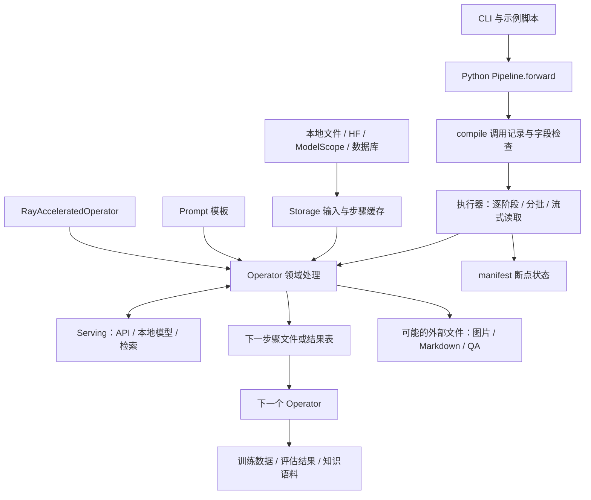

# DataFlow 模块深度解读报告

分析日期：2026-11-06。分析对象：本工作区 `opensource/DataFlow` 的实际文件；版本文件为 **1.0.13**，本地 `.git/HEAD` 指向 `main`，分支引用为 `7d7ff715ee042bc5e7db429bf9d674307c3de32f`。该引用用于定位检出基线，不表示工作区没有未提交修改。本报告不将远程最新版或 README 中的生态宣传当作本地实现事实。

阅读方式：正文解释架构、14 个算子领域、执行和恢复机制、工程边界；[完整算子接口索引](./算子完整索引.md)提供逐个算子的源码位置、构造参数、运行参数及静态写入线索；[源码统计](./源码统计.json)记录统计口径。这里的“输出”分别讨论数据列、数据行、外部文件和 Python 返回值，四者不能混为一谈。

## 1. 核心判断

DataFlow 是面向大模型的数据准备框架，其最有价值的部分是将**数据生成、评分、筛选、改写、训练格式整理**封装为可组合算子，再通过 Storage、Serving 和 Pipeline 将业务逻辑与文件持久化、模型调用、执行管理分开。

它适合搭建“原始语料 → 高质量训练数据”的离线工作流。它也有检索适配、模型训练入口和 WebUI 启动器，但不能因此将核心仓库理解为完整的在线 RAG 产品、独立训练框架或具备任意分支调度能力的通用工作流平台。

源码中有三种不同成熟度的能力：

1. **基础能力相对清晰**：Storage 步骤缓存、Prompt 模板、算子注册、Python 顺序组合。
2. **领域能力丰富但接口行为不完全一致**：同为 Generator，有的保留行，有的扩行、删行甚至重建表；部分说明与实现存在偏差。
3. **可靠执行能力有明确适用范围**：manifest 断点恢复、逐条 ledger 重放和请求预算已经实现，但不能覆盖所有 Storage、算子副作用或分布式场景。

### 1.1 本地源码规模

以下是静态 AST 统计，不等于当前环境能够成功导入或运行的数量。

| 项目 | 数量 | 口径 |
|---|---:|---|
| 核心及随包 Python 文件 | 385 | `dataflow/**/*.py`，排除 cookiecutter scaffold 模板 |
| 注册算子类 | 207 | 类上出现 `OPERATOR_REGISTRY.register` 装饰器 |
| 算子领域 | 14 | `dataflow/operators` 的领域子目录 |
| 注册 Prompt 类 | 98 | `prompts` 下显式注册的类 |
| 流水线示例 Python 文件 | 53 | `statics/pipelines` 下的 Python 文件数，包含辅助文件 |
| 测试文件 | 68 | `test/**/test_*.py`；不是测试用例数 |

## 2. 整体架构与数据流

另一条独立可靠生成路径是 `JSONL 快照 → RecordedGenerationRunner → Serving → SQLite RecordLedger → 成功导出 / 全量 outcomes / 失败重放`。它不是 Pipeline 编译器偷偷插入的节点，也不会自动接管所有现有算子。

### 2.1 目录职责

| 模块 | 职责 | 主要输出 |
|---|---|---|
| `core` | 算子、模型服务、包装器与 Prompt 基础契约 | 抽象类、类型约定、Prompt 类型限制 |
| `operators` | 14 个领域的数据处理逻辑 | 修改后的表、评分、过滤结果、文件或统计值 |
| `prompts` | 任务指令和输入模板 | 发给模型的文本 |
| `serving` | 模型推理、API 请求、Embedding、检索后端 | 文本、向量、视觉/音频处理结果或检索内容 |
| `pipeline` | 记录算子调用、建立字段图、执行顺序控制 | 编译后的节点图、执行结果和可视化 |
| `wrapper` | 调用记录和单算子分批包装 | 调用描述或分批回填结果 |
| `utils` | Storage、注册、检查点、逐条账本、格式验证等 | 缓存文件、manifest、ledger、标准化记录 |
| `rayorch` | 将一个算子的数据分片交给多个 Actor | 合并后的算子输出 |
| `cli.py` / `cli_funcs` | 初始化、训练桥接、评估、WebUI 启动 | 脚手架、配置、数据、训练产物 |
| `webui` | 仓库内 Gradio 工具 | 知识清洗及算子/流水线交互页面 |
| `statics` | 可复制的示例流水线、脚本、脚手架 | 用户可修改的工程起点 |
| `example` | 示例输入及多媒体资源 | 演示材料，并非另一套执行引擎 |
| `logger.py` | 日志设施 | 运行日志 |
| `test` / `docs` | 回归测试与专题文档 | 接口行为证据和使用说明 |

## 3. core：接口契约与扩展基础

源码：[operator.py](../../opensource/DataFlow/dataflow/core/operator.py)、[llm_serving.py](../../opensource/DataFlow/dataflow/core/llm_serving.py)、[prompt.py](../../opensource/DataFlow/dataflow/core/prompt.py)。

### 3.1 OperatorABC

最小抽象只要求 `run()`，并没有强制统一 schema、行数关系或返回类型。大量具体实现采用 `run(storage, input_…=…, output_…=…)`，读取 DataFrame 后处理，再 `storage.write(...)`。

这意味着算子的主要数据输出位于 Storage；`run()` 返回的字符串、字符串列表、字典或 `None` 只是附加接口。不能把所有返回值都理解为下一步骤的数据。数据集评估算子尤其可能只返回统计字典，不写入新的步骤文件。

`get_operator(name, args)` 从注册表取出类后以单个位置参数 `args` 构造，不是对所有构造函数都适用的 `**kwargs` 通用工厂。动态集成时应读取构造签名。

### 3.2 LLMServingABC

定义 `generate_from_input`、`start_serving`、`cleanup`，另有可选 `load_model`。设计目的在于让领域算子不知道请求来自远程 API 还是本地推理。

实际扩展接口比抽象类更丰富，例如 `json_schema`、多图输入、Embedding 和完整 conversations。抽象基类只声明文本批量接口，因此“继承同一个 ABC”不代表后端支持所有算子所需功能。

### 3.3 Prompt 与 prompt_restrict

`PromptABC` 提供 `build_prompt`；`DIYPromptABC` 是用户自定义模板的通道。`prompt_restrict` 在构造时校验 `prompt_template`：允许指定模板、DIY 子类和 `None`，同时更新注解以支持工具内省。

这种设计降低“将 SQL Prompt 误传给数学算子”的风险，但只验证模板类型，不能验证模板内容、模型理解程度或输出正确性。

## 4. Registry 与 prompts：发现、复用与可描述性

源码：[registry.py](../../opensource/DataFlow/dataflow/utils/registry.py)、[prompts](../../opensource/DataFlow/dataflow/prompts)。

注册表按类名建立映射，`get(name)` 触发模块发现和延迟加载。`LazyLoader` 根据模块导入结构按需加载对象；部分模块从 `TYPE_CHECKING` 导入声明中提取结构。这样能避免使用一个轻量算子时立即导入所有领域的重依赖。

`apply_whitelist()` 裁剪已经加载的 `_obj_map` 并生成报告。源码没有在这里设置持久的访问控制策略；不能把它当作后续所有动态加载的安全隔离机制。`_do_register()` 对重复名称保留先注册对象，插件需要避免重名导致行为受导入顺序影响。

Prompt 按 `agenticrag`、`code`、`func_call`、`kbcleaning`、`text2qa`、`text2sql`、`general_text`、`pdf2vqa`、`chemistry` 等主题组织，另有 reasoning 子目录。它们将任务知识从算子逻辑中分离，便于替换策略和比较实验。

工程上应同时版本化 Prompt、模型、解析器和字段映射。单独保留算子类名不足以重现一次合成结果。`get_desc()` 有助于 UI 或 Agent 发现功能，但需要以真实签名及 `run()` 为准，正文第 15 节列出具体不一致。

## 5. Storage：步骤快照、内存与持久化

源码：[storage.py](../../opensource/DataFlow/dataflow/utils/storage.py)。

### 5.1 step 的真实含义

`FileStorage` 的计数从 `-1` 开始。第一次 `step()` 将步骤变为 0，返回浅拷贝：该副本读取原始输入，写入 step1；第二次读取 step1，写入 step2。每次调用保存了一个明确的读写位置。

这也是示例持续使用 `storage=self.storage.step()` 的原因。多个步骤是物化数据快照，而不是一个 DataFrame 引用在全流程中原地共享。

### 5.2 实现对照

| Storage | 输入和输出方式 | 内存/写入语义 | 适用场景 |
|---|---|---|---|
| `FileStorage` | 本地文件；初始输入也可为 `hf:` / `ms:` | 读入整表；每次 write 替换完整阶段文件 | 调试、中小数据、需要每步快照 |
| `LazyFileStorage` | 文件输入，步骤结果先缓冲 | flush 时物化；支持退出时保存等选项 | 降低频繁文件读写开销 |
| `DummyStorage` | 内存数据，可选缓存 | 供包装器和小规模内存处理使用 | 单元测试和单算子包装 |
| `BatchedFileStorage` | 分批 API，输出限定 JSONL/CSV | 第 0 批替换、后续批追加；输入可以先物化再切片 | 分批推理和可追加输出 |
| `StreamBatchedFileStorage` | 逐块读取输入 | 输出同上；避免先加载完整源数据 | 大文件与有限内存处理 |
| `MyScaleDBStorage` | MyScale/ClickHouse 连接及任务标识 | 按数据库字段、分页和任务关联读写 | 已采用该存储体系的业务 |
| `InMemoryStorage` | Ray Actor 内部 DataFrame | 一个逻辑分片的内存读写 | 分布式算子执行 |

`FileStorage` 支持 JSON、JSONL、CSV、Parquet、Pickle、XLSX 输出；Lazy 实现列出的输出类型不含 XLSX。批处理实现拒绝将 Parquet、JSON、Pickle、XLSX 当作逐批可追加格式。输入格式和输出持久化格式是两个选择，不能因为能读 Parquet 就推断支持逐批追加 Parquet。

### 5.3 容易误解的边界

分批不一定流式：`BatchWrapper` 和普通分批存储仍可能先读完整表。流式也不代表整个任务严格常量内存：schema 检查、模型缓存、算子内部收集结果和全局算法仍有额外内存成本。

CSV 不适合直接承载复杂嵌套的 messages、图片列表和工具调用。训练样本推荐 JSONL，并明确字段类型。路径列引用的 Markdown、图片等文件必须与表一起管理；仅备份步骤 JSONL 并不等于保存完整数据资产。

## 6. Pipeline 与 wrapper：编译到底做了什么

源码：[Pipeline.py](../../opensource/DataFlow/dataflow/pipeline/Pipeline.py)、[nodes.py](../../opensource/DataFlow/dataflow/pipeline/nodes.py)、[auto_op.py](../../opensource/DataFlow/dataflow/wrapper/auto_op.py)、[batch_wrapper.py](../../opensource/DataFlow/dataflow/wrapper/batch_wrapper.py)。

### 6.1 compile 的执行过程

1. 扫描 Pipeline 实例的直接属性，把 `OperatorABC` 实例替换为 `AutoOP`。
2. 调用用户的 `forward()`；包装器绑定参数和默认值，将调用记录为 `OPRuntime`，此时被包装算子的 `run()` 不真正执行。
3. 从 Storage 取得初始字段，从参数中识别输入输出列，建立 OperatorNode/KeyNode 依赖图。
4. 检查输入列是否来自源数据或之前算子的输出，然后把 `forward` 替换为编译执行函数。

这是基于 Python 运行轨迹的调用记录，因而有明确限制：`forward()` 中包装器之外的 Python 代码仍会执行；依赖实际推理结果的动态分支不能按普通执行方式记录；藏在列表、字典中的算子不会被这段直接属性扫描自动替换。

### 6.2 字段图不是完整 schema 系统

`OperatorNode` 主要识别名称以 `input_`、`output_` 开头且值为字符串的参数；值为 `None` 的可选字段会跳过。这能较早发现拼错列名，却不能完整表达：

- `input_keys` 列表中的字段依赖；
- 算子内部硬编码读取或写入的列；
- PandasOperator 自定义函数的重命名、删列、嵌套 schema；
- 行数变化、字段值类型、列被覆盖或删除的完整语义。

因此编译通过只表示识别到的列连接有效，不等于模型调用、数据内容和业务规则都验证通过。

### 6.3 三种 Pipeline 入口

`PipelineABC` 默认逐算子执行。`BatchedPipelineABC` 使用统一 runner 支持批次、断点和整文件恢复；`StreamBatchedPipelineABC` 现在是共享同一执行方法的兼容名称，真正决定如何读取数据的是 Storage。

执行基本上是**先完成一个阶段的全部批次，再进入下一阶段**。虽然有字段依赖图和可视化，这里并不是根据任意 DAG 自动调度并行分支的引擎。

模型服务对象会被扫描和引用计数；切换服务或引用耗尽时调用 `cleanup()`。编译后执行也会在阶段结束时对提供 `shutdown()` 的算子释放资源。自定义算子若将 Serving 深藏在嵌套对象里，需要自行管理生命周期。

### 6.4 BatchWrapper 的重要限制

它先读完整 DataFrame，再将批次交给 DummyStorage，最后按结果索引回填原表。这适合“行和索引稳定，只新增/修改列”的算子。对于过滤、扩行、重建索引等操作，回填不能自然表达最终结果：例如批内删除的行可能仍留在原表。不要把它当作所有算子都能透明使用的批处理器。需要行数变化时优先使用批处理 Pipeline 和对应 Storage，并验证算法语义。

## 7. Serving：统一入口背后的不同后端

源码目录：[serving](../../opensource/DataFlow/dataflow/serving)。

| 实现 | 核心功能 | 输出及使用边界 |
|---|---|---|
| `APILLMServing_request` | requests 调兼容接口、线程并发、重试、conversations、Embedding | 通常按输入顺序返回列表；失败模式受配置影响 |
| `LiteLLMServing` | 用 LiteLLM 统一不同模型供应商，支持切换模型 | 需要可选依赖；并非所有供应商能力完全相同 |
| `LocalModelLLMServing_vllm` | 进程内加载 vLLM 模型、采样、生成、向量相关接口 | 受模型、GPU 和 vLLM 版本约束 |
| `LocalModelLLMServing_sglang` | 使用 SGLang Engine | 配置采样与结构化输出；能力以具体方法为准 |
| `LocalHostLLMAPIServing_vllm` | 启动本地 vLLM HTTP 服务再发请求 | 另涉及子进程、端口与服务启动/清理 |
| `APIVLMServing_openai` | 单图、多图 API 调用与图像载荷构建 | 多模态方法并非文本 ABC 的完整统一扩展 |
| `LocalVLMServing_vllm` | 本地视觉语言模型 | 涉及图像数量、显存、模型处理器和推理参数 |
| `LocalModelLALMServing_vllm` | 音频加载及音频语言模型推理 | 支持本地/远程等音频来源；依赖音频模型 |
| `LocalEmbeddingServing` | SentenceTransformers 本地向量 | 用于语义距离和检索，不负责生成答案 |
| `APIGoogleVertexAIServing` | Vertex AI/Gemini、结构输出、批预测 | 批模式涉及 BigQuery 等云资源与任务结果回收 |
| `PerspectiveAPIServing` | Perspective 内容风险评分 | 输出模型评分，不是清洗后的文本 |
| `LightRAGServing` | LightRAG 初始化、文档装载和查询 | 外部 RAG 实现的适配层 |
| `FlashRAGServing` | FlashRAG 检索封装 | 需要模型、语料、索引配置；文件存在不等于顶层直接导出 |

`serving/__init__.py` 的导入项与 `__all__` 不完全一致，例如本地 Embedding、LightRAG 的导入不等于星号导出覆盖。集成时使用明确导入并检查依赖，不要用导出列表推断所有实现。

### 7.1 请求预算与记录结果

`APILLMServing_request` 可以显式启用 `record_results`。`last_results` 记录最近一次生成中每项结果的状态、错误码、尝试数和耗时；它属于可变调用状态，不适合让多个独立调用方同时操作同一个实例。

`request_budget_seconds` 启用有总预算的请求模式：为逻辑请求创建专用 HTTP 子进程，超时后终止并回收。预算覆盖工作任务开始后的启动、网络、重试和退避，**不包含在线程池排队的时间**。本地杀进程不能保证取消远程计算或计费。

当前 `max_retries` 约定是最大尝试次数，不是“首次请求之外再重试 N 次”。有预算模式自动启用结果记录，失败位置返回 `None`；HTTP 200 但正文为空或响应格式错误也会按规则失败/重试。不能把“列表长度正确”视为“每条生成成功”。

## 8. 14 个算子领域详解

### 8.1 core_text：通用文本与模型操作原语（19 个）

源码：[core_text](../../opensource/DataFlow/dataflow/operators/core_text)。这是构建自定义数据流程最常用的起点。

| 子功能 | 代表算子 | 关键输出 |
|---|---|---|
| 通用生成 | PromptedGenerator、FormatStrPromptedGenerator | 生成文本列；后者适合模板引用多列 |
| 长文本生成 | ChunkedPromptedGenerator | 读取路径指向文本，切块推理，写结果文件并输出路径列 |
| 向量/检索 | EmbeddingGenerator、RetrievalGenerator | 向量列、检索结果列 |
| QA 合成 | Text2QAGenerator、Text2MultiHopQAGenerator | 问题、答案、提示词或结构化多跳 QA |
| 通用评估与筛选 | PromptedEvaluator、PromptedFilter、GeneralFilter | 分数、筛选后的样本 |
| 代表性采样 | KCenterGreedyFilter | 根据特征覆盖选出的子集 |
| 改写与自定义变换 | PromptedRefiner、PandasOperator | 改写文本或自定义 DataFrame |
| 基准评估 | BenchAnswerGenerator、BenchDatasetEvaluator 等 | 模型回答与数据集评估结果 |

`PromptedGenerator` 将非空输入送模型，用位置列表回填，跳过的行保留为空输出；返回数量不符时报错。输出默认 `generated_content`，不会因某行为空就主动删行。

`Text2QAGenerator` 是两阶段生成：先由文本生成提示，再生成 QA。每条文本可展开成多条，非法提示会跳过，空问题/空答案会过滤；同时保留展开行对应的源字段。因此不能把通用 Generator 的“保行”行为套用到它身上。

`PandasOperator` 执行用户提供的函数列表，可做任意表变换；代价是编译器无法理解函数内部 schema，检查点也无法自动识别任意闭包逻辑的版本。

### 8.2 general_text：通用文本质量治理（62 个）

源码：[general_text](../../opensource/DataFlow/dataflow/operators/general_text)。这是数量最多的领域，覆盖规则、去重、评价和文本规范化。

**规则过滤**包括空内容、句子/字符/词数量、标点、字符比例、停用词、HTML 实体、占位文本、水印、JavaScript 行等。优点是便宜和可解释；阈值依赖语言和任务，不宜直接把针对英文网页的默认设置用于中文对话、公式或源码。

**语言和风险处理**包括 LanguageFilter/LLMLanguageFilter、BlocklistFilter、Perspective、Langkit、Presidio；PIIAnonymizeRefiner 则对个人信息做匿名化。风险评分、删行与实体替换是不同动作，需要分别设计规则。

**去重**包括 Hash、MinHash、NgramHash、SimHash、SemDeduplicate。精确哈希适合完全相同文本；MinHash 和 n-gram 方法偏向词面近重复；SimHash 基于指纹相近性；语义去重使用语义表示，成本和误合并概率更高。

特别是 HashDeduplicateFilter 的 `seen_hashes` 在 `run()` 内重新创建，所以每批/每个 Ray 分片只在本次输入内去重。需要全局去重时必须增加全局索引、按指纹分区或额外全量阶段。多字段哈希通过 JSON 序列化保留字段边界，但多字段值按字符串表示比较，仍需事先明确类型规范。

**Refiner**包括大小写、HTML/URL、空格、emoji、表情、引用、数字、标点、停用词、缩略词、拼写、词干/词形还原、NER 等。这些变换会改变信息，特别是数字、标点和停用词删除可能破坏数学/代码/事实表达，应按目标训练任务选择。

**评估**包括 BLEU、CIDEr、BERT 类指标、词汇多样性、n-gram、Vendi、Task2Vec 等。前几种衡量不同形式的相似度或分布特性，后两类面向数据集多样性/任务表征；它们不直接等于事实正确率。数据集级指标不能简单按各批得分取平均替代整集计算。

### 8.3 text_pt：预训练语料筛选（15 个）

源码：[text_pt](../../opensource/DataFlow/dataflow/operators/text_pt)。面向连续文本是否适合作为预训练语料，而不是对话角色是否合法。

提供 Perplexity、FineWebEdu、DebertaV3、PairQual、Qurating、Textbook 等 SampleEvaluator 及相应 Filter，另有 MetaSampleEvaluator、CCNetDeduplicateFilter、Phi4QAGenerator。输出包括困惑度、教育性/教材性/文本质量分数或筛选后的语料；Phi4QA 属于数据生成。

有的依赖独立评分模型，有的依赖语言模型/Prompt。质量阈值、分数方向、模型路径和 tokenizer 必须与实现对应；例如低困惑度代表模型容易预测，不自动代表内容更有训练价值。典型组合是先规则与精确去重，再使用较昂贵的质量模型，最后抽检领域覆盖。

### 8.4 text_sft：指令数据质量、合成与训练格式（24 个）

源码：[text_sft](../../opensource/DataFlow/dataflow/operators/text_sft)。

质量评估包括 Alpagasus、DEITA 的质量/复杂度、Instag、Treeinstruct、奖励模型 RM、Superfiltering 和 MMD 数据集指标；对应 Filter 根据各自质量信号保留样本。它们关注不同维度，不存在所有任务都适用的统一“质量分数”。

生成部分包括 CondorGenerator、SFTGeneratorSeed；CondorRefiner 对生成结果再加工。示例采用 `Condor 生成 → 精炼 → Alpagasus 过滤`，输出常见的 instruction/input/output 结构。

另外，本地实现新增了**不调用模型的训练格式准备能力**：QAStructureSampleEvaluator、AlpacaStructureSampleEvaluator、PreferenceStructureSampleEvaluator、QAMessagesGenerator、AlpacaMessagesGenerator、PreferenceStructureFilter。Generator 在这里表示添加结构化字段，不表示创造新内容。

推荐流程是 `原始 QA/Alpaca → 结构评估 → 显式过滤 → messages 转换`。100 条输入中有 3 条不合法时，评估输出 100 条及验证结果，过滤后 97 条，转换仍为 97 条。转换严格保留源内容，要求输出列是新列；遇到非法记录整批失败，不偷偷删除错误样本。

Alpaca 的 `input/history/system` 等可选字段须显式启用，`None` 表示不读取，不自动猜测。偏好数据支持字符串型 prompt/chosen/rejected 校验和字段映射，不应扩展解释为自动支持对话式或多模态 DPO。

### 8.5 conversations：多轮与工具调用数据（14 个）

源码：[conversations](../../opensource/DataFlow/dataflow/operators/conversations)。

一条路径是合成：场景提取和扩展 → 原子任务 → 串行/并串行复合任务 → 函数定义 → 多轮对话 → 评估/筛选。对应 ScenarioExtractGenerator、ScenarioExpandGenerator、AtomTaskGenerator、SequentialTaskGenerator、ParaSeqTaskGenerator、FunctionGenerator、MultiTurnConversationGenerator 等。ConsistentChatGenerator 处理连贯对话生成。

另一条路径是整理现有训练数据：ShareGPTStructureSampleEvaluator、ShareGPTMessagesGenerator、ConversationStructureSampleEvaluator、ValidationFlagFilter。

ShareGPT 转换将 `human/gpt/system` 映射为 `user/assistant/system`；当前只接受受支持的文本 from/value 方言，拒绝未知嵌套字段、权重和多模态字段。转换前需要明确适配，而不是靠容错猜测数据含义。

ConversationStructureSampleEvaluator 检查角色顺序、工具调用 ID、JSON 参数、返回是否缺失/重复、对话是否以完整最终回答结束。允许并行工具的返回顺序不同，不会凭空补造缺失调用和响应。工具定义正确、消息结构合法，仍不表示真实工具执行或答案内容正确。

### 8.6 reasoning：推理任务扩展与答案质量控制（19 个）

源码：[reasoning](../../opensource/DataFlow/dataflow/operators/reasoning)。

主要处理链为 `问题检查 → 问题合成/融合 → 答案生成 → 数学答案抽取或参考对比 → 格式/长度/重复过滤 → 类别/难度/Token 分析`。

ReasoningQuestionFilter 根据多个检查阶段筛问题；ReasoningQuestionGenerator 追加新问题并写 `Synth_or_Input` 来源标记；AnswerGenerator 写推理文本，默认 `generated_cot`。PseudoAnswerGenerator 多次生成候选并进行统计选择，得到伪答案、相关解答和代表解答。多数一致只能构成弱监督信号，不能替代外部正确答案。

GroundTruthFilter 支持精确或数学验证；ModelJudgeFilter 让模型评判与参考答案的关系；FormatterFilter、TokenLengthFilter、NgramFilter 控制格式、长度、重复。`ReasoningAnswerPipelineRootFilter` 的现有实现只是添加 `with_gt/without_gt` 标记并尝试补抽取 GT，保留全部样本，并非真正创建调度分支。

类别、难度、Token 的 DatasetEvaluator 返回统计字典，有些不会写 Storage。如果将其放入要求每步产出文件的线性流程，需要单独处理报告输出。部分评估说明还沿用了错误的分类文案，必须查看 `run()`。

### 8.7 text2sql：围绕真实数据库形成验证闭环（12 个）

源码：[text2sql](../../opensource/DataFlow/dataflow/operators/text2sql)、[database_manager.py](../../opensource/DataFlow/dataflow/utils/text2sql/database_manager.py)。

这是领域闭环最完整的一组：从数据库 schema 出发生成 SQL，检查可执行性，反向生成自然语言问题，验证问句与 SQL 对应关系，构造训练 Prompt，生成多条 CoT，再按 SQL 执行结果一致性投票，最后标注难度。

| 阶段 | 核心算子 | 主要输出 |
|---|---|---|
| SQL 合成 | SQLGenerator、SQLByColumnGenerator | `SQL`、`db_id`、复杂度标记等 |
| SQL 扩展 | SQLVariationGenerator | 变种 SQL 和变换类型，可能重建行且不保留原记录 |
| 可执行检查 | SQLExecutabilityFilter、SQLExecutionFilter | 可通过检查的 SQL 子集 |
| 问题生成 | Text2SQLQuestionGenerator | `question`、`evidence` |
| 一致性筛选 | Text2SQLCorrespondenceFilter | 问题与 SQL 对应的记录 |
| 输入构造 | Text2SQLPromptGenerator | 含 schema 的 `prompt` |
| 推理监督 | Text2SQLCoTGenerator、Text2SQLCoTVotingGenerator | 候选 CoT 与选择后的 `cot_reasoning` |
| 难度标注 | SQLComponentClassifier、SQLExecutionClassifier | 组件难度和模型执行难度 |

DatabaseManager 提供连接、schema/样例构建、批量执行、EXPLAIN、结果对比、缓存等，连接器包含 SQLite、MySQL 和 SQLite 向量扩展。

同一 SQL 可以在不同数据库快照上产生不同结果；执行一致性也可能来自空结果或数据巧合。因此可执行性、结果一致性、语义正确性必须分别看待。SQLExecutionClassifier 默认多次采样的成本显著高于一次推理，适合有预算地使用。真实数据库执行是功能行为，应使用适合验证的数据库副本或权限配置，不能把 SQL 模块理解为纯字符串转换。

### 8.8 knowledge_cleaning：文件/网页转知识语料（10 个）

源码：[knowledge_cleaning](../../opensource/DataFlow/dataflow/operators/knowledge_cleaning)。

典型链：`PDF/文件/URL → MinerU 或网页提取 → Markdown 路径 → 分块 → 清洗 → 多跳 QA → Alpaca 提取`。

FileOrURLToMarkdownConverterAPI/Local/Flash 共享基础处理路径，分别调用外部 API、本地 MinerU 或 Flash-MinerU。这里的 OCR/版面能力由依赖后端提供，主仓库负责组织调用与产物。

KBCChunkGenerator 将路径指向的文本展开为 `raw_chunk` 多行，复制源字段；KBCChunkGeneratorBatch 则保持文档行数，把分块写入外部 JSON 文件并输出 `chunk_path`。同理 KBCTextCleaner 与 Batch 版本分别处理表内文本和外部块文件。

KBCMultiHopQAGeneratorBatch 对文档块生成增强 QA，QAExtractor 将嵌套 QA_pairs 展开为 instruction/input/output；MathBookQuestionExtract 从教材中组织题目与图像。

这些算子经常写 Storage 以外的文件，所以普通表格检查点不能自动回滚所有副产物。KBCTextCleaner 文案中的“事实性内容零修改”是任务目标；实际调用 LLM，代码没有形式化保证事实完全不变，仍需核验。

### 8.9 pdf2vqa：文档题目与图片关联恢复（5 个）

源码：[pdf2vqa](../../opensource/DataFlow/dataflow/operators/pdf2vqa)。

该领域重点是将 PDF 已有内容整理为视觉问答训练样本，而不是只把整页截图发给视觉模型。

1. PDF_Merger 合并文档，写 PDF 路径。
2. 复用 knowledge_cleaning 的 MinerU 转换器，产出内容和版面相关文件。
3. MinerU2LLMInputOperator 展平、编号内容，构造便于模型引用的输入。
4. 复用 ChunkedPromptedGenerator 抽取题目、答案和内容 ID。
5. LLMOutputParser 根据布局将响应恢复为 QA，复制关联图片。
6. QA_Merger 合并问题和答案，输出 QA JSONL、Markdown，并可展开 `qa_item`。
7. VQAFormatter 输出训练用 `messages` 和 `images`，插入图像占位符。

主要难点是 OCR、编号引用、跨页题目、答案匹配与图像路径的共同正确性。仅检查 messages 是合法 JSON 不能证明题图匹配正确。外部图片目录是结果的一部分，移动训练 JSON 时要同步修正资源基准路径。

### 8.10 agentic_rag：面向检索需求的数据构造（4 个）

源码：[agentic_rag](../../opensource/DataFlow/dataflow/operators/agentic_rag)。

AtomicTaskGenerator 从文档生成问题、答案、精炼答案、备选答案、模型无文档回答和黄金文档回答等；通过多次模型调用构造与核验任务。DepthQAGenerator 通过标识符、关系和反向任务扩展更深问题；WidthQAGenerator 合并问答形成横向组合问题。QAF1SampleEvaluator 使用 token-based F1 比较答案。

深度算子会写轮次后缀字段并过滤失败样本；宽度算子可以重建 DataFrame，不保留原始全部字段。它们主要是训练/评测数据生产器，不能从名称推出包含完整线上 Agent、任意工具执行轨迹或生产 RAG 服务。

F1 衡量词面重合，对同义改写、数值正确性和多跳证据完整性有局限。“模型无法脱离文档回答”也是依赖所选模型的判断信号，不是题目绝对具有检索必要性的证明。

### 8.11 code：代码语料过滤与代码指令合成（19 个）

源码：[code](../../opensource/DataFlow/dataflow/operators/code)。

过滤/评价关注自动生成代码、编码负载、文档质量、长度、代码与文本比例、文件类型和模型评分。用于排除机械产物或不适合训练的文件，但合法性和内容质量是不同概念。

合成链包括 `已有代码 → 指令`、`生成指令 → 增强指令 → 代码`，用于构造代码 SFT。CodeSandboxSampleEvaluator 会实际执行代码，写 `sandbox_status` 和 `sandbox_log`；内部 PythonExecutor 管理执行环境、进程、超时和结果提取。

这类执行检查能发现语法/运行时错误，但没有测试断言就不能证明程序满足题意。进程隔离和超时也不构成完整的不可信代码安全沙箱；从执行器存在直接 `exec/eval` 的事实看，集成方需要自行提供隔离环境。

### 8.12 chemistry：化学文本中的 SMILES 抽取与评估（2 个）

源码：[chemistry](../../opensource/DataFlow/dataflow/operators/chemistry)。

ExtractSmilesFromTextGenerator 从 OCR/正文和缩写信息中调用模型抽取 `synth_smiles`；SmilesEquivalenceDatasetEvaluator 对黄金标签与预测做等价性比较，写逐项结果和 `block_score/block_total/block_accuracy`，并在实例上提供 `overall_summary`。

它是窄领域抽取与评估模块，不是完整化学结构识别或通用 AI4Science 系统。部署前需检查等价性比较的具体化学依赖和回退行为；批处理下的 overall_summary 是本次调用统计，不能自然解释为全运行全局汇总。

### 8.13 core_vision：通用视觉生成接口（1 个）

PromptedVQAGenerator 将图像相关输入交给 Serving，写生成内容。它本身没有实现 OCR、目标检测、视觉标注体系，实际能力取决于视觉服务。

本地实现遍历时跳过空输入，但把返回列表直接赋给完整 DataFrame；只要部分行为空，就可能出现结果长度与表行数不一致。这与已做位置回填的 PromptedGenerator 不同，是需要优先验证的真实边界。

### 8.14 core_speech：语音转文本入口（1 个）

Speech2TextGenerator 逐行读取音频路径或 URL，调用音频 Serving，写文本输出，默认 `generated_content`。音频读取和模型执行位于 LocalModelLALMServing_vllm 等服务中。

模块范围较小：不能从其存在推出包含说话人分离、时间戳对齐、完整语音质量治理或声学训练流水线。这些能力需要外部模块或新的算子。

## 9. 可靠处理：三种机制分别解决什么

专题文档：[resilient_jsonl_processing.md](../../opensource/DataFlow/docs/resilient_jsonl_processing.md)。

| 机制 | 解决的问题 | 不覆盖的范围 |
|---|---|---|
| JSONLReadPolicy | 单条物理行损坏导致整个初始输入失败 | 远程数据、任意中间缓存、业务内容错误 |
| PipelineCheckpoint | 阶段/批次文件与提交进度一致，崩溃后恢复 | 任意外部副作用、所有 Storage、恰好一次 API 计费 |
| RecordLedger + RecordedGenerationRunner | 样本级状态、结果保存、只重试失败记录 | 任意 Agent 多轮轨迹、多个写入者的统一事务 |

### 9.1 JSONLReadPolicy

这是显式可选策略，应用于本地初始 JSONL。拒绝空行、非法 UTF-8/JSON、NaN/Infinity 和非对象 JSON 值，原子发布错误 JSONL，记录行号与字节偏移，不复制原始内容。

流式读取每块不超过设定的有效记录数；源位置暂存在 DataFrame.attrs，而非污染用户列。attrs 不会随 JSONL 序列化保存，因此跨阶段的长期血缘仍应由业务保留稳定 source_id。检查阶段可能先扫描一次再读取数据，不是零成本单遍流处理。

### 9.2 PipelineCheckpoint

批级恢复支持单一本地 JSONL/CSV 输入、标准分批 Storage、JSONL/CSV 输出、单写入者以及经 Storage 写入的结果。整文件恢复支持标准 FileStorage、`batch_size=None` 和相应整文件格式。

提交时 flush 输出并原子发布 manifest，保存阶段、批次、文件已提交长度等；恢复时先检查已提交文件，再截掉未提交尾部。绑定输入内容哈希、图中的算子类型/运行参数、输出路径、批大小、读取策略和显式配置。

显式 checkpoint 要提供 `checkpoint_config`，把构造设置、完整 Prompt、模型标识、解析器版本等影响结果的信息声明出来。自动默认路径只使用兼容性配置，不能自动识别所有构造参数和 Python 闭包版本。

不支持的后端、远程来源、旧缓存可能走兼容 cursor 路径。普通 PipelineABC 也不能直接假定使用批处理 runner 的 manifest 行为。已提交输出没有完整内容校验，等长外部损坏可能逃过长度检查。文档明确指出 Windows 特定可靠性路径尚未验证，虽然整体 CI 包含 Windows 环境，两者并不矛盾。

### 9.3 RecordLedger 与 RecordedGenerationRunner

RecordLedger 使用 SQLite 保存逐条状态和成功更新；RecordedGenerationRunner 接收不可变本地 JSONL 快照，通过 Serving 执行一条记录一次逻辑生成，可选解析函数。

成功导出是明确的过滤视图；完整 outcomes 导出保留解析成功的所有输入记录，失败输出为 `None` 并带状态。`only_failed=True` 只重新请求失败记录，已成功结果复用，导出按源顺序重建，因此重复合并不会不断追加重复行。

Runner 按记录顺序发送请求，重心是对应关系和恢复，不是最大吞吐。配置变化或源文件变化会拒绝继续；尚未提交结果的在途请求重启后可能重复。成功文件与 outcomes 分别原子发布，不是跨文件统一原子事务。

## 10. RayOrch：分布式算子执行与语义边界

源码：[accelerated_op.py](../../opensource/DataFlow/dataflow/rayorch/accelerated_op.py)、[memory_storage.py](../../opensource/DataFlow/dataflow/rayorch/memory_storage.py)。

RayAcceleratedOperator 包装算子类及其构造参数，配置副本数、每副本 GPU、运行环境和批次大小。执行时在驱动侧读 DataFrame，转为 records 并拆成逻辑组；每个 Actor 持有独立算子实例，以 InMemoryStorage 处理，驱动侧收集合并后写回 Storage。

包装器传播内部算子的 `run` 签名，让 compile 仍能正确绑定命名参数。Executor 可重复利用；阶段结束可调用 shutdown 回收 Actor。

它适合各记录或分片之间独立的生成、评分和转换。它**不会自动把全局算法变成等价的分布式算法**：全局去重、KCenter、全数据集统计、跨行配对以及有状态处理在分片后可能改变结果。驱动侧仍会物化当前输入与返回结果，因此不能理解为端到端无中心的大数据流式架构。GPU 配额也是调度资源，实际显存是否足够仍取决于模型加载和推理设置。

## 11. CLI、训练桥接与 WebUI

源码：[cli.py](../../opensource/DataFlow/dataflow/cli.py)、[cli_funcs](../../opensource/DataFlow/dataflow/cli_funcs)、[webui](../../opensource/DataFlow/dataflow/webui)。

CLI 使用 Typer，入口为 `dataflow = dataflow.cli:app`。主要能力包括初始化流水线/样例/工程脚手架、查看环境、text2model、pdf2model、eval、chat 和 WebUI。

`text2model` 组织文本到 QA、合并/过滤、生成训练配置并调用 LLaMA-Factory；`pdf2model` 在前面增加文档清洗或视觉 QA 路径。pdf2model 还包含 DataFlex 后端配置与启动桥接。训练引擎和训练算法主要来自外部训练框架，本仓库承担数据和流程衔接；不等于自己实现完整 SFT/RL 栈。

评估入口分 API 和本地模型路径，生成或调用评估脚本。chat 会识别模型/adapter 文件并转交相应聊天入口。

需要区分两套 UI：

- 仓库内 `webui/` 是知识清洗和动态算子/流水线 Gradio 页面。
- `dataflow webui` 对应的 `cli_webui.py` 会使用指定的外部目录、ZIP 或下载的独立 DataFlow-WebUI 发布包，安装其依赖并启动后端。

因此不能把外部 WebUI 的可视化画布、MCP、Harness 或 Agent 能力都归为这个 Python 仓库内部已完整实现。README 提到的 Skills、Ecosystem、RayOrch 也应分清独立项目与当前适配代码。当前目录没有一个可直接等同于完整 DataFlow-Agent 平台的独立 agent 模块。

## 12. statics、example、docs 与测试体系

`statics/pipelines` 按 CPU、API、GPU、core_text 等组织示例，包括文本预训练过滤、SFT 合成、推理、代码、Text2SQL、AgenticRAG、知识清洗、PDF 视觉 QA，以及可靠 JSONL 和训练格式整理。它们是可复制修改的工作流，不是统一配置驱动的工作流数据库。

部分示例是普通 Python 类，直接按顺序调用算子；并不全部继承 PipelineABC。例子中的模型名、输入路径、并发数、数据库路径及 API 地址常带演示性质，需要替换。不能因为示例文件存在就认为当前机器可开箱运行。

`statics/scaffold` 是 cookiecutter 模板，其中包含 `{{cookiecutter.package_name}}` 等占位符；模板渲染前不是合法 Python，本次语法统计明确排除它。

测试包括 CPU 核心行为、模拟 API、真实服务相关路径、RayOrch、批处理、注册/延迟加载、字段对应、断点、训练格式、去重边界等。CI 矩阵包含 Linux Python 3.10–3.13 和部分 Windows 版本，主要执行 `pytest -m "cpu or api"`。这不意味着所有 GPU 后端、外部云服务和每条演示流水线均被该 CI 完整验证。

当前专题 docs 对“训练格式整理”和“可靠 JSONL”解释较详细；根目录 REVIEW.md 是某次审查记录，部分结论可能已随代码改变，只能作为历史线索，不能直接覆盖当前实现。

## 13. 典型场景的模块组合

| 目标 | 建议组合 | 必须验证的输出 |
|---|---|---|
| 现有 QA 转 SFT messages | QAStructureSampleEvaluator → ValidationFlagFilter → QAMessagesGenerator → ConversationStructureSampleEvaluator | 无非法角色/空答案；内容和行对应保持正确 |
| Alpaca/ShareGPT 训练集整理 | 对应源格式评估 → 显式过滤 → 对应 MessagesGenerator | 可选字段启用规则、历史顺序、system 冲突 |
| 大规模预训练语料 | StreamBatchedFileStorage → 规则过滤 → 质量评价 → 明确设计的全局去重 | 留存率、领域覆盖、跨批重复、Token 分布 |
| PDF 构建知识训练集 | MinerU 转换 → Chunk → Cleaner → MultiHopQA → QAExtractor | 文本事实、来源 ID、QA 是否受文档支持 |
| 教材视觉问答 | PDF 合并 → OCR/布局 → 编号抽取 → 题答匹配 → VQAFormatter | 图片可访问、题图匹配、答案对应、messages/images 一致 |
| SQL 专项训练数据 | SQL 合成 → 执行校验 → 问题生成 → 对应性筛选 → CoT → 投票 | 数据库版本、语义正确性、执行结果与难度成本 |
| 推理数据扩展 | QuestionFilter → QuestionGenerator → AnswerGenerator → 验证/去重 | 合成比例、正确率、重复率、答案可验证性 |
| 可靠 API 批量生成 | 本地阶段快照 → RecordedGenerationRunner → ledger → 失败重放 | 每条记录状态、尝试数、成功数、源位置 |

若接入本工作区上层训练产品，可将 DataFlow 作为数据准备执行后端：上层负责输入数据、字段映射、模型服务配置、任务状态和结果检查；将输出交给训练系统。优先复用已有确定性格式算子、Storage 与 ledger，而不是让 UI 根据每个领域的偶然返回类型猜数据结果。

## 14. 成本与性能应如何理解

粗略模型调用量可写为：`样本数 × 每样本调用阶段数 × 候选/采样数 × 实际尝试次数`，再乘以输入输出 Token 成本。这里还没计 OCR、Embedding、数据库执行和文件 IO。

例如 AgenticRAG 原子任务本身包含多轮调用；Text2SQL 的候选问题、CoT 和执行难度采样会叠加；PseudoAnswerGenerator 多次采样。把 Serving 的 max_workers 拉高只改变并发，不会减少总调用量，也可能增加限流与重试。

工程上先执行低成本规则和确定性验证，再调用昂贵质量模型；样本需保留稳定 ID，记录每阶段输入数、输出数、失败数、Token 和耗时。FileStorage 的每阶段全量物化便于检查，但增加磁盘量；Lazy 降低 IO 却改变落盘时机；流式读取降低输入峰值，却无法消除算法本身的全局状态。

这些是根据执行结构得出的成本判断。本报告没有进行吞吐基准，不提供未经测量的加速倍数或成本节约比例。

## 15. 已确认的问题、限制及优先级

以下区分“可直接从实现确认的问题”和“需要集成方处理的设计边界”，避免把所有约束都写成缺陷。

| 优先级 | 事项 | 源码依据与影响 |
|---|---|---|
| 高 | core_vision 空输入对齐问题 | PromptedVQAGenerator 跳过空输入后直接整列赋值，可能长度不匹配 |
| 高 | BatchWrapper 对过滤/扩行不通用 | 以结果索引回填原始全表，无法自然表达删除/增加记录 |
| 高 | 分批/分布式去重并非全局去重 | HashDeduplicateFilter 在每次 run 重建 seen 集合；Ray 分片独立实例 |
| 高 | 自动 checkpoint 无法识别任意配置变化 | 自动模式的配置只是兼容性标识；构造参数/Prompt 等应显式声明 |
| 中 | 字段图不完整表达 schema | 只识别字符串型 input_/output_ 参数，缺少嵌套类型、列表依赖和删列语义 |
| 中 | 元数据与实际 Python 支持范围不一致 | pyproject 宣称 >=3.7，但代码大量使用现代类型语法/运行时类型设施，依赖也有更高版本要求；不能按声明认定兼容 3.7 |
| 中 | 默认依赖较重且约束交叉 | 基础 requirements 含 Torch 全家桶、Gradio、Google 云库、NLP/PII 等；可选训练/推理组合还有限定版本，需独立环境验证 |
| 中 | 描述文案并不完全可靠 | PromptedFilter 构造 min_score=1，但 get_desc 写默认 5；部分 reasoning 说明与实际任务不符 |
| 中 | 部分输出未被声明列完整覆盖 | 例如 SMILES evaluator 额外写 block_*；数据集评估可能仅返回字典，UI/编译器不能只看 output_key |
| 中 | 资源清理依赖识别和正常路径 | Serving 通过对象属性识别；嵌套服务、自定义副作用、异常路径需要验证 |
| 边界 | 恢复范围有限 | 不回滚外部图片、Markdown、数据库和远程计费；输出等长损坏没有全量校验 |
| 边界 | 生成内容质量需要独立评估 | 模型裁判、投票、词面分数不等于事实证明，需任务级抽检与基准 |
| 边界 | 名称相同不代表行为统一 | Generator 可扩行/删行，Filter 可能只标分支，DatasetEvaluator 可只返回汇总 |

## 16. 二次开发建议

1. **先建立输出契约。** 每个算子声明必需输入列及类型、输出列、是否覆盖、行数关系、外部产物、返回值和失败策略。优先把这些从 get_desc 自然语言提升为可检查的结构。
2. **把任务可靠性作为显式选项。** 用户知道自己使用的是阶段恢复、批次恢复还是样本重放；配置和 Prompt 使用可序列化版本，不依赖自动猜测。
3. **区分局部与全局算子。** 增加可分片性声明；对全局去重、配对、聚类和数据集指标设置独立合并阶段。
4. **统一源记录身份。** ID 随扩行保留父子关系；过滤保留原因与计数；文档和图片输出建立产物清单。
5. **使用明确的能力发现。** Serving 声明是否支持 chat、Embedding、单图、多图、音频、结构化输出，而不仅是“属于 LLMServingABC”。
6. **优先修复对齐与批包装语义。** 这些问题会影响样本是否正确对应，比增加新算子更应先处理。
7. **分层管理依赖。** 将 CPU 格式转换、API 调用、本地 GPU、文档 OCR、SQL、训练桥接拆成可验证环境；以目标组合锁版本。

## 17. 阅读源码的推荐顺序

第一轮看 `core/operator.py → utils/storage.py → core_text/generate/prompted_generator.py`，理解单算子的读、处理、写。

第二轮看 `wrapper/auto_op.py → pipeline/Pipeline.py → pipeline/nodes.py → utils/pipeline_runner.py`，理解调用记录、字段图和阶段执行。

第三轮看目标领域的 API/CPU 示例，再进入每个算子的 `run()`、私有处理函数和 Prompt。涉及 SQL 时同时看 DatabaseManager，涉及 PDF 时同时看外部文件路径和布局映射。

第四轮看 `pipeline_checkpoint.py → jsonl_reader.py → record_ledger.py → record_execution.py` 与对应 CPU 回归测试，确认实际运行的恢复与失败边界。

## 18. 分析方法与验证说明

本报告基于本地源码、配置、专题文档、示例和测试定义交叉阅读。对 `dataflow` 下排除 scaffold 的 **385 个 Python 文件做了 AST 语法解析，全部通过**；按装饰器提取了 207 个算子及其接口，生成完整索引，并检查报告中的本地链接。

本次没有安装依赖、启动 GPU/云服务、调用模型或执行训练，也没有声称回归测试通过。当前 Python 环境缺少部分依赖（例如 docstring_parser），因此这里提供的是源码层面的行为分析，不是目标机器的完整运行认证。性能、外部服务正确性与 Windows 检查点可靠性应在实际部署环境按需要验证。
