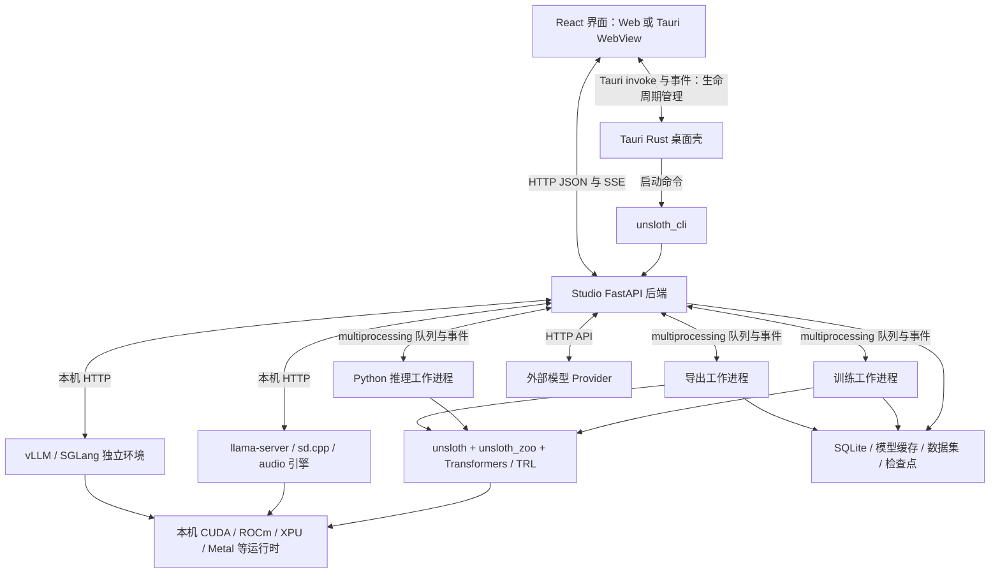
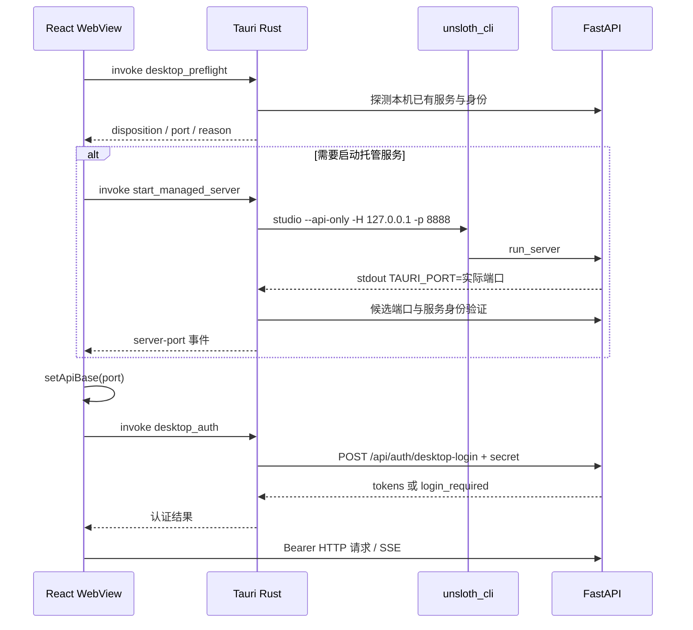
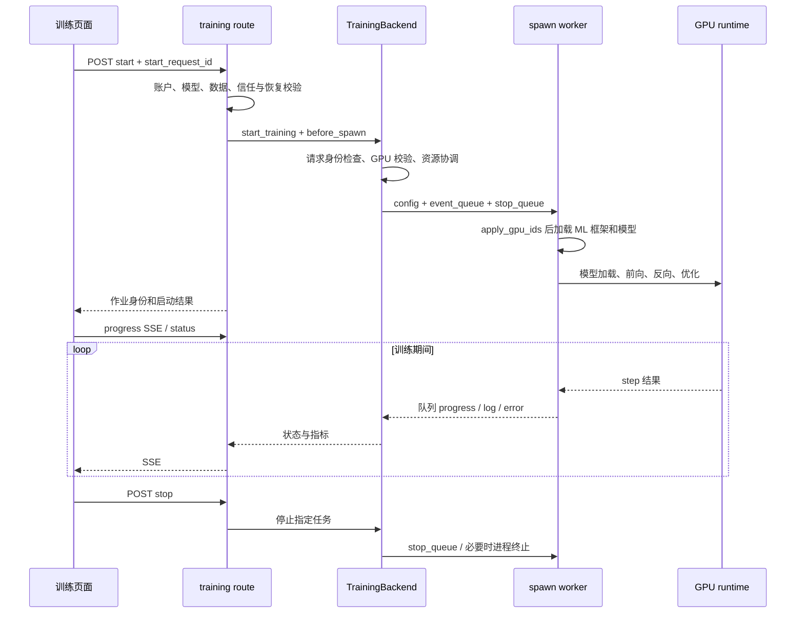

# Unsloth 源码深度解读：模块架构、桌面端与 GPU 服务连接

分析日期：2026-11-07。对象：本地 `opensource/unsloth`。基准提交：`61f2c06f54a214c0619801476831fc84d9200a5f`，提交标题为 `Studio: merge LoRA and LoKR adapters into ComfyUI-quantized weights (#16874)`。

## 1. 核心结论

这份 Unsloth 已经包含三个相互连接、但职责不同的系统：**模型训练与推理优化库 `unsloth/`、命令行入口 `unsloth_cli/`、带 Web 与 Tauri 桌面界面的 Studio**。不能只按早期的“给 Transformers 加速的 Python 库”理解它，也不能把 Studio 当成单纯的聊天页面。

针对“桌面端如何连接 GPU 服务”，最准确的回答是：

> Tauri 桌面壳负责安装、发现、启动、验证和停止本机 Studio 后端；React 界面通过本机 HTTP API 与 Python/FastAPI 后端交互；后端再根据任务类型，通过进程队列调用 Python 工作进程，或通过本机 HTTP 调用 llama.cpp、vLLM、SGLang 等引擎；最终由这些计算进程使用本机 GPU 驱动。

**GPU 连接分为三个层次：桌面连接 Studio、Studio 连接计算进程、计算进程使用 GPU。** 这三层的通信机制不同，不能统称为“桌面通过 WebSocket 连 GPU”。

还有五个重要边界：

1. 桌面主 API 基址由 `setApiBase(port)` 构造为 `http://127.0.0.1:<port>`，当前入口不是任意远程训练服务器地址配置器。证据：[studio/frontend/src/lib/api-base.ts:17](F:/WALLE-AI/uTrainerBuddy/opensource/unsloth/studio/frontend/src/lib/api-base.ts:17)。
2. Settings 中的 Remote access/LAN 主要是**把本机 Studio 提供给其他设备访问**，不是把本机训练任务迁移到云 GPU。证据：[studio/frontend/src/features/settings/api/remote-access.ts:15](F:/WALLE-AI/uTrainerBuddy/opensource/unsloth/studio/frontend/src/features/settings/api/remote-access.ts:15)、[studio/backend/lan_access.py:4](F:/WALLE-AI/uTrainerBuddy/opensource/unsloth/studio/backend/lan_access.py:4)。
3. 后端确实支持外部模型 Provider。它可以通过外部 HTTP 模型 API 使用远程算力，但这是模型调用链路，不代表拥有远程 GPU 节点的训练、显存和进程管理权。证据：[studio/backend/core/inference/external_provider.py:4](F:/WALLE-AI/uTrainerBuddy/opensource/unsloth/studio/backend/core/inference/external_provider.py:4)。
4. Studio 常规文本训练的多 GPU 主链是**单个工作进程通过 device map 放置模型**；底层库另有 TP、PP、CP、FSDP2 能力。两者不能直接画等号。证据：[studio/backend/utils/hardware/hardware.py:7755](F:/WALLE-AI/uTrainerBuddy/opensource/unsloth/studio/backend/utils/hardware/hardware.py:7755)、[unsloth/parallel_env.py:4](F:/WALLE-AI/uTrainerBuddy/opensource/unsloth/unsloth/parallel_env.py:4)。
5. Windows 上的可选 vLLM/SGLang 引擎可以由 Studio 管理独立 WSL2 发行版，并经 localhost 转发访问；这是本机跨运行环境调用。证据：[studio/backend/core/inference/wsl_host.py:4](F:/WALLE-AI/uTrainerBuddy/opensource/unsloth/studio/backend/core/inference/wsl_host.py:4)。

## 2. 分析范围、证据与统计口径

本报告采用“全树盘点 + 关键模块定向阅读 + 调用链交叉验证 + 已有测试契约核对”的方式。对桌面启动、鉴权、训练、GPU 选择、推理引擎和远程访问进行了重点追踪；对其余业务域按入口、主要类/函数、依赖、数据与进程边界解读。

**不是对数百万行源码逐行审计，也没有运行 GPU 训练、桌面安装、真实推理或完整测试集。** 报告中的“已实现”指源码存在相应路径，不等于对所有平台、设备和模型组合做过运行验证。外部依赖如 `unsloth_zoo`、Transformers、TRL、DataDesigner、llama.cpp 的内部实现不在本地本仓源码覆盖范围内。

源码引用固定到本地文件和行号。报告区分：

- **源码事实**：可由引用的函数体、类型、路由和配置验证。
- **架构判断**：从多处源码得出的设计解释。
- **扩展建议**：若用于 uTrainerBuddy，可考虑的后续设计，不是 Unsloth 当前已实现能力。

盘点通过 `git ls-files` 获取已跟踪文件。统计的“源码行数”包括注释、空行、测试和 vendored 代码，不是有效业务 LOC；测试文件数按目录及命名识别，不包含 Rust 文件内部的所有 `#[cfg(test)]` 模块。当前工作树存在两个缺失文件：`scripts/lint_av_shapes.py`、`tests/security/test_scan_packages.py`，未恢复，未计入可读源码。完整记录见 `source-index.json`。

<!-- SOURCE_STATS_START -->
| 目录 | 可读源码文件 | 物理源码行 | 识别出的测试文件 |
|---|---:|---:|---:|
| `(root)` | 5 | 20,655 | 0 |
| `.github` | 59 | 15,432 | 0 |
| `docker` | 39 | 8,541 | 1 |
| `scripts` | 67 | 33,492 | 0 |
| `studio` | 17 | 53,306 | 0 |
| `studio/backend` | 3,194 | 1,891,230 | 2,261 |
| `studio/frontend` | 3,929 | 978,890 | 1,589 |
| `studio/scripts` | 1 | 859 | 0 |
| `studio/src-tauri` | 61 | 54,087 | 0 |
| `studio/systemd` | 1 | 152 | 0 |
| `tests` | 2,032 | 706,672 | 2,032 |
| `unsloth` | 207 | 193,163 | 7 |
| `unsloth_cli` | 85 | 58,544 | 56 |
| **合计** | **9,697** | **4,015,023** | **5,946** |
<!-- SOURCE_STATS_END -->

另有 **686 处 HTTP/WebSocket 路由装饰器文本记录**。这不是 686 个唯一的运行时 URL：路由会叠加前缀、重复挂载，并且部分装饰器跨行书写。接口索引保留原始文件位置，避免把文本扫描伪装成运行时 OpenAPI 枚举。

## 3. 整体架构与进程边界



图中“本机 HTTP 引擎”与“Python 队列工作进程”是并列路径，不能理解为所有推理都会先经过同一个 Python ML worker。图像、视频、音频也各有专门后端，部分 Python 管线运行在后端进程/线程中，不能把所有耗 GPU 操作都概括成子进程。

这种结构的优势在于：界面不需要理解张量、CUDA Context 或训练框架；主后端可以提供统一任务、账户、文件和流式接口；具体引擎可以替换、升级或重启。代价则是进程状态、端口身份、显存回收、环境兼容和取消语义都需要额外协调。

## 4. 根目录各模块的源码定位

| 模块 | 实际责任 | 重要入口与阅读重点 |
|---|---|---|
| `unsloth/` | Python 模型加载、训练优化、算子、量化、并行、保存 | `__init__.py`、`models/loader.py`、`trainer.py`、`kernels/` |
| `unsloth_cli/` | 终端命令、Studio 管理、训练/推理/导出/诊断入口 | `__init__.py`、`commands/studio.py`、`commands/train.py` |
| `studio/frontend/` | 训练、聊天、多模态、数据、设置等交互 | `src/app/`、`src/features/`、`src/hooks/`、`src/lib/` |
| `studio/src-tauri/` | 原生壳、进程管理、安装更新、文件和浏览器集成 | `src/main.rs`、`commands.rs`、`process.rs`、`desktop_auth.rs` |
| `studio/backend/` | HTTP API、业务服务、任务编排、存储与算力适配 | `run.py`、`main.py`、`routes/`、`core/`、`utils/` |
| `studio/setup.*`、`install_*` | 运行时安装、平台探测、预编译引擎与工具准备 | Python、Torch、llama.cpp、音频、Node 等各自安装逻辑 |
| `docker/`、`studio/systemd/` | 服务器/容器部署、进程托管 | 镜像分层、启动脚本、持久化目录、服务端口 |
| `tests/`、各模块 `tests/` | 数值、兼容、生命周期、行为与安全回归 | 不同测试层验证不同契约，不能只跑一个目录即认为全部覆盖 |
| `scripts/`、`.github/` | 构建、发布、扫描、性能探针、CI 自动化 | 与产品运行时区分；探针不等于产品功能入口 |
| `images/` | 品牌与文档图片 | 不承担训练/服务逻辑 |

CLI 的正式 console script 映射为 `unsloth = "unsloth_cli:app"`。根目录旧式脚本不应作为理解桌面启动的首选入口。证据：[pyproject.toml:49](F:/WALLE-AI/uTrainerBuddy/opensource/unsloth/pyproject.toml:49)。

## 5. `unsloth/`：真正的模型优化层

### 5.1 初始化不是简单的 import

`unsloth/__init__.py` 在导入早期设置环境、兼容层和并行配置。例如 `UNSLOTH_PARALLEL` 会在 Transformers/Accelerate 初始化前被展开；FSDP2 启动配置也在早期接入。Apple Silicon 的 MLX 路径、GPU 路径和 CPU 回退分开处理。

这说明导入顺序是其运行语义的一部分：某些参数必须在设备枚举、框架导入或进程组建立前设置。Studio 选择 fresh spawn worker，与这种初始化约束高度一致。证据：[unsloth/__init__.py:40](F:/WALLE-AI/uTrainerBuddy/opensource/unsloth/unsloth/__init__.py:40)、[unsloth/__init__.py:267](F:/WALLE-AI/uTrainerBuddy/opensource/unsloth/unsloth/__init__.py:267)、[unsloth/__init__.py:2160](F:/WALLE-AI/uTrainerBuddy/opensource/unsloth/unsloth/__init__.py:2160)。

`unsloth_zoo` 是重要外部依赖，不是本仓中能完整展开的目录。MLX loader/trainer、编译、损失、设备规划等能力存在从 zoo 导入的路径。分析调用栈时，到这些 import 应标记为依赖边界，不能声称已从本仓验证其全部实现。证据：[unsloth/models/rl.py:34](F:/WALLE-AI/uTrainerBuddy/opensource/unsloth/unsloth/models/rl.py:34)、[pyproject.toml:194](F:/WALLE-AI/uTrainerBuddy/opensource/unsloth/pyproject.toml:194)。

### 5.2 模型加载：统一入口、分模型族适配

`models/loader.py` 的 `FastLanguageModel` 和 `FastModel` 是关键外观层。`from_pretrained()` 接受模型 ID、本地路径、dtype、4/8/16 位加载、FP8、全量微调、device map、梯度检查点、remote code 信任等参数，并接入离线、量化、并行和 tokenizer 包装逻辑。

`FastLanguageModel` 继承 `FastLlamaModel`，但并不意味着只支持 Llama。模型族专用文件如 `qwen2.py`、`qwen3.py`、`mistral.py`、`gemma*.py`、`vision.py`、`falcon_h1.py` 等承担架构差异；通用 loader 决定进入哪种实现路径。`FastModel` 则覆盖更宽的架构分流。证据：[unsloth/models/loader.py:1226](F:/WALLE-AI/uTrainerBuddy/opensource/unsloth/unsloth/models/loader.py:1226)、[unsloth/models/loader.py:1270](F:/WALLE-AI/uTrainerBuddy/opensource/unsloth/unsloth/models/loader.py:1270)、[unsloth/models/loader.py:2205](F:/WALLE-AI/uTrainerBuddy/opensource/unsloth/unsloth/models/loader.py:2205)。

典型训练 API 语义是：

```text
from_pretrained(...)       解析模型、量化与设备放置，加载模型/分词器
get_peft_model(...)        挂接可训练适配器及相应优化
for_training(...)         切换适合反向传播的运行模式
Trainer.train(...)        数据批处理、前反向、梯度累计、优化与检查点
for_inference(...)        切换推理模式
save / export             保存适配器、合并权重或转换目标格式
```

这里的 `fast_inference=True` 是模型库侧的 vLLM 集成选项，**与 Studio 安装并管理独立 vLLM 服务的路径不是同一个入口**，不要把参数名相似当成架构相同。

### 5.3 `kernels/`：优化发生在算子和反向传播层

| 文件组 | 源码关注点 | 实际收益机制 |
|---|---|---|
| `fast_lora.py`、`multi_lora.py` | LoRA 投影、共享输入、前后向、梯度需求 | 共享矩阵运算、减少重复读写与不必要梯度计算 |
| `cross_entropy_loss.py` | 自定义 autograd、Triton 前后向、大词表分块 | 减少中间张量与访存，按词表规模选择执行路径 |
| `rms_layernorm.py`、`layernorm.py`、`fused_add_rms_layernorm.py` | 归一化及融合 | 减少 kernel launch 和内存往返 |
| `rope_embedding.py`、`qk_norm_rope.py` | 旋转位置编码及组合操作 | 合并相关张量变换 |
| `swiglu.py`、`geglu.py` | MLP 激活 | 细化前后向实现、减少中间结果 |
| `nf4.py`、`fp8*.py`、`nvfp4.py`、`int4_packed.py` | 量化格式与执行 | 以格式适配的存储和计算降低开销，受设备与模型约束 |
| `moe/` | 专家模型相关计算 | 处理稀疏专家结构，而非普通 dense 层的直接复制 |

以 LoRA 为例，概念式是 `Y = XW + s(XA)B`。代码不仅计算这个公式，还对多个共享 X 的投影合并低秩矩阵乘法，按参数是否需要梯度跳过工作，并保留不适合融合时的处理路径。源码可见 `_shared_XA()`、`_shared_lora_backward()`、`_lora_AB_grads()`。证据：[unsloth/kernels/fast_lora.py:349](F:/WALLE-AI/uTrainerBuddy/opensource/unsloth/unsloth/kernels/fast_lora.py:349)。

交叉熵实现根据词表规模选择单块或分块执行，并保存 backward 所需统计量；这类优化才是“训练更省显存/更快”的底层机制之一。不能根据代码存在直接给出对所有模型都成立的加速倍数。证据：[unsloth/kernels/cross_entropy_loss.py:392](F:/WALLE-AI/uTrainerBuddy/opensource/unsloth/unsloth/kernels/cross_entropy_loss.py:392)。

### 5.4 Trainer、优化器与低精度策略

`unsloth/trainer.py` 包含 `UnslothTrainingArguments`、`UnslothTrainer(SFTTrainer)`，并对 TRL 参数兼容、packing、padding-free、视觉数据 collator 和优化器创建进行适配。它不是重新实现一套与 Hugging Face 无关的训练平台。证据：[unsloth/trainer.py:957](F:/WALLE-AI/uTrainerBuddy/opensource/unsloth/unsloth/trainer.py:957)、[unsloth/trainer.py:1404](F:/WALLE-AI/uTrainerBuddy/opensource/unsloth/unsloth/trainer.py:1404)、[unsloth/trainer.py:1834](F:/WALLE-AI/uTrainerBuddy/opensource/unsloth/unsloth/trainer.py:1834)。

`optimizers/` 包含 BF16/Flash AdamW、Q-GaLore、优化器状态卸载。`state_offload.py` 的设计是把优化器状态保存在 host，在 step 中分块搬入 GPU；是否可按块更新取决于优化器的数学语义，而不是对所有优化器都透明适用。证据：[unsloth/optimizers/state_offload.py:4](F:/WALLE-AI/uTrainerBuddy/opensource/unsloth/unsloth/optimizers/state_offload.py:4)。

`precision/` 把精度格式、GEMM dtype/scaling、高精度保留层、GPU 能力门槛和“实际是否启用”的检查集中为策略。它本身主要是配置与校验，底层运算仍落到 torchao 或 Unsloth kernels。证据：[unsloth/precision/__init__.py:4](F:/WALLE-AI/uTrainerBuddy/opensource/unsloth/unsloth/precision/__init__.py:4)。

### 5.5 分布式、RL、数据与导出

- `parallel_env.py` 解析 dp/tp/pp/cp/FSDP 配置，建立并行布局；`parallel_capabilities.py` 在修改模型前检查组合约束。`models/tp_*`、`pp_*`、`fsdp2_*` 与 `context_parallel.py` 承担各轴实现。不能假定任意量化、模型和并行轴都能自由组合。证据：[unsloth/parallel_env.py:4](F:/WALLE-AI/uTrainerBuddy/opensource/unsloth/unsloth/parallel_env.py:4)、[unsloth/parallel_capabilities.py:4](F:/WALLE-AI/uTrainerBuddy/opensource/unsloth/unsloth/parallel_capabilities.py:4)。
- `models/rl.py`、`rl_replacements.py`、`dpo.py` 等对接 RL/偏好训练；公开的 `PatchFastRL` 体现其改造既有训练器的方式。库有 RL 能力，不等于 Studio 所有训练表单都暴露完整 RL 工作流。
- `dataprep/` 提供原始文本、电子书、合成数据等准备能力；`RawTextDataLoader` 支持多种文本来源及 token 分块。`chat_templates.py`、tokenizer 工具处理对话协议和标签。证据：[unsloth/dataprep/raw_text.py:22](F:/WALLE-AI/uTrainerBuddy/opensource/unsloth/unsloth/dataprep/raw_text.py:22)。
- `save.py` 把保存方法挂到模型上，覆盖合并、量化及不同目标格式；`patch_saving_functions()` 是理解“模型为何多了这些保存 API”的入口。证据：[unsloth/save.py:9052](F:/WALLE-AI/uTrainerBuddy/opensource/unsloth/unsloth/save.py:9052)。
- `registry/` 是模型元数据注册与检索，不是 GPU 服务发现系统。证据：[unsloth/registry/__init__.py:12](F:/WALLE-AI/uTrainerBuddy/opensource/unsloth/unsloth/registry/__init__.py:12)。

## 6. 前端：同一套界面服务 Web 与桌面

前端技术栈可以从 package 和构建配置直接确认：React 19、TypeScript、Vite、TanStack Router、Zustand、Tailwind、assistant-ui；图形数据配方使用 React Flow，表格和虚拟列表有独立依赖。证据：[studio/frontend/package.json:1](F:/WALLE-AI/uTrainerBuddy/opensource/unsloth/studio/frontend/package.json:1)。

### 6.1 按 feature 划分业务，而非按后端微服务划分

| feature 组 | 主要职责 | 与后端的关系 |
|---|---|---|
| `auth`、`security`、`credentials`、`hf-auth` | 登录、令牌、敏感操作与模型源凭据 | 账户服务、remote-code 审批、Provider/Hub 凭据 |
| `training`、`train-model-picker`、`dataset-picker` | 训练配置、数据映射、运行状态、指标 | `/api/train`、数据集与模型接口 |
| `chat`、`chat-background`、`generation-presets` | 会话、流式生成、工具调用、生成配置 | inference 路由、后台 generation run |
| `model-picker`、`loaded-models`、`hub` | 搜索、下载、选型、当前模型状态 | 模型目录、下载任务、模型驻留 |
| `images`、`video`、`audio`、`npu` | 多模态任务及设备相关 UI | 各专用 inference 路由与引擎 |
| `recipe-studio`、`data-recipes` | 配方图、字段、Provider、验证器、执行与导出 | DataDesigner 包装和配方作业 |
| `rag`、`library` | 文档、知识库、素材与检索 | 摄取、解析、向量/全文检索 |
| `export` | 检查点选择、合并、格式转换、发布 | 导出编排器与工作进程 |
| `settings`、`profile`、`api-monitor` | 环境、远程访问、统计、API 可观测性 | 设置存储、硬件与使用统计 |
| `browser`、`native-intents`、`deep-links` | 内置浏览器、拖放、原生文件、深链 | Tauri 原生能力及后端文件授权 |
| `scheduled-tasks` | 定时任务编辑与运行记录 | Studio 内置调度循环 |
| `studio`、`tour`、`find-in-page`、`interface-zoom`、`igpu-carveout`、`transformers-upgrade` | 应用框架、引导、辅助交互与运行环境设置 | 对应跨业务服务 |

配置状态和运行状态分开，例如 `training-config-store.ts` 与 `training-runtime-store.ts`。配置可通过 Zustand persist 保留，运行状态则需要和后端任务身份重新对齐。单靠浏览器持久化无法可靠判断训练进程是否还活着。证据：[studio/frontend/src/features/training/stores/training-config-store.ts:199](F:/WALLE-AI/uTrainerBuddy/opensource/unsloth/studio/frontend/src/features/training/stores/training-config-store.ts:199)。

### 6.2 Web 与桌面的 URL 差异

`api-base.ts` 的默认基址是空字符串。Web 模式因此使用相对地址 `/api/...`，跟随当前网页 origin；桌面模式则先设为 `http://127.0.0.1:0`，等待真实端口。

开发时 Vite 将 `/api`、`/v1`、`/mcp` 代理到 `127.0.0.1:8888`，部分配方插件接口代理到 `8004`。这只是开发代理配置，不是桌面实际后端端口发现协议。证据：[studio/frontend/vite.config.ts:47](F:/WALLE-AI/uTrainerBuddy/opensource/unsloth/studio/frontend/vite.config.ts:47)。

`authFetch()` 负责附加 Bearer token、处理网络失败、401 刷新与桌面重新认证。它是调用 Studio API 的重要统一层。需要注意函数体会给调用附加 token，不能把它当作任意外部 URL 的无害通用 fetch；外部 Provider 的主调用应走后端。证据：[studio/frontend/src/features/auth/api.ts:429](F:/WALLE-AI/uTrainerBuddy/opensource/unsloth/studio/frontend/src/features/auth/api.ts:429)。

## 7. 桌面端连接本机 GPU 后端：完整启动链

### 7.1 Tauri 不是只包一个窗口

`main.rs` 注册应用、插件、命令和退出管理；`commands.rs` 把 Rust 能力暴露给 React；`process.rs` 维护后端进程及日志。其他模块围绕真实运行问题展开：

| Rust 模块 | 责任 |
|---|---|
| `preflight/` | 判断安装状态、后端协议/版本、已有进程与可管理性 |
| `desktop_port.rs` | 自定义端口校验、候选端口发现 |
| `desktop_backend_owner.rs`、`process_identity.rs` | 后端身份与归属验证，避免控制错进程 |
| `desktop_auth.rs` | 本地 secret 换桌面会话 |
| `install.rs`、`install_watchdog.rs` | 安装状态、输出解析、卡住/失败处理 |
| `update.rs`、`desktop_updater.rs`、`staged_update.rs` | 后端/桌面更新与 staged 操作 |
| `windows_job.rs` | Windows 进程树寿命管理 |
| `native_intents.rs`、`native_backend_lease.rs`、`native_path_policy.rs` | 文件拖放/深链/路径访问授权 |
| `browser_*` | 内置浏览器及下载、捕获、代理等原生功能 |
| `diagnostics/` | 日志阶段、报告、脱敏 |
| `gpu_rendering.rs`、`linux_gpu_supervisor.rs` | 桌面 WebView 图形渲染/运行稳定性；不能根据文件名误认为训练 GPU 调度器 |

证据入口：[studio/src-tauri/src/main.rs:2276](F:/WALLE-AI/uTrainerBuddy/opensource/unsloth/studio/src-tauri/src/main.rs:2276)、[studio/src-tauri/src/commands.rs:145](F:/WALLE-AI/uTrainerBuddy/opensource/unsloth/studio/src-tauri/src/commands.rs:145)、[studio/src-tauri/src/process.rs:3240](F:/WALLE-AI/uTrainerBuddy/opensource/unsloth/studio/src-tauri/src/process.rs:3240)。

### 7.2 启动状态机

`useTauriBackend()` 使用 checking、not-installed、installing、repairing、starting、running、stopped、error 等状态。首先执行 `desktop_preflight`，其 disposition 明确区分：

- `not_installed`：需要安装。
- `managed_ready`：托管环境可启动。
- `managed_stale`：托管运行环境过旧/不完整，需要视原因修复。
- `owned_ready` / `owned_stale`：识别到桌面拥有的后端。
- `attached_ready`：可附着的既有服务。
- `external_conflict`：已有后端与本次控制操作存在冲突。

这里的“attached/external”首先描述**本机已有服务的生命周期归属**，不代表远程 GPU 节点。前端附着后同样执行 `setApiBase(preflight.port)`，地址仍是 loopback。证据：[studio/frontend/src/hooks/use-tauri-backend.ts:82](F:/WALLE-AI/uTrainerBuddy/opensource/unsloth/studio/frontend/src/hooks/use-tauri-backend.ts:82)、[studio/frontend/src/hooks/use-tauri-backend.ts:306](F:/WALLE-AI/uTrainerBuddy/opensource/unsloth/studio/frontend/src/hooks/use-tauri-backend.ts:306)。

### 7.3 真正启动的命令

前端调用：

```typescript
await invoke("start_managed_server", { port: 8888 });
```

Rust `backend_args()` 构造的命令等价于：

```text
unsloth studio --api-only -H 127.0.0.1 -p 8888
```

“等价于”很重要：Windows 托管环境可能直接解析到 Python 解释器调用，而不是依赖有问题的 console stub。启动路径还设置工作目录、托管环境上下文、后端 owner、进程代次 generation、stdout/stderr 管道和生命周期标记。证据：[studio/frontend/src/hooks/use-tauri-backend.ts:380](F:/WALLE-AI/uTrainerBuddy/opensource/unsloth/studio/frontend/src/hooks/use-tauri-backend.ts:380)、[studio/src-tauri/src/process.rs:3225](F:/WALLE-AI/uTrainerBuddy/opensource/unsloth/studio/src-tauri/src/process.rs:3225)、[studio/src-tauri/src/process.rs:3240](F:/WALLE-AI/uTrainerBuddy/opensource/unsloth/studio/src-tauri/src/process.rs:3240)。

**Tauri 并没有在 Rust 内直接加载 CUDA 或训练模型。** 它启动的是 CLI，CLI 再进入 Python 的 `run_server()`。`--api-only` 服务桌面已打包的前端；但桌面拥有的后端仍有为 Remote/LAN 访问提供打包页面的分支，不能笼统说这个模式永远不提供静态页面。证据：[studio/backend/run.py:1715](F:/WALLE-AI/uTrainerBuddy/opensource/unsloth/studio/backend/run.py:1715)、[studio/backend/run.py:2306](F:/WALLE-AI/uTrainerBuddy/opensource/unsloth/studio/backend/run.py:2306)。

### 7.4 端口不是猜出来的

默认请求端口为 8888，候选范围覆盖其后 20 个端口；`UNSLOTH_DESKTOP_PORT` 可以调整起点，并校验范围和浏览器禁止访问的端口。实际服务器完成 bind/startup 后才输出：

```text
TAURI_PORT=<实际监听端口>
```

Rust 读取 stdout 中的 marker，验证候选服务，才发布 `server-port` 事件。React 获得端口后执行 `setApiBase()`，随后业务 API 才能指向正确的本机服务。证据：[studio/src-tauri/src/desktop_port.rs:6](F:/WALLE-AI/uTrainerBuddy/opensource/unsloth/studio/src-tauri/src/desktop_port.rs:6)、[studio/backend/run.py:2814](F:/WALLE-AI/uTrainerBuddy/opensource/unsloth/studio/backend/run.py:2814)、[studio/src-tauri/src/process.rs:3849](F:/WALLE-AI/uTrainerBuddy/opensource/unsloth/studio/src-tauri/src/process.rs:3849)、[studio/src-tauri/src/process.rs:3754](F:/WALLE-AI/uTrainerBuddy/opensource/unsloth/studio/src-tauri/src/process.rs:3754)。

这个设计避免了“8888 被其他程序占用，但 UI 把它误认为训练服务”的错误。端口只是连接地址，真正的身份还需协议、安装根标识和 owner 机制。

### 7.5 服务身份与健康检查

`/api/liveness` 提供廉价的存活信息，包括 service、desktop protocol/manageability version、studio root id 和可选 owner。`/api/health` 提供更多能力信息；版本、设备类型等主机信息有鉴权边界，部分硬件探测也需要额外处理。

Rust 监控优先用 `/api/liveness`，旧后端没有时再回退 `/api/health`。它不仅看 HTTP 200，还要求匹配预期状态和 `service == "Unsloth UI Backend"`；启动和重计算期有不同容忍逻辑。证据：[studio/backend/main.py:2180](F:/WALLE-AI/uTrainerBuddy/opensource/unsloth/studio/backend/main.py:2180)、[studio/backend/main.py:2241](F:/WALLE-AI/uTrainerBuddy/opensource/unsloth/studio/backend/main.py:2241)、[studio/src-tauri/src/commands.rs:503](F:/WALLE-AI/uTrainerBuddy/opensource/unsloth/studio/src-tauri/src/commands.rs:503)。

这也解释了为什么“服务还活着”和“GPU/模型已经就绪”必须拆开：PyTorch 导入、驱动初始化、模型下载和编译都可能很慢。不能让一个 GPU 探测阻塞，就导致桌面把整个后端判死。

### 7.6 桌面自动认证

桌面没有因为访问 localhost 就跳过 API 认证。Rust 从 Studio 的 auth 目录读取 `.desktop_secret`，向 `/api/auth/desktop-login` 交换凭据；前端通过 `invoke("desktop_auth")` 获取会话结果，然后保存 token。

单用户模式可以返回桌面标记的 owner token；多用户模式会返回 `login_required`，仍需登录具体账户。文件 secret 表示“桌面与安装的联系”，不能代替多用户身份。证据：[studio/src-tauri/src/desktop_auth.rs:106](F:/WALLE-AI/uTrainerBuddy/opensource/unsloth/studio/src-tauri/src/desktop_auth.rs:106)、[studio/src-tauri/src/desktop_auth.rs:271](F:/WALLE-AI/uTrainerBuddy/opensource/unsloth/studio/src-tauri/src/desktop_auth.rs:271)、[studio/backend/routes/auth.py:522](F:/WALLE-AI/uTrainerBuddy/opensource/unsloth/studio/backend/routes/auth.py:522)、[studio/frontend/src/features/auth/tauri-auto-auth.ts:97](F:/WALLE-AI/uTrainerBuddy/opensource/unsloth/studio/frontend/src/features/auth/tauri-auto-auth.ts:97)。

### 7.7 启动时序图



### 7.8 停止和崩溃恢复

Unix 启动时建立进程组，停止有 SIGTERM、等待、SIGKILL 阶梯；Windows 使用 Job Object、精确端口 shutdown、控制事件及必要的进程终止。采用已有后端时，源码拒绝在缺乏端口到进程身份绑定时盲目退化成 PID kill。

后端自身也有父进程 watchdog 和子进程清理，防止桌面异常退出后留下占显存的训练/推理进程。证据：[studio/src-tauri/src/process.rs:4267](F:/WALLE-AI/uTrainerBuddy/opensource/unsloth/studio/src-tauri/src/process.rs:4267)、[studio/backend/run.py:2821](F:/WALLE-AI/uTrainerBuddy/opensource/unsloth/studio/backend/run.py:2821)。

这里值得借鉴的是“拥有进程”和“连接进程”分离：能访问一个服务，不代表当前桌面可以停止、更新或删除它。

## 8. FastAPI 后端：API、状态与计算编排

`main.py` 构建 FastAPI、注册生命周期、中间件、鉴权和各路由。`run.py` 负责启动参数、监听、TLS/远程访问衔接、端口 marker、PID 与退出管理。二者分别偏“应用构建”和“服务器进程启动”。

### 8.1 路由/服务/模型/存储的分层

| 层 | 职责 | 典型例子 |
|---|---|---|
| `routes/` | HTTP 参数、鉴权、前置校验、错误码、响应与 SSE | training、inference、providers、export、rag |
| `models/` | Pydantic 请求与响应契约 | training request、Provider 配置、load response |
| `core/` | 业务操作、任务编排、引擎调用与工作进程 | TrainingBackend、InferenceOrchestrator、ExportOrchestrator |
| `utils/` | 硬件、路径、环境、权限、运行时兼容 | hardware、storage_roots、native_path_leases |
| `storage/` | SQLite 持久化和数据访问 | studio_db、providers_db、rag_db |
| `state/` | 活动生成、工具审批、订阅、运行中的协作状态 | active_generations、run_subscribers、tool_approvals |
| `hub/`、`picker/` | 模型/数据来源、索引、下载与选择 | HF/ModelScope、账户资源访问、模板与目录 |

这种分层并非处处严格：部分 route 文件相当大，并直接协调跨业务资源。后续二次开发不能假定 `core/` 完全不依赖 `routes/`；例如显存协调中存在对 inference route 所暴露后端的调用。

### 8.2 关键接口地图

| 接口 | 作用 | 计算是否在请求函数内完成 |
|---|---|---|
| `GET /api/liveness` | 进程存活与桌面能力 | 轻量读取 |
| `GET /api/health` | 能力、身份相关状态 | 部分检测有预算/异步状态 |
| `GET /api/system`、`/api/system/hardware`、`/api/system/gpu-visibility` | 系统与设备视图 | 硬件查询/缓存 |
| `POST /api/train/start` | 验证并启动训练 | 训练在工作进程运行 |
| `GET /api/train/start-requests/{id}` | 确认提交结果 | 查询启动记录 |
| `POST /api/train/stop` | 请求停止当前指定训练 | 通过停止协议协调 worker |
| `GET /api/train/status`、`/metrics` | 状态与历史指标 | 读状态/存储 |
| `POST /api/train/progress` | 训练 SSE | 长连接；兼容 GET |
| `POST /api/inference/load`、`/unload` | 模型生命周期 | 可触发长时间加载/卸载 |
| `POST /api/inference/chat/completions` | Studio 对话 | 路由至具体引擎，支持流式 |
| `POST /v1/chat/completions` | 对外兼容模型 API | 共享相关推理能力，不表示全部 OpenAI 行为完全等价 |
| `/api/providers/` | 外部模型服务配置 | 后端保存与访问外部 API |
| `/api/engines` | 可选引擎安装和管理 | 独立环境/作业 |
| `/api/export`、`/api/data-recipe`、`/api/rag` | 导出、配方、知识库 | 各自作业模型 |
| `POST /v1/fine_tuning/jobs` | 兼容风格的微调作业提交 | 本实例队列和训练能力 |
| `/mcp` | Studio 对外工具服务 | 调用同一套业务能力 |

实际路由挂载位置：[studio/backend/main.py:1980](F:/WALLE-AI/uTrainerBuddy/opensource/unsloth/studio/backend/main.py:1980)、[studio/backend/main.py:1995](F:/WALLE-AI/uTrainerBuddy/opensource/unsloth/studio/backend/main.py:1995)。微调 API 确有入队和作业接口，因此不能把 Studio 描述成“完全没有队列”；但这里的队列也不是跨 GPU 集群调度器。证据：[studio/backend/routes/openai_fine_tuning.py:992](F:/WALLE-AI/uTrainerBuddy/opensource/unsloth/studio/backend/routes/openai_fine_tuning.py:992)、[studio/backend/routes/openai_fine_tuning.py:1059](F:/WALLE-AI/uTrainerBuddy/opensource/unsloth/studio/backend/routes/openai_fine_tuning.py:1059)。

## 9. 从点击训练到 GPU 执行：逐层追踪

### 9.1 提交并非一个无身份的 POST

`train-api.ts::startTraining()` 向 `/api/train/start` 提交参数与启动请求 ID，设置 60 秒请求超时，并区分“明确失败”和“结果未知”。后端提供 start-request 查询、acknowledge、cancel 接口，处理“服务已开始训练，但客户端没有收到响应”的情形。

这比前端超时后直接重复提交可靠得多。训练任务是长寿命资源，网络连接只是观察和控制它的通道。证据：[studio/frontend/src/features/training/api/train-api.ts:38](F:/WALLE-AI/uTrainerBuddy/opensource/unsloth/studio/frontend/src/features/training/api/train-api.ts:38)、[studio/frontend/src/features/training/api/train-api.ts:153](F:/WALLE-AI/uTrainerBuddy/opensource/unsloth/studio/frontend/src/features/training/api/train-api.ts:153)、[studio/backend/routes/training.py:1852](F:/WALLE-AI/uTrainerBuddy/opensource/unsloth/studio/backend/routes/training.py:1852)。

### 9.2 请求前置校验

训练路由先处理模型/数据来源、Hub 权限、本地路径、模型格式、平台能力、remote-code 信任、恢复训练信息等问题，再进入资源变更与 spawn。这样可避免参数早已无效，却先把用户聊天模型卸载。

`TrainingBackend` 构建 worker config，固定部分模型/数据缓存来源，并记录 provenance。继续训练不能只认路径字符串，还要核对实际模型/适配器来源是否与提交时一致。证据：[studio/backend/routes/training.py:1938](F:/WALLE-AI/uTrainerBuddy/opensource/unsloth/studio/backend/routes/training.py:1938)、[studio/backend/core/training/training.py:1806](F:/WALLE-AI/uTrainerBuddy/opensource/unsloth/studio/backend/core/training/training.py:1806)。

### 9.3 GPU 选择：显式与自动分开

`prepare_gpu_selection()` 有两种语义：

- 显式 `gpu_ids`：验证请求是否处在父进程可见设备集合内、设备能否运行所需 kernels，然后使用这些设备。
- 自动选择：根据模型、训练类型、量化、batch、sequence length、LoRA rank、梯度检查点和优化器估算需要的显存，再结合可用显存选设备。

显式选择在卸载现有资源前校验；自动选择依赖释放后的 free VRAM，因而延后执行。GPU ID 在这套 API 中不能随便当成 worker 内部 `cuda:N`，因为子进程遮罩会重新编号。证据：[studio/backend/utils/hardware/hardware.py:6821](F:/WALLE-AI/uTrainerBuddy/opensource/unsloth/studio/backend/utils/hardware/hardware.py:6821)、[studio/backend/core/training/training.py:1829](F:/WALLE-AI/uTrainerBuddy/opensource/unsloth/studio/backend/core/training/training.py:1829)。

### 9.4 显存协调：不是统一 empty_cache

训练启动通过 `before_spawn` 执行资源协调，涉及导出、图像、视频、Decision、聊天和语音模型。其中：

- 可能停止导出工作进程，释放其持有的 GPU 资源。
- 对图像/视频检查和卸载对应活动引擎；图像引擎若明确不使用 Torch 的设备，存在保留分支。
- 对仍在加载的聊天模型和托管推理引擎采用释放策略。
- 普通已驻留聊天/STT 模型可能保留：只有在余量满足估算和安全边际时才保留，否则按顺序释放并重估。
- 对无法停止、仍持有 GPU 的关键引擎，抛出带 `blocks_training` 的错误，阻止继续 spawn。

所以“开始训练一定清空所有模型”和“只执行 `torch.cuda.empty_cache()`”都不准确。释放活跃权重和 CUDA Context 往往需要卸载甚至退出对应进程。证据：[studio/backend/routes/training.py:2434](F:/WALLE-AI/uTrainerBuddy/opensource/unsloth/studio/backend/routes/training.py:2434)、[studio/backend/routes/training_vram.py:665](F:/WALLE-AI/uTrainerBuddy/opensource/unsloth/studio/backend/routes/training_vram.py:665)、[studio/backend/routes/training_vram.py:426](F:/WALLE-AI/uTrainerBuddy/opensource/unsloth/studio/backend/routes/training_vram.py:426)。

### 9.5 创建隔离的训练工作进程

`TrainingBackend` 使用 `mp.get_context("spawn")`，为任务创建 `event_queue` 和 `stop_queue`，进入 `core.training.worker::run_training_process()`。外层包装同时传递账户上下文，并去除不应泄露给子进程的原生路径 secret。

fresh spawn 的意义是：新解释器、干净的模块状态、在 GPU 初始化前设置可见设备、训练结束后可释放进程占用；它也服务于 Transformers 版本切换。它不是远程 RPC，更不是把 Python 对象发到另一台 GPU 服务器。证据：[studio/backend/core/training/training.py:738](F:/WALLE-AI/uTrainerBuddy/opensource/unsloth/studio/backend/core/training/training.py:738)、[studio/backend/core/training/training.py:1913](F:/WALLE-AI/uTrainerBuddy/opensource/unsloth/studio/backend/core/training/training.py:1913)、[studio/backend/core/training/worker.py:4](F:/WALLE-AI/uTrainerBuddy/opensource/unsloth/studio/backend/core/training/worker.py:4)。

### 9.6 在 worker 中绑定 GPU

worker 从 `resolved_gpu_ids` 读取选择结果，在模型加载之前调用：

```python
apply_gpu_ids(gpu_ids, backend=config.get("device_backend"))
```

具体写入随平台不同：

| 运行时 | 主要选择机制 | 需要留意 |
|---|---|---|
| NVIDIA CUDA | `CUDA_VISIBLE_DEVICES`，必要时统一 PCI 顺序 | 物理 ID、UUID、MIG 与进程逻辑序号不同 |
| AMD ROCm | CUDA/HIP 可见性变量及 ROCR 相对映射 | 不能用 NVIDIA 的编号假设解释 AMD |
| Intel XPU | `ZE_AFFINITY_MASK` | 必须在 Level Zero/设备枚举前设置 |
| Apple Silicon | 独立 MLX 路径 | 不是给 macOS 设置 CUDA 变量 |

父后端把检测到的 device backend 传给 worker，是为了避免 worker 为判断平台而先初始化错误的设备环境。证据：[studio/backend/core/training/worker.py:4313](F:/WALLE-AI/uTrainerBuddy/opensource/unsloth/studio/backend/core/training/worker.py:4313)、[studio/backend/utils/hardware/hardware.py:7642](F:/WALLE-AI/uTrainerBuddy/opensource/unsloth/studio/backend/utils/hardware/hardware.py:7642)。

例如在无额外复杂遮罩的 NVIDIA 主机上选择物理 GPU `[2, 5]`，worker 中通常会看到逻辑 `cuda:0`、`cuda:1`。模型放置必须使用正确的编号空间；不能再拿物理 `5` 当作 worker 内第五张卡。

### 9.7 真正的训练执行

worker 根据任务分流到普通文本/视觉/音频、MLX、embedding、Decision 等实现。常规 `core/training/trainer.py::UnslothTrainer` 加载模型、数据、LoRA/训练配置，使用库侧 `FastLanguageModel`/`FastVisionModel`/`FastModel` 和 TRL。

这里有两个不同的同名类：

- `studio/backend/core/training/trainer.py::UnslothTrainer`：Studio 任务执行适配层。
- `unsloth/trainer.py::UnslothTrainer`：继承 TRL SFTTrainer 的库侧训练器。

阅读调用栈必须带上文件路径，否则很容易把 UI 任务管理和训练算法实现混在一起。证据：[studio/backend/core/training/trainer.py:508](F:/WALLE-AI/uTrainerBuddy/opensource/unsloth/studio/backend/core/training/trainer.py:508)、[studio/backend/core/training/trainer.py:1339](F:/WALLE-AI/uTrainerBuddy/opensource/unsloth/studio/backend/core/training/trainer.py:1339)、[unsloth/trainer.py:1404](F:/WALLE-AI/uTrainerBuddy/opensource/unsloth/unsloth/trainer.py:1404)。

### 9.8 指标回传与重连

worker 将进度、日志、错误和完成事件写入 event queue；主进程 pump 消费并维护状态/历史；训练路由输出 SSE；前端解析并更新 runtime store。

进度接口带 `expected_job_id`，并可发送 `Last-Event-ID`，防止重新连接后把另一任务的事件当成本任务。路由存在 progress、heartbeat、complete、error 等事件；部分状态以快照/历史重建，不能假定所有事件都构成无限持久的严格一次消息日志。

当前通用流助手优先使用 **POST SSE**，遇到 405 才回退 GET；源码明确解释这是为了规避 Quick Tunnel 对 streamed GET 的行为。SSE 是 HTTP 响应体中的事件流，不要求必须使用浏览器 `EventSource`。证据：[studio/backend/core/training/training.py:2965](F:/WALLE-AI/uTrainerBuddy/opensource/unsloth/studio/backend/core/training/training.py:2965)、[studio/backend/routes/training.py:3075](F:/WALLE-AI/uTrainerBuddy/opensource/unsloth/studio/backend/routes/training.py:3075)、[studio/frontend/src/features/training/api/train-api.ts:378](F:/WALLE-AI/uTrainerBuddy/opensource/unsloth/studio/frontend/src/features/training/api/train-api.ts:378)、[studio/frontend/src/lib/open-stream-response.ts:11](F:/WALLE-AI/uTrainerBuddy/opensource/unsloth/studio/frontend/src/lib/open-stream-response.ts:11)。



## 10. 推理连接：四条主要路径

### 10.1 Python / Unsloth / MLX 工作进程

`core/inference/__init__.py` 默认返回 `InferenceOrchestrator`，不是直接返回真正持有模型的 `InferenceBackend`。为了兼容旧调用，公开的 `InferenceBackend` 名字也指向 orchestrator；真实 ML 后端在 `.inference`，由 worker 使用。

orchestrator 创建 command queue、response queue、cancel/drain event 及每请求停止记录，启动 `run_inference_process()`。主进程通过命令与响应管理加载、生成、计数、卸载和取消。证据：[studio/backend/core/inference/__init__.py:4](F:/WALLE-AI/uTrainerBuddy/opensource/unsloth/studio/backend/core/inference/__init__.py:4)、[studio/backend/core/inference/orchestrator.py:650](F:/WALLE-AI/uTrainerBuddy/opensource/unsloth/studio/backend/core/inference/orchestrator.py:650)、[studio/backend/core/inference/worker.py:2118](F:/WALLE-AI/uTrainerBuddy/opensource/unsloth/studio/backend/core/inference/worker.py:2118)。

这层分离使主 API 进程可以维持控制与流式响应，而模型崩溃或依赖切换只需重建工作进程。响应调度还必须处理多个请求的身份，不能把全局队列中的任意 token 发给当前页面。

### 10.2 GGUF / llama.cpp

`LlamaCppBackend` 管理 llama-server 子进程。它为引擎分配本机端口、构造参数、启动、等待健康、用 HTTP 调用，再在卸载时清理进程。其 `base_url` 明确返回 `http://127.0.0.1:<engine_port>`。

所以常见链路是：

```text
React --HTTP/SSE--> Studio:<studio_port>
       Studio --HTTP/SSE--> llama-server:<engine_port>
                  llama-server --原生 GPU backend--> GPU
```

**Studio API 端口与 llama-server 端口不是同一个端口。** 浏览器通常只知道前者；后者属于后端托管的内部引擎。GPU 层数、张量拆分、上下文和缓存等选项由后端翻译为引擎配置。证据：[studio/backend/core/inference/llama_cpp.py:8326](F:/WALLE-AI/uTrainerBuddy/opensource/unsloth/studio/backend/core/inference/llama_cpp.py:8326)、[studio/backend/core/inference/llama_cpp.py:8713](F:/WALLE-AI/uTrainerBuddy/opensource/unsloth/studio/backend/core/inference/llama_cpp.py:8713)、[studio/backend/core/inference/llama_cpp.py:19435](F:/WALLE-AI/uTrainerBuddy/opensource/unsloth/studio/backend/core/inference/llama_cpp.py:19435)。

### 10.3 可选 vLLM / SGLang 服务

`engine_install.py` 管理独立运行环境；`ManagedEngine` 选择安装环境、分配端口、设置设备遮罩和编译缓存、计算显存预算、启动进程并探测 `/health`。`EngineAdapter` 负责不同引擎的参数和入口差异。

独立环境是必要的：vLLM/SGLang 的 Torch、Transformers、Triton 等依赖并不能任意混装到 Studio 主环境。源码允许在精确满足锁定条件时共享部分基础依赖，而不是简单复制同一个 Python 环境。证据：[studio/backend/core/inference/managed_engine.py:740](F:/WALLE-AI/uTrainerBuddy/opensource/unsloth/studio/backend/core/inference/managed_engine.py:740)、[studio/backend/core/inference/engine_adapters.py:97](F:/WALLE-AI/uTrainerBuddy/opensource/unsloth/studio/backend/core/inference/engine_adapters.py:97)、[studio/INFERENCE_ENGINES.md:114](F:/WALLE-AI/uTrainerBuddy/opensource/unsloth/studio/INFERENCE_ENGINES.md:114)。

内部服务有自己的 API key，启动 key 通过环境变量传给引擎，HTTP 请求附带对应鉴权。`engine_transport.py` 使用 `httpx.AsyncClient(trust_env=False)` 调用 `/v1/chat/completions`，解析 SSE，并用有界队列把异步 HTTP 流桥接回同步生成器。取消会影响读流，不只是停止前端动画。证据：[studio/backend/core/inference/engine_adapters.py:107](F:/WALLE-AI/uTrainerBuddy/opensource/unsloth/studio/backend/core/inference/engine_adapters.py:107)、[studio/backend/core/inference/engine_transport.py:63](F:/WALLE-AI/uTrainerBuddy/opensource/unsloth/studio/backend/core/inference/engine_transport.py:63)。

可选引擎的多卡模式包括 tensor/pipeline/data；adapter 将选中 GPU 数量映射到对应并行参数。源码/随仓说明明确以**单机**为配置范围，不应把 `gpu_ids=[0,1]` 理解成两个远程 worker。证据：[studio/backend/core/inference/engine_adapters.py:145](F:/WALLE-AI/uTrainerBuddy/opensource/unsloth/studio/backend/core/inference/engine_adapters.py:145)、[studio/INFERENCE_ENGINES.md:21](F:/WALLE-AI/uTrainerBuddy/opensource/unsloth/studio/INFERENCE_ENGINES.md:21)。

### 10.4 外部模型 Provider

外部 Provider 配置包含类型、base URL、凭据、额外 headers、模型与能力等信息。前端通过 Studio API 配置，后端 `external_provider.py` 再访问外部服务；协议包括兼容的 chat completions 及对其他协议的转换路径。

```text
Tauri WebView → 本机 Studio → 远程 vLLM / Ollama / 兼容服务 / 云模型 API
```

这条链路确实可以使用远程 GPU 推理，但控制边界是“调用模型 API”。Studio 不因此知道远端物理 GPU ID、驱动、训练 PID、检查点路径或集群资源队列。证据：[studio/backend/models/providers.py:175](F:/WALLE-AI/uTrainerBuddy/opensource/unsloth/studio/backend/models/providers.py:175)、[studio/backend/routes/providers.py:331](F:/WALLE-AI/uTrainerBuddy/opensource/unsloth/studio/backend/routes/providers.py:331)、[studio/backend/core/inference/external_provider.py:4](F:/WALLE-AI/uTrainerBuddy/opensource/unsloth/studio/backend/core/inference/external_provider.py:4)。

## 11. GPU 管理：硬件视图、显存预算与并行边界

### 11.1 硬件检测与计算进程隔离

`utils/hardware/` 包含统一设备检测及 NVIDIA、AMD、Apple、NPU、MIG、显存估计等分支。统一层处理设备可见性、不同枚举来源和 CPU/加速器能力，而不仅是执行一次 `nvidia-smi`。

系统路由提供的是**运行 Studio 后端这台主机的硬件视图**。Web 客户端访问远程 Studio 时，看到的是服务器 GPU，而不是浏览器所在电脑；桌面默认启动本机后端时，两者才位于同一主机。证据：[studio/backend/utils/hardware/hardware.py:1559](F:/WALLE-AI/uTrainerBuddy/opensource/unsloth/studio/backend/utils/hardware/hardware.py:1559)、[studio/backend/main.py:3074](F:/WALLE-AI/uTrainerBuddy/opensource/unsloth/studio/backend/main.py:3074)。

应区分：主机可枚举设备、父后端允许看到的设备、某个任务实际选择的设备、worker 的逻辑设备序号、引擎自己的设备枚举。容器遮罩、MIG、AMD SMI/HIP 编号和 WSL 都会让这些集合或编号不同。

### 11.2 GPU arbiter 与 residency

`gpu_arbiter.py` 维护 chat、diffusion、video、decisions 等驻留者、账户归属及物理 GPU 集合，围绕加载/驱逐做同步。`gpu_residency.py` 基于 live free VRAM 估算是否能够共存，无法估价的资源不应乐观判为可容纳。

策略有“释放其他模型”“能放下则保留”“Always 下拒绝会驱逐的加载”等差异。Always 拒绝会以明确的 409/标记表达，不是把它误报为普通 OOM。证据：[studio/backend/core/inference/gpu_arbiter.py:4](F:/WALLE-AI/uTrainerBuddy/opensource/unsloth/studio/backend/core/inference/gpu_arbiter.py:4)、[studio/backend/core/inference/gpu_arbiter.py:60](F:/WALLE-AI/uTrainerBuddy/opensource/unsloth/studio/backend/core/inference/gpu_arbiter.py:60)、[studio/backend/core/inference/gpu_residency.py:4](F:/WALLE-AI/uTrainerBuddy/opensource/unsloth/studio/backend/core/inference/gpu_residency.py:4)。

这是**单实例内部资源协调器**。其锁和驻留表不是跨机器分布式锁，也不对用户在终端启动的任意其他 GPU 程序拥有控制权。其他程序突然占显存，依然可能使预测失效。

### 11.3 多 GPU 必须分四个概念

| 能力 | 本仓证据 | 应怎样理解 |
|---|---|---|
| Studio 常规训练选择多 GPU | `get_device_map()` 返回 CUDA `unsloth_balanced` / XPU `balanced` | 模型放置/分片路径；不是 UI 自动 torchrun 多节点 |
| Studio 可选推理引擎多 GPU | `EngineAdapter.command()` 的 tensor/pipeline/data flags | 单机引擎并行 |
| 核心 Python 库分布式训练 | `parallel_env.py`、TP/PP/CP/FSDP2 文件 | 需匹配 launcher、框架、模型和能力表 |
| 图像 DiT 的 FSDP2 设计稿 | `fsdp2_design_notes.md` 自述 design only | 这份文档不能作为该具体实现已落地的证据 |

证据：[studio/backend/utils/hardware/hardware.py:7755](F:/WALLE-AI/uTrainerBuddy/opensource/unsloth/studio/backend/utils/hardware/hardware.py:7755)、[unsloth/parallel_capabilities.py:4](F:/WALLE-AI/uTrainerBuddy/opensource/unsloth/unsloth/parallel_capabilities.py:4)、[studio/backend/core/training/fsdp2_design_notes.md:1](F:/WALLE-AI/uTrainerBuddy/opensource/unsloth/studio/backend/core/training/fsdp2_design_notes.md:1)。

## 12. 远程 GPU 场景：支持什么、连接方向是什么

### 12.1 远程用户访问 GPU 主机上的 Studio

最直接路径是把完整 Studio 跑在 GPU 主机上，由浏览器访问它提供的页面和 API。因为 Web 前端默认相对 URL，UI、模型下载、训练、输出目录都属于该远程实例。

可选接入方式包括直接可访问的绑定地址、LAN connector、Cloudflare Tunnel，或运维侧提供的 SSH 隧道。`run.py` 中有 SSH 端口转发提示，但这不是桌面内置的 SSH 节点注册/凭据管理器。证据：[studio/backend/run.py:469](F:/WALLE-AI/uTrainerBuddy/opensource/unsloth/studio/backend/run.py:469)、[studio/backend/cloudflare_tunnel.py:22](F:/WALLE-AI/uTrainerBuddy/opensource/unsloth/studio/backend/cloudflare_tunnel.py:22)。

### 12.2 Remote access / LAN 是“向外开放本实例”

Remote access 设置调用 `/api/settings/remote-access/start` 等接口，后端启动和管理 Cloudflare 相关连接、状态与自动启动偏好。LAN 则为已发现的地址增加监听，同一个 ASGI 应用复用现有主生命周期，避免启动初始化重复执行。

远程用户通过网络进入的仍是同一个 Studio 服务，GPU 执行地没有改变。即使隧道在 localhost 转发，也必须在后端区分远程调用来源与桌面本地身份。证据：[studio/backend/utils/remote_access_settings.py:4](F:/WALLE-AI/uTrainerBuddy/opensource/unsloth/studio/backend/utils/remote_access_settings.py:4)、[studio/backend/lan_access.py:4](F:/WALLE-AI/uTrainerBuddy/opensource/unsloth/studio/backend/lan_access.py:4)。

### 12.3 桌面作为任意远程 Studio 客户端

本次在桌面主 API、设置、训练及引擎连接主链中，未找到通用的“填写远端 Studio 地址并切换完整训练后端”流程。关键正面证据是 `setApiBase()` 只有 port 参数，启动命令固定 loopback，preflight/auth 都围绕本机安装和本地 secret。

因此，**不能把修改一个 URL 当作已完成远程桌面支持**。至少还要处理：

- 本地托管与远程附着的模式切换；远程模式不能执行本地安装、停止和更新。
- 远程登录、TLS、跨域/CSP、token 按 endpoint 隔离。
- 本地文件上传、远程路径浏览、检查点下载以及模型缓存归属。
- 断线后的任务身份恢复、SSE 重连、取消确认和版本/能力协商。
- native path lease、拖放、文件对话框和内置浏览器能力的本地/远程边界。

现有 Tauri CSP 包含 loopback 和特定模型源，启动时还有模型源补充逻辑；它不是任意远程 Studio origin 的开放策略。证据：[studio/src-tauri/tauri.conf.json:18](F:/WALLE-AI/uTrainerBuddy/opensource/unsloth/studio/src-tauri/tauri.conf.json:18)、[studio/src-tauri/src/main.rs:2255](F:/WALLE-AI/uTrainerBuddy/opensource/unsloth/studio/src-tauri/src/main.rs:2255)。

### 12.4 Windows/WSL 不等于远程 GPU

本机 Windows Studio 可通过 `wsl.exe` 管理私有 WSL2 引擎环境；`ManagedEngine` 发现 `info.host == "wsl"` 时构造 guest 启动命令，localhost 转发连接引擎，管道关闭参与 guest 生命周期终止。

这条链路是 Windows 宿主 → WSL Linux 引擎 → 本机 GPU。WSL 的 Linux 文件路径、GPU 编号和环境与 Windows 不完全相同，所以还需要路径映射和 guest GPU 映射。不能据此宣称已经具备 SSH 远程训练管理。证据：[studio/backend/core/inference/wsl_host.py:4](F:/WALLE-AI/uTrainerBuddy/opensource/unsloth/studio/backend/core/inference/wsl_host.py:4)、[studio/backend/core/inference/managed_engine.py:759](F:/WALLE-AI/uTrainerBuddy/opensource/unsloth/studio/backend/core/inference/managed_engine.py:759)、[studio/backend/core/inference/managed_engine.py:934](F:/WALLE-AI/uTrainerBuddy/opensource/unsloth/studio/backend/core/inference/managed_engine.py:934)。

### 12.5 场景对照

| 目标 | 现有路径 | 主要边界 |
|---|---|---|
| 在本机桌面训练 | Tauri → 本机 Studio → training worker | 依赖本机支持的训练运行时 |
| 从普通电脑使用服务器 GPU 训练 | 浏览器 → GPU 主机 Studio | 数据/缓存/输出在服务器 |
| 在桌面聊天中调用远端 GPU 模型 | 本机 Studio → External Provider | 通常只获得模型 API 能力 |
| 手机访问电脑上的模型 | LAN / Remote access → 电脑 Studio | 是服务对外暴露，不是算力迁移 |
| Windows 桌面用 Linux 推理引擎 | 本机 Studio → 托管 WSL2 → 引擎 | 仍是本机算力 |
| 多 GPU 节点注册、排队、租约与远程训练 | 本次主链未见完整实现 | 需要另建控制面与执行协议 |

## 13. 其余重要业务模块解读

### 13.1 Hub、模型选择与数据集

`hub/` 自带 routes、schemas、services、storage、workers 和 ModelScope 分支，说明它是完整资源接入域，而不是把 Hugging Face SDK 暴露给前端。它连接模型/数据搜索、缓存、下载、账户访问、端点代理与浏览器会话。

训练、推理、导出都依赖它提供稳定的模型来源。缓存路径存在不代表当前账户有权使用对应私有模型；训练路由还会做授权和缓存 fallback 校验。模型选择器则需要结合目录与运行能力判断，而不只是把模型名塞给 `from_pretrained()`。相关挂载：[studio/backend/main.py:2017](F:/WALLE-AI/uTrainerBuddy/opensource/unsloth/studio/backend/main.py:2017)。

### 13.2 数据配方：图编辑器到 DataDesigner 作业

`recipe-studio` 把图节点、边、seed、sampler、expression、LLM、model provider、validator、tool profile 等转换成配方 payload；后端 `core/data_recipe/service.py` 构造 DataDesigner config 与 Provider。

`jobs/manager.py` 使用 spawn 作业进程及事件协议；worker 执行配方、生成预览/产物并回传状态。GitHub repo seed、unstructured seed 插件扩展输入来源，OXC 与文本格式 validator 处理生成内容校验。

核心价值是把“数据生成流程”变成配置与可追踪作业。LLM 列可以调用本地或外部 Provider，因此配方运行不必然代表本地 GPU 执行。证据：[studio/backend/core/data_recipe/service.py:788](F:/WALLE-AI/uTrainerBuddy/opensource/unsloth/studio/backend/core/data_recipe/service.py:788)、[studio/backend/core/data_recipe/service.py:829](F:/WALLE-AI/uTrainerBuddy/opensource/unsloth/studio/backend/core/data_recipe/service.py:829)、[studio/backend/core/data_recipe/jobs/manager.py:50](F:/WALLE-AI/uTrainerBuddy/opensource/unsloth/studio/backend/core/data_recipe/jobs/manager.py:50)。

### 13.3 RAG：解析、切块、嵌入、检索

`ingestion.py` 的主线为 parse → chunk → embed → store，在进程内线程中运行，返回 document/job ID，并在 scope 内按内容 hash 去重。解析涉及普通文本、Office、PDF/OCR 等；这类文件处理服务与模型训练 worker 是不同执行模式。

`retrieval.py` 使用 FTS5 词法检索和向量余弦检索，再通过 Reciprocal Rank Fusion 融合。`embeddings.py` 提供 sentence-transformers / llama-server facade，并处理 embedding 空间身份和重索引。

一个值得关注的显存细节：进程内 sentence-transformers 默认偏向 CPU，源码解释是避免在长寿命主进程创建难以释放的 GPU Context；GPU 可以显式启用。子进程 llama-server 路径的资源寿命不同，不能一概而论。证据：[studio/backend/core/rag/ingestion.py:4](F:/WALLE-AI/uTrainerBuddy/opensource/unsloth/studio/backend/core/rag/ingestion.py:4)、[studio/backend/core/rag/retrieval.py:4](F:/WALLE-AI/uTrainerBuddy/opensource/unsloth/studio/backend/core/rag/retrieval.py:4)、[studio/backend/core/rag/embeddings.py:46](F:/WALLE-AI/uTrainerBuddy/opensource/unsloth/studio/backend/core/rag/embeddings.py:46)。

### 13.4 导出：独立编排器，不能当普通下载接口

`ExportOrchestrator` 与真实 `ExportBackend` 分离，使用 spawn 工作进程；变化的 Transformers 环境可通过重启 worker 处理。导出可能要重新加载权重、合并适配器、量化、调用外部转换工具、写大量文件或上传 Hub。

因此导出也会消耗 GPU、CPU、RAM、磁盘和网络，并与训练争用资源。代码有日志缓冲、非活动超时、取消和清理路径；“导出按钮”背后是任务生命周期。证据：[studio/backend/core/export/__init__.py:4](F:/WALLE-AI/uTrainerBuddy/opensource/unsloth/studio/backend/core/export/__init__.py:4)、[studio/backend/core/export/orchestrator.py:31](F:/WALLE-AI/uTrainerBuddy/opensource/unsloth/studio/backend/core/export/orchestrator.py:31)、[studio/backend/core/export/export.py:91](F:/WALLE-AI/uTrainerBuddy/opensource/unsloth/studio/backend/core/export/export.py:91)。

### 13.5 图像、视频、音频与 NPU

`core/inference/` 下数量庞大的 diffusion/video/audio 文件，很多是模型族适配、量化/内存优化、缓存、编译、加载器和媒体处理，不能逐文件称为独立服务。

- 图像侧有 diffusion engine router、Python 管线、sd.cpp、MLX、预量化、offload、VAE 与 LoRA 合并等实现域。
- 视频侧按模型族及流水线分解，涉及文本编码、去噪、VAE、帧、编码及显存驻留。
- 音频侧有生成、编辑、语音、转写和 sidecar；不同模型/任务选择不同引擎。
- NPU 另有目录、安装与运行后端，不能把所有设备都视作 `torch.cuda`。

这些模块共用账户、路径、产物库和部分 GPU 仲裁能力，但执行进程模型并不统一。入口可从 inference/video/whisper/npu 路由和 `diffusion_engine_router.py` 开始追踪。其完整文件导航见附带模块索引。

### 13.6 工具调用、MCP、浏览器与研究

`tools.py` 定义/执行搜索、代码、终端等工具；`tool_loop_controller.py`、`studio_tool_loop.py` 等组织模型输出→解析工具→审批/执行→结果回填→继续生成。`state/tool_approvals.py` 保存待审批状态，sandbox 模块实现平台执行约束。

有两个方向相反的 MCP：

1. `core/inference/mcp_client.py`：Studio 作为客户端接入外部工具服务器。
2. `mcp_server.py` + `studio_mcp/`：Studio 在 `/mcp` 暴露自身模型、数据、训练、导出、媒体等工具。

MCP 在此是工具协议，不是 CUDA 远程执行协议。Studio 对外 MCP 工具通过自身路由和调用者 API key 进入同一套权限与任务管理。证据：[studio/backend/core/inference/mcp_client.py:40](F:/WALLE-AI/uTrainerBuddy/opensource/unsloth/studio/backend/core/inference/mcp_client.py:40)、[studio/backend/mcp_server.py:4](F:/WALLE-AI/uTrainerBuddy/opensource/unsloth/studio/backend/mcp_server.py:4)。

`core/research/` 提供研究 prompt、解析、引用和脱敏等支持，`research_runs.py` 管理研究运行；`browser_*` 同时横跨 React、Rust 原生壳和后端。工具型应用的能力不能仅从聊天模型推理函数理解。

### 13.7 定时任务、素材库和外部会话导入

`scheduled_tasks/scheduler.py` 明确是 **Studio 运行时才运行** 的循环，按计划启动任务，保存为聊天，并处理时间区、取消、超时与活跃用户冲突。它不是独立于 Studio 的云端永久定时服务。证据：[studio/backend/core/scheduled_tasks/scheduler.py:4](F:/WALLE-AI/uTrainerBuddy/opensource/unsloth/studio/backend/core/scheduled_tasks/scheduler.py:4)。

`library` 与各种 gallery 管理生成资产和文件引用；`external_import` 导入其他工具的本地对话，并保持重复导入时用户编辑的语义。它们属于数据组织层，不涉及 GPU 节点发现。证据：[studio/backend/core/external_import/__init__.py:4](F:/WALLE-AI/uTrainerBuddy/opensource/unsloth/studio/backend/core/external_import/__init__.py:4)。

`core/systemone/`、Decision 相关模型及 route 构成单独的决策能力域；训练中对 Decision 模型存在单 GPU 限制分支。不能把文本聊天模型的所有配置直接套到这个分支。证据：[studio/backend/core/training/worker.py:4313](F:/WALLE-AI/uTrainerBuddy/opensource/unsloth/studio/backend/core/training/worker.py:4313)。

## 14. 存储、账户与本地文件能力

### 14.1 状态分三层

1. **前端状态**：页面配置、交互、客户端缓存。页面关闭不等于服务器任务终止。
2. **后端内存状态**：当前进程、队列、取消标志、驻留模型、活跃订阅。后端重启后需要重新建立。
3. **持久数据**：SQLite 中的训练历史、指标、会话、设置、Provider、RAG、任务，以及磁盘上的模型、数据集、检查点和媒体。

`storage/studio_db.py` 使用 sqlite3、WAL、foreign keys 等机制；各业务有对应存储模块。恢复历史记录不等于恢复原来的 GPU 进程，应区分“任务记录可恢复”与“训练进程仍存活”。证据：[studio/backend/storage/studio_db.py:4](F:/WALLE-AI/uTrainerBuddy/opensource/unsloth/studio/backend/storage/studio_db.py:4)。

`utils/paths/storage_roots.py` 集中计算 Studio 根目录与业务路径，默认可落到 `~/.unsloth/studio`，并支持托管根目录/环境覆盖。桌面 Rust 也有自己的根目录解析和环境清理，以避免壳与 Python 使用不同安装目录。证据：[studio/backend/utils/paths/storage_roots.py:209](F:/WALLE-AI/uTrainerBuddy/opensource/unsloth/studio/backend/utils/paths/storage_roots.py:209)。

### 14.2 多账户不是只在界面换用户名

`account_context`、`core/training/account_jobs.py` 和存储/Hub 权限共同约束作业读写、模型资源和路径。子进程启动也传递账户上下文，防止 worker 回到默认 owner 身份。

这解释了为何 GPU 驻留表记录账户：在共享 Studio 中，一个用户不应随意卸载另一个用户持有的模型。但这些逻辑仍需和单实例算力容量结合，不代表提供了硬件级租户隔离。

### 14.3 原生文件拖放为何有 lease

Tauri 可以获得操作系统文件路径，而普通网页不应随意读取服务端任意路径。`native_path_leases.py` 和 Rust `native_backend_lease.rs` 建立受控的路径能力，并特意在生成子进程时移除相关 secret。

这是一项与远程扩展直接相关的设计：本地拖入 `C:\data\train.jsonl`，只能说明本地客户端有这个文件，不能说明 GPU 服务器有同一路径。远程训练必须上传为资源 ID 或映射到显式共享存储。证据：[studio/backend/utils/native_path_leases.py:95](F:/WALLE-AI/uTrainerBuddy/opensource/unsloth/studio/backend/utils/native_path_leases.py:95)、[studio/backend/utils/native_path_leases.py:173](F:/WALLE-AI/uTrainerBuddy/opensource/unsloth/studio/backend/utils/native_path_leases.py:173)。

### 14.4 身份、网络、代码信任是不同边界

源码区分登录 token、桌面 secret、引擎 key、Provider key、Hub token、native path lease，以及 `trust_remote_code` 审批。它们的作用域不同：获得本机桌面会话不意味着外部 Provider 能读取桌面 secret；允许模型自定义代码也不等于允许任意工具执行。

对本报告而言，这不是完整安全审计结论，而是解释连接机制必须保留的权限边界。

## 15. 安装、部署、许可与测试体系

### 15.1 安装是产品功能的一部分

根安装脚本、Studio setup、Python stack/各预编译引擎安装器以及 Tauri install/update 共同构成可运行产品。它们处理平台、硬件后端、Python/依赖、引擎、下载和安装反馈。

Tauri 从安装输出解析结构化 marker，例如 `[TAURI:STEP]`，以显示真实阶段；`install_watchdog.rs` 处理长时间无进展，诊断模块记录失败上下文。这比 UI 仅展示一个“正在安装”状态复杂得多。证据：[studio/src-tauri/src/install.rs:208](F:/WALLE-AI/uTrainerBuddy/opensource/unsloth/studio/src-tauri/src/install.rs:208)。

桌面壳更新与 Python 后端更新是不同对象，版本及协议需要协商。不能仅更新前端就假设服务端所有新路由都存在；兼容 GET/POST stream、preflight stale 等逻辑正是解决这种差异。

### 15.2 容器部署的端口不能照抄桌面

Docker Studio 镜像把训练基础栈、Studio、JupyterLab 和可选 sshd 组合。该 Dockerfile 描述 Studio 使用 8000、Jupyter 使用 8888；桌面主链的默认 8888 则属于 Studio。端口应结合部署形态判断。证据：[docker/Dockerfile.studio:1](F:/WALLE-AI/uTrainerBuddy/opensource/unsloth/docker/Dockerfile.studio:1)。

容器代码目录与数据目录分离，挂载持久数据卷不会天然固定旧版本源码。GPU 是否可用由宿主机驱动和容器设备映射共同决定；容器中的 Studio 仍只管理其运行环境可见设备。

### 15.3 许可元数据不能按仓库名一概而论

根 `pyproject.toml` 标记 Apache-2.0，许多核心历史文件带 Apache 头；Studio、CLI 及部分新增核心模块文件带 AGPL-3.0 标记。这里仅记录源码中的许可信息，不对二次分发义务作法律结论。复用时需要按实际涉及文件及其依赖核对，不能以根 metadata 代替全部文件许可。证据：[pyproject.toml:16](F:/WALLE-AI/uTrainerBuddy/opensource/unsloth/pyproject.toml:16)、[studio/LICENSE.AGPL-3.0:1](F:/WALLE-AI/uTrainerBuddy/opensource/unsloth/studio/LICENSE.AGPL-3.0:1)、[unsloth/precision/__init__.py:1](F:/WALLE-AI/uTrainerBuddy/opensource/unsloth/unsloth/precision/__init__.py:1)。

### 15.4 已有测试体现的契约

| 测试/位置 | 能帮助验证的设计 |
|---|---|
| `backend/tests/test_gpu_selection.py` | 父设备遮罩、物理 ID、UUID、GPU 选择等语义 |
| `backend/tests/test_training_start_idempotency.py` | 训练启动幂等和请求身份 |
| `backend/tests/test_training_managed_engine_stop.py` | 引擎无法退出时阻止训练启动 |
| `backend/tests/test_desktop_auth.py` | 桌面 secret 和会话语义 |
| `backend/tests/test_managed_engines*.py` | 可选引擎、平台、参数与安装约束 |
| `frontend/tests/tauri-backend-transport-failure.test.ts` | 请求暂时失败不应误判后端已死亡 |
| `src-tauri/src/desktop_port.rs` 内部测试 | 端口范围、候选集与浏览器限制 |
| `src-tauri/src/commands.rs` 内部测试 | liveness、watchdog、归属与控制行为 |

本次阅读了相关测试名称/关键断言作为设计证据，**未执行这些项目测试**，也未使用测试数量推导覆盖率或运行可靠性。报告和生成索引本身进行了文件/行号引用检查。

## 16. 面向 uTrainerBuddy 的架构借鉴

以下为根据源码的设计建议，不是本次对 uTrainerBuddy 的实现修改。

### 16.1 可以直接借鉴的分层

- UI 只依赖稳定任务 API、能力信息和事件流，不依赖 CUDA/训练框架内部对象。
- Native shell 管理安装与本地服务寿命，业务数据走 HTTP，避免把每个训练参数做成原生 IPC。
- API 进程与文本训练/推理/导出 worker 分离，允许重启依赖环境及释放 GPU Context。
- 启动作业使用 request ID，运行作业使用 job ID，重连绑定 job ID；超时不直接等于失败。
- 服务连接有身份/协议验证，进程操作有 owner 验证；连接和拥有是两个不同权限。
- 设备能力与显存预算由服务端决定，前端只展示测量和可执行选择。

### 16.2 如果产品目标是“桌面连接远程 GPU”

建议把连接类型建模为明确的对象，而不是散落在代码中的一个全局 URL：

```text
ComputeConnection
  id / display_name
  mode: local_managed | remote_studio | remote_worker | external_inference
  endpoint / auth_reference
  capabilities / protocol_version
  lifecycle_owner: desktop | user | platform
```

这四种 mode 的控制能力应分别约束：本地托管可以安装/启动；远程 Studio 可以调用其业务 API；remote worker 需要独立训练执行协议；external inference 只提供模型 API，不能在 UI 中假装拥有训练能力。

### 16.3 远程训练需要补齐的合同

| 领域 | 建议合同 | 对应解决的问题 |
|---|---|---|
| 能力发现 | engine、版本、支持任务、设备 UUID、显存、权限 | 避免只靠 model name 判断能否训练 |
| 作业提交 | request ID、不可变配置、模型/数据版本、资源需求 | 网络重试与可复现 |
| 作业控制 | job ID、owner、取消确认、明确终态 | 取消命令丢失和任务误控制 |
| 事件 | sequence/cursor、快照、重放窗口 | 断线后补进度而非重新启动 |
| 文件 | 上传/下载、校验和、资源 ID、产物清单 | 客户端路径与 GPU 主机路径不同 |
| 调度 | 节点心跳、资源租约、任务归属、并发配额 | 单实例锁无法管理多机器 |
| 凭据 | endpoint 作用域、账户切换、过期与撤销 | token 不能跨实例混用 |
| 生命周期 | attached 与 managed 分开 | 退出桌面不应默认杀死远程长期任务 |

若只需要单台服务器训练，可先采用“远端 Studio 作为完整服务”的方式；若需要多节点/团队资源池，则应把 Unsloth 作为计算执行引擎，把节点管理、调度和产物存储放在另一个明确的控制层。后者是新增系统能力，不能由现有的 `gpu_arbiter` 自然扩展推导出来。

### 16.4 不宜直接照搬的部分

一些热点文件已包含大量平台、模型与历史兼容逻辑。直接复制巨型 inference route 或 llama backend，会把安装、鉴权、引擎参数、模型选择、工具执行和媒体生成一并耦合进新产品。

更合理的复用单位是可验证的接口/协议和边界：桌面启动协议、job/event 契约、独立引擎适配器、GPU 可见性转换、进程 owner、账户与文件授权。底层 Unsloth 优化库可以作为 worker 依赖，而非把整个 Studio 当成不可分割的 UI SDK。

## 17. 推荐源码阅读路线

按“先连通，再计算，再扩展”的顺序读，可以避免被模型专用实现淹没：

1. **确定 UI 怎么找服务**：`api-base.ts` → `use-tauri-backend.ts`。
2. **确定谁启动和控制服务**：`commands.rs` → `process.rs` → `preflight/` → `desktop_auth.rs`。
3. **确定 Python 服务入口**：CLI 注册 → `commands/studio.py` → `backend/run.py` → `main.py`。
4. **追完整训练链**：`train-api.ts` → `routes/training.py` → `core/training/training.py` → `worker.py` → `trainer.py`。
5. **理解 GPU 与多卡语义**：`utils/hardware/hardware.py` → `training_vram.py` → `gpu_arbiter.py` → `gpu_residency.py`。
6. **对照推理执行类型**：`orchestrator.py`/`worker.py`、`llama_cpp.py`、`managed_engine.py`、`external_provider.py`。
7. **进入优化内核**：`unsloth/models/loader.py` → 具体模型族 → `kernels/`、`trainer.py`、`precision/`、`parallel_capabilities.py`。
8. **按产品功能扩展**：Hub/数据 → 配方/RAG → 导出 → 工具/MCP → 账户/存储 → 安装/部署。

## 18. 交付物与复核方式

- 本文：模块职责、源码实现解释、桌面/GPU 主链、远程边界、扩展建议。
- `模块与接口索引.md`：自动生成的分目录统计、较大源文件导航和路由装饰器清单；用于继续下钻，不代表这些文件都已逐行阅读。
- `source-index.json`：逐源文件行数、测试标记、分组统计、路由位置、缺失文件和工作树状态。
- `source_audit.py`：只读盘点和带行号摘录工具，不导入项目 ML 模块。
- `render_report.py`：生成统计/索引、展开并核对源码链接的工具。

在工作区根目录可重新执行 `python reports/unsloth/source_audit.py` 盘点当前工作树；如源码版本变化，原报告结论与行号应一同复查。报告没有使用最新网络资料覆盖本地版本，也没有将 README 的性能宣传或设计草稿当成实测结果。
