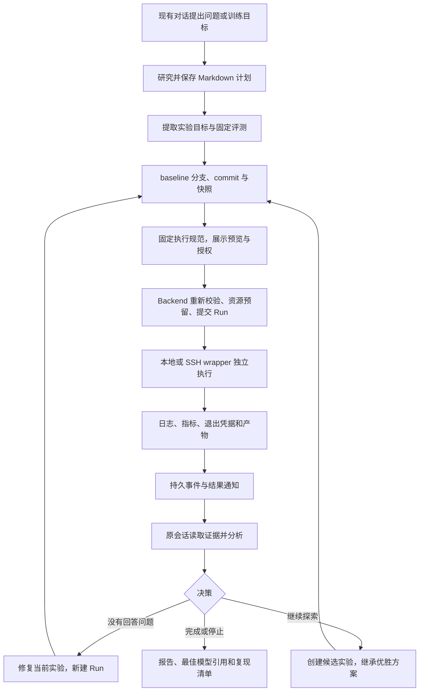
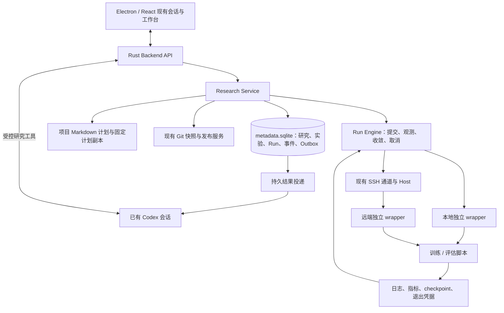

# uTrainerBuddy 研究与模型训练实施方案

日期：2026-11-11

状态：供审阅的实施提案；本文不代表新增功能已经实现，也不启动训练或修改已有执行契约。
依据：当前产品源码、[原生研究契约](docs/research-contract.md)、[研发迭代计划最新基线](研发迭代计划方案.md)、[OpenResearch 工作流解读](OpenResearch工作流解读.md)。

## 1. 可行性与推荐路线

**可行。建议基于已有 Electron/React 工作台、Rust Backend 和 Codex 会话，借鉴 OpenResearch 的实验树、固定快照、独立执行、证据回收和结果驱动迭代。** 当前无需重建聊天、服务器连接或文件发布系统。

首个交付目标是：用户在现有对话提出目标 → 生成项目计划文档 → 审阅一次 baseline 执行方案 → 运行固定代码 → 展示真实日志、指标及产物 → 结果返回原会话 → Agent 基于证据分析。随后增加候选实验、自动迭代与真实 GPU 训练。

沿用现有 A1 → A2 → A3 → A4 顺序。本文建议将 A4 拆为“远端执行前的授权和资源边界”与“后续完整预算/自动研究”，避免在没有执行约束时开放无人值守训练。实际开发前同步更新契约与迭代文档，保留旧版本接口兼容性。

产品使用自己的 UI、对象和状态权威；OpenResearch 作为工作流和实现参考。逐模块引用上游代码时记录 commit、文件、修改和许可证。已撤销的原生 Dashboard 与研究网关路线不重新进入产品关键路径。

## 2. 当前基础与实际缺口

以下是本次源码与记录核对结果；未重跑历史测试。文档中的已通过记录属于已有证据，不等于本次重新验收。

| 领域 | 当前基础 | 需要补齐 |
|---|---|---|
| 首页与会话 | quick/deep 模式、原生 Agent 回合及研究动态工具 | 执行工具、结果回合与可靠投递 |
| 研究计划 | 项目 Markdown 文件、受控读写、hash 冲突检查与历史版本 | 将某个不可变计划版本关联到正式执行 |
| 研究记录 | research_sessions、幂等请求、来源作用域 | 执行研究身份与文件计划的明确关系 |
| 工作台 | 已有计划/运行/产物/动态/文件标签，计划与文件基础 | 运行树、详情、指标比较、真实产物与持久动态 |
| 项目与算力 | Project、ComputeTarget、绑定 revision、SSH 会话 | 执行目标固定、环境检查、资源占用与恢复 |
| 代码版本 | Git 快照、清单、摘要、发布与传输 | Experiment 分支/worktree 管理、Run 固定快照 |
| 远端 Host | 握手、目录边界、分块传输、校验与发布 | 独立任务 wrapper、launch/inspect/cancel/logs |
| 训练执行 | 当前无完整研究 Run 链路，研究工具也明确禁止冒充执行 | 本地执行器、状态收敛、取消和重启恢复 |
| 训练负载 | 可承载用户项目，参考仓库有训练示例 | 产品自己的最小训练配方、指标协议、模型产物规则 |

主要代码依据：

- [研究工具](backend/src/research_tools.rs)、[计划文档](backend/src/research_documents.rs)、[研究记录](backend/src/research.rs)。
- [状态存储](backend/src/store.rs)、[聊天回合](backend/src/chat.rs)、[Codex 适配](backend/src/harness/codex.rs)。
- [项目同步](backend/src/project_sync.rs)、[算力管理](backend/src/compute.rs)、[远端会话](backend/src/remote_session.rs)、[Host](backend/host/src/lib.rs)。
- [项目工作台](frontend/desktop/src/renderer/components/layout/ProjectWorkbench.tsx)、[计划文档组件](frontend/desktop/src/renderer/components/research/PlanDocuments.tsx)。

## 3. 首版产品范围

首版支持一个本地 Git 项目、一名用户、已有 Codex 会话、本地受控训练/评估，以及一台 Linux x86_64 SSH GPU 服务器。训练任务首批串行，研究执行默认逐次审阅。

研究不必全部导向训练：文献调研和方案讨论可以在计划/报告阶段结束；只有存在明确实验问题、代码、评测及授权时才进入执行。

首版交付两种实际负载：

1. 小型 CPU 模型的真实训练与评测，形成可快速重复的端到端验收样例；确定性小程序只用于执行器工程测试。
2. Linux GPU 上的单卡、小模型 LoRA/SFT 验证配方，绑定用户选定的模型、数据与固定评测。具体模型和训练框架在实机资源明确后选择、锁版本和实测，不预先承诺某显存一定能运行。

大模型预训练、多机分布式、Slurm/Kubernetes/商业云适配、自动费用结算、远端 Agent 常驻、多用户调度列为后续独立范围，不作为首版依赖。

## 4. 用户工作流

用户先在“计划”审阅目标、评测和边界。执行预览集中展示具体代码版本、命令/配方、计算目标、数据/模型引用、资源和上限；已有有效授权覆盖的后续执行不重复询问。研究文本、Agent 建议和 quick/deep 模式都不自动构成执行授权。

“运行”展示 baseline、候选及每次尝试；选择 Run 后看到阶段、观测时间、日志、指标、代码差异和产物。“产物”打开报告或下载指定权重。“动态”显示真实持久事件。结果分析仍发生在原有会话中。

## 5. 架构和状态所有权

- Backend 是研究与 Run 状态唯一写入方；UI、模型工具和手动测试走同一服务。
- Markdown 文件继续是可编辑计划正文权威；SQLite 不增设另一份可编辑正文。
- wrapper 拥有实际任务进程及退出凭据，训练与 Agent 回合、SSH 展示连接解耦。
- 指标与产物有各自的收集状态，Run 成功不能代替产物保存成功。
- 本地 Backend 关闭后，已提交的远端任务可继续；自动分析与下一轮需要 Backend 和 Agent 恢复。首版不承诺电脑关机后继续自主研究。

建议按职责增加 `research_execution.rs`、`experiments.rs`、`runs.rs`、`run_engine/`、`artifacts.rs`、`research_outbox.rs` 等模块；文件拆分随实现规模调整，避免提前建设通用调度平台。

## 6. 数据契约

| 对象 | 核心内容与约束 |
|---|---|
| ResearchSession | 复用研究身份，保存来源会话、生命周期、授权和暂停；新执行流程从选定计划显式创建/关联，不为每篇文档自动建研究 |
| PlanSnapshot | 固定文档身份、原始字节摘要与只读副本；已有 Run 永远引用当时版本，后续修改生成新版本 |
| EvaluationSpec | 指标名/单位/方向、数据划分版本、seed、脚本和协议摘要；协议变化建立新比较组，不混排结果 |
| Experiment | research_id、父实验、假设、Git 分支、配方版本、是否已回答；父子不能跨研究或成环 |
| Run | experiment_id、attempt、request_id、固定计划/评测/快照/目标/资产、资源、handle、状态与时间 |
| AssetRef | 数据或模型的目标、路径、只读边界和版本证据；大型外部目录采用清单/固定 revision，说明未全量哈希的限制 |
| Metric | run_id、stage、name、step、value、unit、时间及来源；缺失为 null，非有限值显式标记，不能补零 |
| Artifact | run_id、kind、位置、大小、摘要和可用状态；本地可用/远端可用/待回收/缺失区分 |
| ResearchEvent / Outbox | 单调事件序号、固定通知与批次身份、投递/处理状态；与对应 Run 变化事务提交 |
| ExecutionGrant | 允许的项目、目标、配方、资源、次数、有效期与上限；明确 scope，不把 request_id 当作授权 |

单次授权绑定固定 RunSpec 摘要，其中包括计划、代码快照、配方、评测、目标、资产及资源上限。预览之后这些内容变化则授权失效；范围授权显式列出可变字段及边界，由 Backend 校验。修复重跑同样经过快照、执行规范与授权匹配，不直接跳回提交。

计划文件被编辑或删除，不影响历史 Run 已保存的只读计划证据。旧 research_sessions/plan 数组保留兼容读取，新正式计划继续读项目文件。文档快照是历史执行证据，不是可编辑计划的第二权威。

继续扩展现有 `metadata.sqlite`，按当前 schema v3 增量迁移、备份和回滚测试；不连接历史 OpenResearch 数据库。旧研究数据未来通过独立导入功能处理。

## 7. 实验版本与执行约定

每个实验绑定受管 Git 分支；Agent 在明确的实验 worktree 编辑，运行只使用已提交快照。保护用户原有 checkout，不自动提交用户未审阅的更改。并发分支隔离、依赖环境隔离和快照创建都由后端可核验。

P1 必须适配现有调用链：当前 Agent cwd 来自 conversation.extra.workspace，快照服务读取 project.local_root 且要求指定 commit 等于该目录 HEAD。新增由 Backend 解析的实验工作目录绑定与指定 commit 归档入口；明确原生会话在工作目录变更时的恢复/切换行为，不允许模型传入任意归档根。验收主目录停留在 A、实验 worktree 提交 B 时，Agent 编辑和 Run 快照均对应 B。

在一组可比较实验中保持同一执行配方与评测协议，超参数和模型改动写入版本化配置。基线完成后冻结其已测代码；新假设创建子实验。缺依赖等未回答问题的失败可以修复当前实验，但每次重跑创建新 Run，保留原有 commit 和错误证据。

OpenResearch 用固定 shell 命令表达执行契约；本产品建议使用固定、版本化的 `RunRecipe`：包含 setup/train/evaluate 的 argv、入口、工作目录、环境锁摘要、超时及输出约定。优先显式 argv；确需 shell 时执行已提交脚本，不拼接未验证的模型文本。机密环境通过现有凭据通道注入，不写入快照和日志。

某轮只解决一个决策，例如学习率。下一轮从经确认的优胜方案继续。不同数据划分、评测脚本或训练预算的结果必须标明比较限制；小幅收益需要重复 seed 或额外验证后才能晋级。

## 8. Run 生命周期、恢复与资源约束

首版沿用现有契约的阶段：`queued → preparing → running → succeeded | failed`；派发后取消进入 `cancelling`，只有确认任务已终止才成为 `cancelled`。setup/train/evaluate 为子阶段，不以日志关键词推断终态。

执行阶段与观测联系分别表达。现有契约使用 reconciling/unknown 描述恢复；建议细化为独立观测字段，保留 last_known_state、observed_at、恢复原因，避免断网覆盖实际运行阶段。该变更须先形成兼容契约，不能直接改旧字段语义。

关键实现顺序：

1. Backend 原子记录 Run、幂等请求、授权校验及资源预留，再触发执行器副作用。
2. wrapper 以稳定 run_id 排他写入启动意图；同一提交重复调用返回原 handle，不重复启动。
3. 保存 host instance、启动时间/boot identity、进程身份和日志位置；PID 单独不足以证明同一任务。
4. Backend 重启按原 handle 查询。启动回执丢失先查证；无法确认则标记待核对，绝不盲目重提。
5. 取消保存意图并终止进程树；Windows 使用 Job Object 等生命周期机制，Linux 使用独立进程组及退出凭据。任务脱离控制后仍需检测残留，不能只检查父进程。
6. 接回原 Run 后继续读取日志偏移、指标及产物；文件身份改变重置读取并显示原因，不拼接不同文件。

首批单目标只允许一个训练 Run。事务预留目标/GPU，完成证据和清理确认后释放；未知状态保留占用。GPU 外部进程仍需启动前检查，产品不声称能对所有外部任务提供排他锁。

对长期无法核实的任务提供重新核对、凭证确认终止和显式放弃追踪。放弃追踪不等于已停止进程：保留取消意图和残留任务记录，主机恢复后继续核对；资源和预算通过独立、留痕的核销规则处理，不因 UI 放弃动作自动宣称释放。P0 明确这些操作及状态契约，覆盖服务器重装和执行目录丢失。

本地 wrapper 必须脱离 Backend 进程生命周期运行；“普通子进程测试通过”不足以证明关闭桌面后任务继续。独立验证 Backend 强杀、桌面退出与操作系统重启的不同结果；系统重启通常终止训练，需如实记录而非伪称存活。

## 9. 结果回流与 Agent 自动迭代

Run 终态、结果事件和 Outbox 同事务写入。Outbox 在发起会话空闲、用户队列处理完成后投递，不能打断当前回合或绕过暂停。恢复后重试投递，永久失败保留原因和手动“在会话中分析”入口。

区分 run.terminal 与 evidence.ready：前者报告执行结束，后者表示该配方声明的必要日志、最终指标及清单已可读取。分析回合由 evidence.ready 驱动；失败运行可以错误日志和退出凭据作为就绪条件，无需等待不存在的指标。证据收集持久重试，补齐后去重触发分析；无法补齐时发送明确的证据不足通知。验收训练结束后断网、恢复回收后自动分析的完整路径。

现有 `ChatHost` 有活动回合与忙碌检查，但不能据此假定可靠内部队列已存在。新增持久内部输入与受理接口，复用现有会话调度；以固定 notice/batch/input 身份把“通知确认”与“会话受理”关联。保证逻辑受理去重；不承诺外部模型调用恰好一次，交付结果不明时先查证，不能自动重复有副作用的回合。

通知只携带 Run 身份、状态和证据入口，不把日志内容当成指令。Agent 必须调用证据读取工具后报告结论。新增工具建议为 `experiment_create/list/get`、`run_prepare/submit/get/cancel`、`run_logs/metrics/artifacts`；名字和字段在实现时统一版本化，工具身份仍由当前项目/会话在 Backend 绑定。

默认 Copilot：结果到达后自动分析并提出下一步，启动新训练需要有效授权。后续 Agentic 允许在授权范围内执行修复、补充候选或晋级；服务端检查次数、超时、目标、资源和暂停，不依赖提示词阻止越界。

## 10. 训练、评测和产物

训练配方至少明确：固定模型版本、数据版本与 train/validation/test 划分、依赖锁、seed、训练参数、checkpoint 策略、评测入口及指标方向。Agent 提议的候选不得反复使用保留测试集调参；验证集选型，最终测试单独记录。

首版采用轻量、可验证的文件协议：追加写 `metrics.jsonl`（schema_version/run/stage/metric/step/value）和产物 manifest；Backend 有界增量读取并校验。训练脚本结束前输出最终评测与摘要，wrapper 独立记录退出码。文件协议和可视化服务解耦，后续按需求接 Trackio/TensorBoard，避免首版部署额外指标服务。

训练 Run 可以成功但指标不达标，界面分开显示执行结果与目标达成情况。GPU 利用率和显存是资源观测，不能替代验证 loss、准确率等模型质量指标。

小型日志、最终指标、报告和产物清单自动回收；大型 checkpoint/权重默认保留远端，显式下载后校验摘要。保存 best/last checkpoint 及其评测来源，不默认只保留最后一步。断点续训创建新 Run，固定原 checkpoint 与摘要，并检查配方兼容性。

最终交付包包含计划版本、实验树、代码 commit/快照、环境/资产引用、baseline 与候选证据、最佳 checkpoint 位置、复现命令和限制。仅有训练结束通知不算模型交付完成。

## 11. 分阶段实施与验收

| 阶段 | 交付内容 | 完成门槛 |
|---|---|---|
| P0：执行契约收口 | 对齐文件计划与研究身份、RunRecipe、评测/资产引用、授权预览；更新 docs/research-contract.md | 同一计划版本能生成可审阅的执行规范；旧数据兼容；未授权不启动 |
| P1：A2 本地 baseline | Experiment/Run/事件迁移、受管分支、固定快照、本地独立 wrapper、日志/指标/取消、运行详情 | 实际小模型训练与评测；重复提交只有一个任务；Backend 重启接回；取消证据正确 |
| P2：A3 结果回流 | 持久 Outbox、内部会话输入、证据工具、结果分析和候选实验 | 真实 Agent 提交 baseline、收到结果、读取证据并解释；完成一轮可追溯候选比较；重复通知不双跑 |
| P3：SSH/GPU 受控闭环 | Host 执行协议、资产绑定、远端 wrapper、日志回收、目标资源预留、单次授权与超时 | 真实 Linux GPU 完成一次小模型 LoRA/SFT；断 SSH/关桌面后任务继续，恢复接回同一 Run；远端取消与产物回收通过 |
| P4：有界自动研究与交付 | Agentic 授权范围、预算预留/结算、暂停与恢复、最佳模型和证据报告 | 在固定预算内自动完成 baseline → 候选 → 比较 → 晋级/停止；越限提交被 Backend 拒绝；权重与报告可验证 |

P1 是第一个可使用版本，P2 是第一个智能体研究闭环，P3 才能宣称已交付 GPU 模型训练能力，P4 才能宣称有界自主研究。每个阶段交付 UI、API、持久化、失败路径、用户操作说明和验收记录，不能以只完成后端或静态演示代替阶段完成。

在代码继续可构建、投入稳定且单卡测试环境可用的前提下，粗略工作量：P0 2–3 人日，P1 6–9 人日，P2 5–8 人日，P3 7–12 人日，P4 5–8 人日，总计约 25–40 人日。该估算用于安排顺序，不是排期承诺；硬件获取、模型下载和外部环境故障另计。P0 后依据执行器试验修正估算。

## 12. 授权、预算与暂停

P0/P1 即实现最小执行授权、单任务超时和并发限制。P3 的远端任务由 wrapper 本机强制超时，即使 Backend 断联仍生效。P4 再扩展研究累计 Run 数、GPU 时间和可选估算费用。

预算预留与 Run 提交原子完成；计时从可核验的任务证据计算，未知运行不能直接释放额度。自有 SSH 服务器首版可严格约束分配时长，但无法核验实际电费或云账单；估算金额明确标记，严格费用上限需要提供商计费证据。

“暂停研究”阻止新提交与自动迭代，现有训练继续；“停止 Agent”结束当前会话处理；“取消 Run”请求终止指定任务；“取消所有运行”是单独明确动作。断网取消显示待送达，不能立即报成功。用户重新授权或恢复研究后才继续相关自动操作。

现有 Agent 通用 shell 能力是另一条执行路径：仅约束研究工具无法保证任意 shell 不启动训练。Copilot 首版保留底层工具审批并审阅执行；开放 Agentic 前须确认 harness 能对 shell/SSH/后台启动实施执行策略，无法覆盖时明确限制自主能力范围，不能宣称全局强制预算已成立。

## 13. 验收与失败矩阵

| 层级 | 必测内容 |
|---|---|
| 存储与 API | v3 升级、事务回滚、项目/会话隔离、父实验校验、计划 hash 冲突、同 request_id 不同正文拒绝 |
| 执行 | 重复提交、启动回复丢失、Backend 在提交/启动/终态间崩溃、wrapper 崩溃、超时、取消与自然结束竞争 |
| 环境与资产 | 无依赖、GPU 不存在/被占用、OOM、磁盘满、数据不可读、模型版本变化、checkpoint 不兼容 |
| 恢复 | SSH 断开与认证失效、桌面关闭后接回、目标切换不重定向旧 Run、无法核对时不自动双跑 |
| 证据 | 日志截断/轮转、指标缺失或非有限值、manifest 越界、产物不存在、下载损坏、小文件回收失败 |
| Agent | 忙时排队、暂停不迭代、重复通知去重、会话删除、模型退出和受理结果不明，不编造指标 |
| UI | 从现有入口走完整流程；切项目/会话后旧响应不覆盖；刷新重开、空/失败状态、日志定位、产物 Preview |
| 科学评测 | baseline 与候选协议一致、验证/测试隔离、引用真实指标、波动与不足清楚、可用同一配方复跑 |

协议 fixture 用于契约测试，实际 CPU 训练用于本地闭环，真实模型回合用于 Agent 交互，真实 GPU 训练用于远端能力；四类证据分别记录。用户 GPU 环境验收必须报告服务器、GPU、模型/数据版本、Run ID、指标、耗时及产物位置。

## 14. 建议先实施的任务包

本方案审阅后，首先实施 P0 + P1，不一次性铺开全部平台：

1. 更新执行契约，确定 PlanSnapshot、RunRecipe、EvaluationSpec、AssetRef 和 ExecutionGrant 的最小字段；同步调整现有迭代顺序描述。
2. 新增 Experiment/Run/事件表与同一套 API/Agent 工具入口，建立执行预览和授权检查。
3. 在受管分支提交可运行的 CPU 小模型 baseline，生成不可变快照。
4. 实现本地独立 wrapper 与恢复、超时、取消，接入结构化指标及产物清单。
5. 在现有“运行/产物/动态”标签读真实数据，完成真实训练、重启接回及取消验收。
6. 保存阶段证据，再推进 Outbox、原会话分析和候选比较。

需要在阶段进入前落实的外部条件：P1 的隔离本地项目；P3 的 Linux GPU 服务器与 Host 安装许可、目标模型及数据使用条件；P4 的可接受预算和自主授权范围。这些不阻碍先完成本地受控 baseline。

## 15. OpenResearch 参考对应

| 借鉴能力 | 参考位置 | 本产品落点 |
|---|---|---|
| 实验树与研究决策 | [experiment-tree](opensource/OpenResearch/agent-skills/orx-experiment-tree/SKILL.md) | Experiment + Agent 研究工具和指令 |
| 快照、后台引擎、结果通知 | [experiments.md](opensource/OpenResearch/arc/experiments.md) | 现有快照服务 + 自有 Run Engine/Outbox |
| 会话与工作目录隔离 | [agents.md](opensource/OpenResearch/arc/agents.md) | 现有 Codex Harness + 实验 worktree |
| 验证证据后报告 | [results](opensource/OpenResearch/agent-skills/orx-results/SKILL.md) | 日志/指标工具、证据引用和报告 |
| 独立远端执行与恢复 | [remote.md](opensource/OpenResearch/arc/remote.md) | 自有 Host 协议与 wrapper |
| 自主程度 | [autonomy.rs](opensource/OpenResearch/src/local/autonomy.rs) | Copilot 默认；Agentic 增加服务端执行约束 |

采用的是已核对的流程与不变量；上游具备某能力，不等于 uTrainerBuddy 已集成或通过验收。

## 16. 系统提示词、Skills 与 MCP 的迁移实施

### 16.1 目标与当前差距

将 OpenResearch 的 Agent 工作方法正式纳入产品：系统提示词提供持续上下文，Skills 提供按任务加载的操作流程，工具提供实际能力，Backend 落实身份、状态与授权。提示词和技能与执行器一同交付、版本化和验收。

当前 `research_tools.rs` 有研究指令和计划动态工具，`chat.rs` 拼接 quick/deep 指令；`api.rs` 的 skills、skills/available、mcp/servers 返回空列表，`chat.rs` 拒绝非空 inject_skills。因此现有设置入口和工具调用展示不能视为已实现技能加载或 MCP 配置。

核对上游后需准确区分：

- `SYSTEM_PROMPT.md` 是由项目事实渲染的会话工作指南。
- `agent-skills/` 保存按需加载的研究流程；实验提交主要调用 `orx` CLI。
- `orx mcp` 主要暴露 Agent 协作工具及特定 Harness 的权限桥接。
- `alphaxiv-mcp` 提供文献、研究者和个人文献库能力；其他检索入口也存在于 CLI，不能把所有检索功能都视为现成 MCP。

借鉴后使用 uTrainerBuddy 的工具/API；无需为了沿用技能文本再增加一条 `orx` 执行路径。研究执行动态工具继续直接调用同一 Backend 服务；MCP 接入外部文献及后续协作能力，未来如需把内部工具暴露为 MCP，也只增加协议适配层。

### 16.2 系统提示词：模板化与能力驱动

建议新增 `backend/agent-resources/SYSTEM_PROMPT.md`，由提示词构建器取代散落的字符串拼接。拆为以下部分：

| 部分 | 借鉴内容 | uTrainerBuddy 适配 |
|---|---|---|
| 角色与研究职责 | 调研、假设、实验、证据、交付 | 以当前用户目标推进，普通问题无需建立研究 |
| 项目事实 | 项目身份、工作目录、算力与产物目录 | Backend 注入当前项目、会话、受管 worktree 和实际可用目标 |
| 研究上下文 | 项目状态与实验树 | 固定计划版本、当前实验、相关 Run 与证据入口；大内容按需读 |
| 执行原则 | 提交快照、异步执行、结果分析 | 使用 run_* 工具；只有工具确认才能报告提交成功；evidence.ready 后分析 |
| 环境规范 | 尊重依赖工具、锁文件与环境隔离 | 结合项目配置，不把 uv 或某框架设成硬依赖；依赖安装属于受控配方 |
| 引用规范 | 每个结果可追溯到代码、Run 和产物 | 返回现有 Preview 支持的链接与结构化引用；未接入前不照搬上游 file/run 标签 |
| 技能路由 | 按任务加载对应技能 | 仅列出已安装且依赖工具可用的 buddy-* 技能 |
| 当前模式 | 自主程度与目标作为每轮上下文 | quick/deep 控制研究深度；Copilot/Agentic 控制执行自主程度，两个维度独立 |

每轮注入真实能力清单；尚无 Run 工具时保留“不能执行训练”的限制，P1 工具完成后再替换为受控执行规则。来源材料、日志和历史记录作为数据传入，不插入更高优先级的指令段。项目事实包含观测时间，避免把过期连接状态当成当前就绪。

记录每个回合使用的 prompt_version、skill_bundle_version 和工具 schema 版本，以便解释行为差异。原生线程升级时明确工具重新注册、上下文交接与失败恢复；不只更新 UI 上的版本号。

### 16.3 Skills 迁移清单

以下名称是拟实现的产品资源，不是当前会话已安装的技能。迁移时保留有效研究规则，逐条替换命令、路径和前置条件。

| 上游技能 | 拟迁移技能 | 核心保留与适配 | 阶段 |
|---|---|---|---|
| orx-lit-review | buddy-literature | 主题检索、原文核实、来源与限制；优先可用文献工具，失败才用网页检索；先支持模型研发领域来源 | P0 |
| SYSTEM_PROMPT 中的计划职责 + orx-create | buddy-research-plan | 目标、资料、候选方向、实验步骤、评测、约束；通过现有 research_document_* 保存和修改 | P0 |
| orx-git | buddy-experiment-code | 工作目录校验、差异、提交与快照；绑定受管实验目录，不直接操作用户 checkout | P1 |
| orx-create + orx-experiment-tree | buddy-experiment-tree | baseline、候选兄弟节点、优胜节点晋级、冻结已回答实验、修复另建 Run | P1–P2 |
| orx-compute | buddy-run | 执行预览、授权匹配、预检、提交后结束回合；先 local，P3 加 SSH 指南 | P1/P3 |
| orx-logs | buddy-run-evidence | 按 Run 读取日志、指标与产物，处理截断/缺失/未回收，不从状态推断数字 | P1 |
| orx-results | buddy-results | 验证配置与指标、比较曲线和终值、指出不可比因素，给出修复/补充/晋级/停止决策 | P2 |
| orx-reports | buddy-reports | 按主题组织报告和复现材料，通过受控产物登记关联研究与 Run | P0 文档；P2 运行产物 |
| orx-figures | buddy-figures | 图表规范、源数据与绘图脚本同行；按实际数据选图，不强制每次生成图 | P2 |
| orx-agent-delegation | buddy-delegation | 子任务身份、状态、消息、结果回传和权限继承 | 单 Agent 闭环完成后 |

`orx-paper` 的 LaTeX/PDF、`orx-instances` 的云实例、上游 feedback 和账户管理按产品需求另行引入。首版不把这些依赖写入默认技能索引。实验配方的框架知识作为 buddy-run 的后续参考资源，不能冒充上游已有的通用模型训练技能。

技能目录建议为 `backend/agent-resources/skills/<name>/SKILL.md`，附必要 references/assets 与来源清单。优先通过 Harness 支持的会话级技能目录加载；若当前适配无法可靠支持，则使用只读 `research_skill_list/read` 动态工具按需读取打包资源，并在系统提示词注明调用流程。两种方式选一种经实际回合验收的路径，避免同一技能重复注入。首版先交付内置技能，不把任意上传/执行第三方技能作为前置条件。

### 16.4 MCP 能力分层

| 能力 | 上游参考 | 适配计划 |
|---|---|---|
| 文献搜索与阅读 | alphaxiv-mcp 的 discover_papers、get_paper_content、answer_pdf_queries | 首批只读检索/阅读；核验服务可用性、认证与超时，记录来源 URL/论文 ID 和实际读取范围 |
| 个人文献库 | list_library、list_annotated_papers、get_paper_notes | 用户连接账号后启用；未登录明确显示不可用，不把个人库与公共检索混同 |
| 文献库写入 | save_papers_to_folder、create_folder | 后续按明确用户操作启用，失败显示实际结果 |
| 其他学术来源 | orx discover 的 OpenAlex、PubMed、bioRxiv | 作为可选连接器扩展；先选模型研发相关来源，不强制实现全部学科 |
| Agent 协作 | models、delegate、subscribe、status、read、send、answer、cancel、wait | 后续复用产品会话与持久队列，保持任务、工作目录及权限隔离；单 Agent 研究不依赖此能力 |
| 权限桥接 | orx mcp 的 approve | 仅在对应 Harness 需要时适配；当前原生审批链继续复用，模型不能通过 approve 工具给自身授权 |

文献 MCP 是 P0 的实际研究能力交付项：至少一个真实可用的只读检索/阅读连接器，并完成一次来源可核验的计划生成。提供商能力需在接入时查证，不能仅复制工具名就宣称接通。服务不可用时可以继续分析已有代码/材料，明确证据限制。

新增 MCP 注册/探测/连接状态，接入已有配置界面。区分已配置、已连接、已发现工具和本回合可调用；凭据由后端或原生适配持有，不进入系统提示词。连接变更后的线程刷新需实测，超时、取消、认证失败及 tools/list 失败必须进入可见状态。

内部研究写工具先保留现有动态工具入口，保证项目和会话由 Backend 绑定。后续如提供 `trainerbuddy-research` MCP，复用同一工具 schema 和业务函数，使用会话范围凭证并校验每次调用，不能接受模型自行指定跨项目根目录，也不在同一回合重复暴露两组同名执行工具。

### 16.5 与阶段计划合并

- **P0 增补 Agent 基础能力**：提示词模板/构建器、能力清单、内置技能加载、buddy-literature/research-plan/reports、一个只读文献连接器。交付真实研究 → 引用核实 → 项目计划落盘，而非仅写出 SKILL.md。
- **P1 随执行器启用技能**：experiment-code、experiment-tree、run、run-evidence；同步注册实际已实现的实验/运行工具并适配工作目录。
- **P2 完成研究决策**：results、figures、运行报告和证据就绪后的回合；用真实 Agent 完成至少一次比较与下一步决策。
- **P3 增加 SSH 指南**：固定目标、数据与模型资产、长任务恢复、checkpoint 回收，不在文献技能里混入远端执行操作。
- **P4 完成有界自主研究**：提示词说明授权范围，Backend 强制限制；多 Agent 委派作为后续独立能力验收。

原 P0 2–3 人日只涵盖执行契约收口，不再覆盖本节新增实现。提示词/内置技能加载与真实连接器接入暂增估 4–7 人日，整体暂估 29–47 人日；P0 验证当前 Harness 和服务连接后重新估算。

### 16.6 迁移质量与验收

1. 建立来源清单：每份提示词/技能/资产记录上游 commit、路径、摘要、许可证、适配差异与依赖工具；发布资源来自受版本管理目录，不依赖 opensource 参考目录。
2. 检查所有命令与交叉引用：迁移后的默认技能不能要求不存在的 orx 命令、上游项目 ID、账户、目录或未接入的渲染标签。
3. 实际回合验证按需加载：研究请求读取文献/计划技能，运行请求读取执行/证据技能，普通问答不强制生成计划；记录加载版本与工具调用证据。
4. 同时验证成功与降级：有文献连接时生成可核实引用；未登录、超时、无结果时说明限制，不伪称已读论文；未实现执行工具时不宣称启动训练。
5. 运行与恢复验证：新旧线程工具升级、项目切换、过期工具调用、暂停、重复投递均由后端拒绝或去重；提示词更新不能扩大授权。
6. 检查最终报告：每个实验结论有真实 Run/指标/文件引用；图表有源数据，checkpoint 有位置与可用状态。技能合规只说明流程遵循，科学结论仍由证据支持。

## 17. 2026-11-11 实施进度

继续实施增量：已完成固定 EvaluationSpec、评估器文件快照核对、指标协议身份校验、候选比较 API/Agent 工具与桌面界面；真实 Agent 正确比较两次真实 CPU 训练并给出下一步决定。P2 的研究暂停、通知退避重试、人工恢复和跨重启去重也已完成。当前工具/技能版本 6、schema v5。详见 [候选比较实施记录](reports/desktop/research-comparison-implementation.md) 和 [控制阶段记录](reports/desktop/research-control-implementation.md)。P3/P4 仍未完成。

已按第 14 节优先实施包交付本地受控闭环，并提前接通 P2 的持久结果通知：独立提示词模板、9 个内置技能、真实只读文献 MCP、实验 worktree、固定 Run 快照与批准、本地 wrapper、恢复/取消/超时、结构化证据、桌面运行/产物/动态、原会话 Agent 分析。

真实文献 Agent、真实 CPU 训练、真实 Agent 结果回读、桌面组件验收均已通过。此进度不表示 P0–P4 全部完成：资产/环境/授权契约、远端 GPU 训练和有界自主执行仍需后续阶段。详细代码范围、测试命令、证据与限制见 [本地阶段实施记录](reports/desktop/research-workflow-implementation.md) 及上述增量记录。
