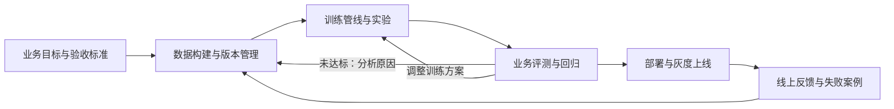

# uTrainerBuddy 产品定位与实施方案

整理日期：2026-11-06  
文档状态：产品讨论初稿，供需求细化、架构设计和首版范围评审使用。

> 2026-11-08 更新：补充论文与代码仓库复现。执行架构以 [OpenResearch 实施方案](基于OpenResearch的智能体模型研发实施方案.md) 为准，采用固定版本研究内核和默认远程工作区；新增产品能力仍需实施验收。

配套技术设计：[技术架构设计方案](技术架构设计方案.md)。已确定桌面端采用 Electron、Backend 采用 Rust，复用外部 Agent 引擎，支持远程 GPU 执行及 Skill/MCP。

配套交互设计：[UI 交互设计方案](UI交互设计方案.md)，定义智能体协作、数据构建、训练、评测及长期任务监控与可观测性。

## 1. 可行性与产品定位

产品具备技术可行性。建议围绕“业务目标或研究指标驱动的模型研发”建设，覆盖数据构建、训练管线、评测、推理上线和持续迭代。

建议定位：

> uTrainerBuddy：从业务目标、研究想法、论文或代码仓库出发，帮助用户复现方法、验证结论并持续改进，交付可追溯实验与成果的模型研发伙伴。

用户无需先提供要复现的论文、方法或模型结果，也无需在创建项目时准备好模型、数据和评测标准。复现是一种可选任务；业务目标、初始参照和评测协议可以在探索中逐步形成。

首版优先打通已有开源模型的微调、评测和上线。从零预训练基础大模型可以作为远期扩展，其数据、算力和工程投入需要单独评估。

Buddy 的核心价值是帮助用户回答并推进这些问题：

- 当前模型为什么没有达到目标？
- 应该优先改数据、训练策略、模型选择，还是推理方案？
- 下一轮最值得做什么实验？
- 实验是否有效，证据是否可信，是否值得上线？

不能只把训练参数放进聊天框。产品应持续产出可检查、可执行、可复现的研发结果。

## 2. 用户分类与四种产品入口

前三类主要反映用户已有资产和准备程度的差异；第四类属于探索性工作方式，可以贯穿前三类场景。建议四种入口共享同一套实验与资产底座。

| 用户类型 | 用户已有条件 | 核心诉求 | Buddy 的首要工作 |
| --- | --- | --- | --- |
| 指标攻关型 | 模型权重、训练数据、评测要求与数据 | 提升榜单精度，争取领先结果或 SOTA | 测量或核验当前表现并分析失分 |
| 业务适配型 | 业务要求、开源模型权重、少量业务数据 | 获得符合业务要求且效果可证明的模型 | 建立业务评测和补数据方案 |
| 从零落地型 | 只有业务要求 | 获得可用的模型或完整业务服务 | 明确验收标准、选择技术路线和候选模型 |
| 研究探索型 | 研究问题、训练方向或策略想法 | 探索有效方法，形成可信结论 | 提出可检验假设并设计实验 |

### 2.1 指标攻关型

典型流程：

> 测量或核验当前表现 → 分析失分样本 → 提出假设 → 设计对照实验 → 执行训练 → 对比结果 → 决定下一轮策略。

仅当用户明确提供复现目标时，增加论文或已有结果的复现任务。建立当前模型的初始参照，不等于必须复现外部工作。

重点能力：

- 按任务、样本难度和错误类型分析失分原因。
- 判断数据、训练配方、模型结构和推理策略的改进优先级。
- 管理实验预算、并行实验和提前终止条件。
- 通过消融实验区分不同改动的贡献。
- 输出可复现配置、模型产物和实验报告。

需要区分模型能力提升与整个评测系统的指标提升。例如增加检索、调整解码或增加测试时计算，也可能提高成绩，应明确记录收益来源和成本。

产品可以帮助用户系统性攻关，不能承诺一定达到 SOTA。应遵守榜单的数据使用规则，设置独立保留集，避免训练数据污染和反复针对同一测试集调优造成的过拟合。

### 2.2 业务适配型

典型问题：模型在业务中不好用，但用户不清楚问题分布，也不知道如何验证训练效果。

典型流程：

> 澄清业务 → 建立任务规范 → 构建小型人工审核评测集 → 测量基线 → 找出数据缺口 → 补数据与训练 → 验收。

以售后客服为例：

| 业务要求 | 可评测内容 |
| --- | --- |
| 正确回答退换货问题 | 政策判断正确性、条件完整性 |
| 输出可以接入业务系统 | 字段准确率、格式合法率 |
| 不乱承诺赔偿 | 越权承诺发生率 |
| 不确定时转人工 | 应转人工场景的识别率 |
| 能够实际部署 | 延迟、吞吐和单次请求成本 |

这一类的关键能力是评测设计与数据补齐。少量真实案例可以作为起点；合成数据需要审核，验收集不能全部依赖同一个生成流程。

主要交付：业务验收标准、版本化数据集、模型、对比评测报告和可调用服务。

### 2.3 从零落地型

Buddy 首先承担业务分析和模型方案设计职责。只有业务需求，不代表应该从零预训练模型，应先验证适合的技术路线。

| 需求特点 | 优先验证的路线 |
| --- | --- |
| 知识经常变化，需要引用来源 | 检索增强与知识库 |
| 输出格式、语气、任务行为不稳定 | 提示词优化，再评估监督微调（SFT） |
| 需要操作业务系统 | 工具调用与工作流 |
| 领域任务能力不足，且能获得有效样本 | 数据建设与微调 |
| 存在明确的领域语言适配需求 | 进一步评估持续预训练 |

典型流程：

> 需求访谈 → 任务与验收设计 → 选择候选模型 → 建立最小基线 → 获取数据 → 对比技术路线 → 训练与验收 → 部署。

必须包含可行性验证阶段。如果任务依赖企业内部知识，却没有资料、历史记录或专家参与，应明确缺失条件。可以先交付原型和数据采集方案，但不能仅凭需求描述证明模型符合真实业务。

最终交付可以是微调模型，也可以是模型、检索和工具组成的完整服务。

### 2.4 研究探索型

建议作为贯穿产品的 Research 模式，允许其他类型用户随时进入。

典型流程：

> 接收方向或想法 → 盘点已有条件 → 按需调研与诊断 → 提出假设 → 设计最小实验 → 执行与观察 → 更新问题或进入验证 → 沉淀研究结论。

探索阶段允许组合变化、调整问题定义，以发现有价值的信号；验证阶段再固定评测协议，进行控制变量、消融和重复实验。不能将“每次只改变一个变量”作为所有开放探索的强制前提。

例如，针对“长尾类别表现差”，Buddy 应提出补数据、调整采样、改变训练目标等竞争假设，为每个假设设计验证实验、资源预算和停止条件。

研究记录必须区分：

- 已有方法或文献结论。
- 针对当前任务提出的假设。
- 当前实验已支持的结论。
- 仍缺少证据的推测。

评价重点是实验的信息价值、结果可复现性，以及是否减少无效尝试。

### 2.5 逐步补齐目标与资产

四种产品入口分别为“提升指标”“适配业务”“从零构建”“探索方向”。用户可以只提供业务描述或研究想法，Buddy 根据当前缺口选择诊断、调研、数据构建、模型比较或小规模实验。

需要区分三个概念：复现目标是可选的外部工作；初始参照是了解当前方案表现；探索目标是希望发现或改善的问题，可以逐步明确。项目应记录已确认要求、暂定假设和缺失条件，评测协议修订后应保留版本并标注结果可比性。

开放探索可以产出有效方法、负面结果或证据不足的结论，不要求所有项目最终都上线服务。

### 2.6 复现研究入口与材料输入

四种入口表达用户目标，论文、代码仓库、模型和数据表达用户提供的材料，两者可以组合。保留统一输入框，增加“复现研究”快捷入口；入口只帮助启动任务，共用项目、Chat、实验、Run、资产与证据，不建立独立执行系统。复现过程中可以转入指标攻关或开放探索。

| 材料 | 可开展的任务 | 首个有价值的结果 |
| --- | --- | --- |
| 论文 PDF、论文链接或标识 | 理解方法、复现指定表格/实验、验证核心结论、独立实现 | 带出处的方法摘要、目标清单与缺失条件 |
| GitHub 仓库链接或已有本地/远端仓库 | 跑通示例、复现指标、迁移数据、修改方法 | 固定 commit 的代码分析、运行入口与最小验证计划 |
| 论文与关联仓库 | 核对论文和实现差异、复现实验、消融与改进 | 论文主张—实现位置—实验验证的对应关系 |

用户可输入：“复现这篇论文的主要实验，只有一张 24GB GPU，先验证核心结论。”Buddy 先分析材料，再补齐必须明确的目标、数据、资源和授权。论文与仓库的关联需要来源证据，第三方实现不能自动标为官方实现；无法读取的资料明确标记待获取，不编造内容。

### 2.7 复现范围、证据与交付

复现约定应明确目标表格/结论、原报告值、数据划分、模型、评测方法、允许偏差、重复实验要求、预算和允许的替代条件。约定可以逐步形成，但用于正式结果比较的版本必须固定。

| 结果层次 | 验收含义 |
| --- | --- |
| 工程跑通 | 环境、程序与输入输出实际工作，不表示达到论文效果 |
| 方法实现 | 核心方法已有实现及检查，注明缺失细节和实现假设 |
| 指标复现 | 在约定可比条件和误差范围内达到目标；注明使用作者权重评测或重新训练 |
| 结论验证 | 对照、消融或重复实验支持指定主张，报告不确定性与适用范围 |

这些结果分别判定，不自动互相推出。缩小模型、减少数据或改变训练预算应标记为缩小规模验证；不可比条件不能用于宣称原指标已复现。可交付忠实复现、部分复现、未达到目标、证据不足或受条件限制的报告，不承诺任意论文都能完整复现。

原始方法的复现 baseline、兼容性修复和算法改进分别留痕；改进进入新实验分支，保留与复现 baseline 的关系。报告包含来源版本、运行配方、变更与偏差、Run/日志/指标/产物引用、比较结果和未解决问题。负面结果、可运行实现和消融报告均可构成完整交付，不强制部署服务。

首个复现场景选用依赖明确、数据可取得、单卡可执行且指标清楚的仓库，随后扩展“论文＋官方仓库”，再验证“仅论文、独立实现”。各类任务都支持标准配方及自定义研究代码。

## 3. 生命周期闭环

| 环节 | 基础平台能力 | Buddy 提供的帮助 |
| --- | --- | --- |
| 需求分析 | 项目、目标和指标 | 判断提示词、RAG、微调等路线，建立基线 |
| 数据构建 | 导入、清洗、标注、版本 | 发现重复、错误标签和样本缺口，提出补充方案 |
| 训练管线 | 配置、调度、日志、检查点 | 推荐训练配方，小规模试跑，解释失败原因 |
| 评测 | 评测集、指标、模型对比 | 找出退化场景，给出有证据的改进建议 |
| 推理上线 | 服务、鉴权、监控、回滚 | 检查部署兼容性、压测结果和发布条件 |
| 持续迭代 | 反馈和样本审核 | 将失败案例整理为下一轮候选训练数据 |

四种入口共同管理以下资产链路：

> 目标或问题与约束 → 假设或方案 → 数据与实验 → 模型 → 评测证据与结论 → 按需部署与反馈。

上述链路允许迭代回退和修订问题，生命周期图表达交付路径，不代表所有项目都必须按固定阶段执行。

第二类用户建立评测后，可以进入第一类的指标攻关；第三类用户建立业务基线后，可以进入第二类流程。

## 4. 技术架构建议

### 4.1 复用研究内核与执行框架，扩展产品领域能力

以下框架为可选负载；Chat、Experiment、Run、恢复与 Outbox 统一由固定版本 OpenResearch 研究内核管理。产品扩展目标、复现约定、资产、预算与证据，不另建任务控制系统。后文早期 Worker/工作流候选不作为当前实施顺序。

| 层次 | 候选选型 | uTrainerBuddy 负责的内容 |
| --- | --- | --- |
| 数据处理 | 优先验证 DataFlow；Data-Juicer 等作为对照候选 | 数据目标与配方、算子适配、质量检查、审核、版本和血缘 |
| 训练执行 | LlamaFactory | 配方生成、任务管理、日志与产物归档 |
| 效果评测 | OpenCompass 与自定义业务评测 | 基线对比、失败分析、发布门槛 |
| 推理服务 | GPUStack 管理推理引擎，例如 vLLM | 模型交付、上线流程、版本回滚 |
| 作业调度 | 初期 Linux 容器 Worker；后期按需接 Kubernetes | 统一任务状态、资源分配和恢复机制 |

GPUStack 可作为推理侧基础设施。训练作业的调度、检查点和实验管理仍需单独设计；存在明确多机训练需求时，再评估 Kubeflow Trainer 等方案。

上述选型属于候选方案，集成前需要验证具体版本下的接口、模型支持和运行兼容性。

OpenResearch 采用固定版本受控派生，作为研究执行内核；DataFlow 仍为数据准备负载候选。不要求首版同时集成所有候选项目，也不要求自定义论文实现转换为标准训练框架。

### 4.2 三层架构

- 交互层：在现有 `frontend/desktop` 上二次开发 Electron + React，提供对话与数据、实验、评测、服务等工作区。
- 控制层：独立 Rust Backend，使用 Tokio/Axum、SQLite，负责会话、Harness 适配、结构化配置校验、持久化工作流、元数据与权限；外部 Agent 负责推理与研究决策。
- 执行层：通过 SSH 与独立 Rust 远端宿主连接 GPU 服务器，运行数据、训练与评测负载；通过部署适配器管理长期服务。

长时间任务必须交给持久化工作流执行，不能依赖聊天会话持续存在。Buddy 的建议应转化为经过校验的配置和任务，并遵守算力预算。

外部 Agent 引擎目标包括 Codex、Claude Code、OpenCode、DeepSeek Harness，通过各自的结构化协议接入。产品内置 Skill 与 MCP 工具调用统一 Backend 应用服务，不能直接绕过业务状态管理。各引擎能力按版本验证，不假定接口与恢复能力完全一致。

默认主链路为 Electron → 本地网关 → 远程研究内核/原生 Harness；执行链路为 Agent → 内核 CLI/工具 → Run Engine → host/wrapper → 实验结果 → Outbox → Agent。远程工作区承担持续研究，桌面离线后按已有授权与预算继续；本地兼容模式不承诺关机后继续 Agent 决策。

### 4.3 当前仓库基础

本次初步查看发现：

- `frontend/desktop`：React 前端，可作为交互层候选基础。
- `opensource/gpustack`：GPUStack 源码，可评估作为推理部署基础。
- `opensource/runtime`：GPUStack Runtime 源码，可评估资源探测与工作负载管理能力。
- `opensource/OpenResearch`：研究工作台与实验运行管理参考，已有本地深度解读。
- `opensource/DataFlow`：数据准备后端候选，已有模块报告与完整算子接口索引。

本次检查为目录、说明文档和部分关键词检索，未进行运行验证或完整代码审计。这些目录的存在不代表生命周期已经集成打通；数据集、训练与实验业务仍需建设和验证。

### 4.4 借鉴 OpenResearch 的实验控制思想

建议分开管理 Project、Experiment、Run、Chat：项目表达业务或研究问题，实验表达待验证假设，Run 表达一次具体执行，聊天记录协作过程。另行管理数据集、模型、评测协议和部署，形成跨对象的来源关系。

优先吸收以下设计：

- 任务阶段与连接状态分开，断网不能直接判定训练失败。
- 先持久化提交意图，提交结果不明时查证原任务，避免盲目重复启动。
- 控制服务与远端训练执行进程分离，界面关闭不应直接终止训练。
- 取消需要停止证据；结果通知和日志回收需要持久记录。
- 每个 Run 固定代码、数据、模型、环境、配置和评测协议；关键约束由程序保证。

同时保留两条执行路径：标准训练路径使用结构化配置和经过验证的配方；自定义研究路径允许 Agent 修改训练代码、损失函数或采样方法。两者共用任务状态、预算、产物和评测管理。

实验树可作为展示方式，但底层应允许数据与策略的合并来源。部署服务有独立生命周期，不应仅作为永不结束的训练 Run 管理。

### 4.5 借鉴 DataFlow 的数据集构建思想

#### 4.5.1 定位与总体流程

DataFlow 的主要借鉴价值是将生成、评分、筛选、改写和训练格式整理封装为可组合算子，并将算子与 Storage、模型 Serving、执行机制分离。建议用于数据准备，不将其视为完整生命周期平台。

数据构建的产品流程为：

> 数据目标 → 数据诊断与来源盘点 → 选择或生成处理配方 → 小样本试运行 → 检查质量与成本 → 批量执行 → 审核与发布数据集版本 → 训练及独立评测 → 调整数据策略。

没有复现目标时，仍可从业务或研究想法出发设计流程。没有真实业务资料时，应先采集、获取或标注数据，不能假定合成可以替代缺失的内部事实。

#### 4.5.2 四类用户的数据流程

| 用户类型 | 数据流程重点 | 主要输出 |
| --- | --- | --- |
| 指标攻关型 | 分析失分，调整数据配比，补充困难样本，比较数据策略 | 候选数据版本与下游效果证据 |
| 业务适配型 | 诊断少量案例，扩展业务场景，生成并审核候选样本 | 可训练数据、来源记录与独立验收数据 |
| 从零落地型 | 定义数据需求，寻找来源、采集或标注，建立样本规范 | 数据获取计划、初始数据集与质量报告 |
| 研究探索型 | 探索合成方法、过滤策略、采样与数据混合 | 可复用配方、实验记录与研究结论 |

#### 4.5.3 用户操作数据配方，底层组合算子

推荐提供以下配方入口：业务文档转问答、历史对话转多轮 SFT、少样本扩充、评测失败案例补数、偏好对构建、清洗及采样策略对比。

Buddy 负责选择和修改配方，专业用户可展开算子、Prompt 与代码。先验证少量关键算子和配方，再扩展覆盖；不将静态索引中的 207 个注册算子直接视为已经认证的产品能力。

算子索引用于能力发现和接口适配，不能仅凭构造签名、自然语言描述或静态写入线索自动生成生产流程。

#### 4.5.4 建立显式算子契约

| 契约维度 | 必须表达的内容 |
| --- | --- |
| 输入与输出 | 字段、类型、必需条件、覆盖和删除行为 |
| 行数关系 | 一对一、一对多、过滤、聚合，以及记录对应关系 |
| 执行范围 | 单条独立、分片内处理或需要全局数据，能否并行 |
| 依赖与配置 | 模型与版本、完整 Prompt、解析器、外部服务和处理参数 |
| 产物 | 数据表、图片、文档、统计报告及其引用关系 |
| 失败与恢复 | 失败状态、过滤原因、可重试范围和外部副作用 |

通过适配层统一这些契约，不能把所有 `run()` 返回值都当作下一节点的数据。执行前检查字段与能力匹配，执行后检查行数、来源关系、样本结构和外部资源可访问性。

#### 4.5.5 快照、血缘与样本级恢复

借鉴阶段快照、检查点和逐条结果账本，记录每条样本的状态、尝试、失败原因与输出。支持只重放失败样本，并在恢复前验证输入和处理配置是否一致。

血缘至少覆盖：

> 来源文档或会话 → 片段 → 生成候选样本 → 审核或修改后样本 → 数据集版本 → 训练实验 → 模型与评测结果。

稳定 ID 应跨阶段保留，扩行记录父子关系，合并记录多个来源；过滤保留可追踪原因。图片、Markdown 等外部文件进入产物清单，不能只保存 JSONL。

发布版本应固定输入资产、算子及配方版本、模型、Prompt、解析器、参数与输出摘要，避免同一版本的内容被覆盖。工作中的阶段快照与正式发布的数据集版本应分别管理。

DataFlow 当前恢复机制有具体适用范围，不自动覆盖所有 Storage、外部文件或分布式执行；在途请求可能重复，不能承诺远程模型调用或计费恰好一次。模型生成具有不确定性，应保留实际输出，而不是只靠配置期待重新生成相同内容。

#### 4.5.6 数据质量与模型效果分别验证

数据质量分数上涨或样本数增加，不能证明业务效果改善。记录阶段输入量、输出量、失败量、过滤原因、质量分布、Token、耗时和成本，并通过下游实验检验配方收益。

例如固定基座、训练配方和独立评测协议，对比原始数据、清洗数据、补充困难样本后的数据版本，分别报告效果和成本。探索阶段可组合策略；确认收益来源时再做消融。

训练与验收数据应按文档、会话、客户等来源组隔离；按任务需要在合成前划分来源组，避免同源样本泄漏。不得用受保护测试集的答案反向合成训练数据。

模型裁判和生成器同源时，评分只能作为筛选信号。关键事实、业务规则与困难案例需要规则验证或人工抽查。

#### 4.5.7 集成边界与首版验证

- 字段依赖图不等于完整 schema 系统，编译通过不代表内容正确。
- BatchWrapper 对过滤、扩行不通用，需要专门验证记录对应关系。
- 分片去重不等于全局去重，全局统计、配对与采样需要相应算法及合并阶段。
- 现有 Pipeline 主要按阶段执行，有图可视化不代表具备任意 DAG 并行调度能力。
- 按目标配方隔离并固定依赖环境，分别验证 CPU、API、本地 GPU 和文档解析组合。

首条集成验证链路建议为：

> 少量业务数据 → 诊断 → 扩充候选样本 → 审核 → 发布数据版本 → 训练 → 独立评测。

验证重点包括样本对应正确、配置变化可识别、中断恢复、失败记录重放、来源可追溯，以及下游效果是否改善。当前报告与索引属于静态分析依据，不代表上述集成链路已运行通过。

### 4.6 候选项目的职责衔接

| 层次 | 主要职责 | 参考方向 |
| --- | --- | --- |
| Buddy 决策层 | 理解目标、发现缺口、提出数据和训练策略 | 自研业务与研究流程 |
| 数据构建层 | 配方执行、质量检查、审核、版本和血缘 | 借鉴 DataFlow，按需比较其他数据框架 |
| 实验控制层 | 固定实验配置、远程执行、恢复与结果反馈 | 借鉴 OpenResearch |
| 训练与服务层 | 执行训练、部署推理与监控 | 接入 LlamaFactory、GPUStack 等成熟引擎 |

Buddy 提出计划，数据后端执行有契约的配方，实验控制层记录训练和评测证据，发布通过验收的模型到服务层。各层通过明确的任务与资产接口衔接。

### 4.7 UI 交互与可观测性产品要求

Electron 桌面沿用现有 React 前端二次开发，以 Harness Agent 协作为中心：左侧管理项目、会话与资源索引，中间始终保留 Agent 对话，右侧提供计划、运行、资产与记录工作台。数据、训练与评测通过对象卡片打开右侧详情，不替换中心会话。右侧可跟随会话或固定监控对象；打开对象与引用给 Agent 分开，切换会话、停止回复或关闭面板都不取消后台任务。全局任务中心用于跨会话找回长期工作。

| 产品区域 | 用户要完成的事 | 关键交互与观测内容 |
| --- | --- | --- |
| 项目入口与概览 | 从目标或想法开始，补齐条件 | 四种入口、已确认要求/假设/缺口、当前证据与待办 |
| Buddy 协作 | 理解行动、补充约束、分析结果 | 计划草稿、工具活动、对象卡片、提问/权限、证据引用 |
| 全局任务中心 | 跨会话找回长期工作 | 按工作区聚合数据/训练/评测，阶段、联系状态、最近确认与可执行操作 |
| 数据工作区 | 设计并验证数据策略 | 配方与试跑、阶段计数、样本前后对照、失败重放、审核、版本和血缘 |
| 实验与训练 | 观察优化过程、比较方案、处理异常 | 指标曲线、资源、日志、事件、配置差异、检查点与续跑 |
| 评测工作区 | 判断效果与证据是否可信 | 生成/评分进度、中间结果、覆盖率、切片、逐样本对照和协议差异 |
| 模型与服务 | 根据验收结果完成交付 | 模型来源、实际产物评测、服务健康、性能与回滚 |

界面始终区分任务阶段、连接状态、指标新鲜度和业务达标状态。断线保留最后确认值并标注时间；程序执行完成不自动表示效果达标。动态扩行和探索任务不伪造整体百分比，未知指标不填零。

“停止 Buddy 回复”“暂停后续自动推进”“取消训练任务”“从检查点续跑”分别设计，按实际能力显示。取消请求和确认停止分开；运行中修改参数通常创建新 Run。已有授权范围内的普通动作不增加逐步确认流程。

长任务监控包括阶段/样本进度、质量、模型调用、训练指标、资源、预算、日志和重要事件。告警具备证据、去重、待办与恢复入口；用户可将选中的样本、曲线时间段和日志片段交给 Buddy 分析。

本地应用停止期间，远端任务继续记录结果，但本地通知和下一轮 Agent 决策暂停。重连后核对任务并展示离开期间变化；全天候自主研究与告警依赖后续远程工作区。详细页面线框、指标口径与交互验收见 [UI 交互设计方案](UI交互设计方案.md)。

## 5. 关键工程要求

### 5.1 数据可信

- 隔离训练集、验证集和测试集。
- 防止同一文档、同一会话的近似样本跨集合泄漏。
- 文档生成训练问答时保留来源，并安排人工抽查。
- 自动生成的数据不能直接视为正确答案。

### 5.2 结果可追溯

每个上线模型应关联：

> 基座版本＋数据集版本＋训练配置＋代码或镜像版本＋模型产物＋评测报告。

LoRA 产物还需记录基座、tokenizer 和聊天模板。导出后的实际部署产物需要重新验收。

### 5.3 评测有业务意义

除通用能力外，还应检查业务成功率、关键类别退化、延迟、吞吐和服务成本。LLM 评分可以辅助，关键案例需要规则或人工复核。

### 5.4 执行可靠

作业需要支持取消、超时、重试、检查点恢复和资源释放。重试与续跑应明确区分，避免重复执行造成产物或实验记录混乱。

## 6. 首版范围与优先级

### 6.1 用户优先级

建议以第二类“业务适配型”为主要服务对象，同时具备第一类“指标攻关型”的实验与评测底座。

- 第二类更能体现 Buddy 补齐用户能力的价值。
- 第一类可检验系统的专业性、可复现性和诊断质量。
- 第三类先限定一个行业或任务，降低需求与验收的不确定性。
- 第四类先支持有边界的假设验证，逐步扩展研究探索能力。

### 6.2 推荐首版支持范围

- 选择一个具体场景，例如客服意图分类、结构化信息抽取或标准回复生成。
- 文本模型，限定一个模型家族和一两个经过验证的规格。
- JSONL/CSV 导入、格式转换、去重和人工抽查。
- 验证一条 DataFlow 数据配方，覆盖小样本试跑、候选生成、审核、版本发布、血缘和失败恢复。
- SFT 与 LoRA/QLoRA，单机单卡或单机多卡。
- 固定业务测试集，支持基座与微调模型对比。
- 候选模型部署为 API，支持健康检查、基础压测和回滚。
- 线上失败案例经过审核后进入下一轮候选数据集。
- 全局任务中心与数据/训练/评测独立详情页，提供进度、指标、日志、证据和最近确认时间。
- 一条可观察的长任务闭环，覆盖离开页面、断线、应用重启、取消未确认、中间评测与结果回收。

从零预训练、多模态、大规模强化学习和跨云多集群调度，待基础闭环验证后逐步扩展。

### 6.3 首版验收场景

> 导入一份真实业务数据，建立基线，完成一次微调，展示独立测试集上的提升与退化，部署可调用 API，并能回滚和复现整次实验。

研发流程跑通与模型效果达标应分别验收。即使某次训练没有提升，也应能完整记录结果、解释证据并给出下一步实验建议。

### 6.4 周期估算

在复用开源引擎、限定模型与硬件、有真实数据和可用算力的前提下，小团队首个试点可粗估为 8–12 周。

这属于初步规划估算，尚未经过详细工作量拆解。企业级多租户、高可用和异构硬件适配需另行评估。

新增 DataFlow 与 OpenResearch 借鉴项需要纳入工作量拆解；上述周期不表示已覆盖两者的完整集成或全部算子支持。

UI 工作区、指标采集与存储、告警及长期监控验收也需纳入工作量拆解，首版按配套交互方案的 P0 范围交付。

## 7. 产品价值验证

首版应通过真实任务验证：

1. 用户是否愿意反复使用“失败分析 → 补数据 → 再训练”的流程？
2. Buddy 是否比用户自行组合工具更省时间，并减少无效实验？
3. 效果提升是否能在独立业务测试集上稳定复现？

建议以“评测驱动的微调 Buddy”切入，先在一个业务场景中证明持续改善模型的能力，再扩展更广的生命周期支持。

## 8. 后续需要明确的产品决策

- 首批试点客户、业务任务与验收指标。
- 部署形态：本地、私有化或托管服务。
- 首版支持的模型、GPU、操作系统与资源规模。
- 用户数据的获取、审核与持续维护方式。
- 单次实验和项目总预算，以及任务执行权限。
- 业务效果、开发效率和实验可信度的验收方式。

这些事项目前属于待细化决策，不应视为已经确认的需求。

## 9. 参考资料

以下项目与本地分析文档用于方案参考。具体集成能力应以选定版本及实测结果为准。

- [UI 交互设计方案](UI交互设计方案.md)：页面、智能体协作、长期任务监控、观测契约与验收。

- [DataFlow 模块深度解读报告](reports/DataFlow/模块深度解读报告.md)：架构、算子领域、执行、恢复及集成边界。
- [DataFlow 算子完整接口索引](reports/DataFlow/算子完整索引.md)：207 个显式注册算子的静态接口资料。
- [DataFlow 可靠 JSONL/CSV 处理说明](opensource/DataFlow/docs/resilient_jsonl_processing.md)：检查点、样本账本与恢复范围。
- [OpenResearch 项目深度解读](OpenResearch项目深度解读.md)：实验控制、Agent 与远程运行架构。
- [OpenResearch 实验与计算架构](opensource/OpenResearch/arc/experiments.md)：实验、快照、任务状态与通知机制。

- [Data-Juicer](https://github.com/datajuicer/data-juicer)：数据清洗、合成和分析。
- [LlamaFactory](https://github.com/hiyouga/LlamaFactory)：模型微调与训练方式支持。
- [OpenCompass](https://github.com/open-compass/opencompass)：模型能力评测。
- [GPUStack](https://docs.gpustack.ai/latest/)：推理部署与 GPU 管理。
- [vLLM 在线服务](https://docs.vllm.ai/en/latest/serving/openai_compatible_server/)：模型推理服务与兼容 API。
- [Kubeflow Trainer](https://trainer.kubeflow.org/en/latest/)：Kubernetes 原生分布式训练。
