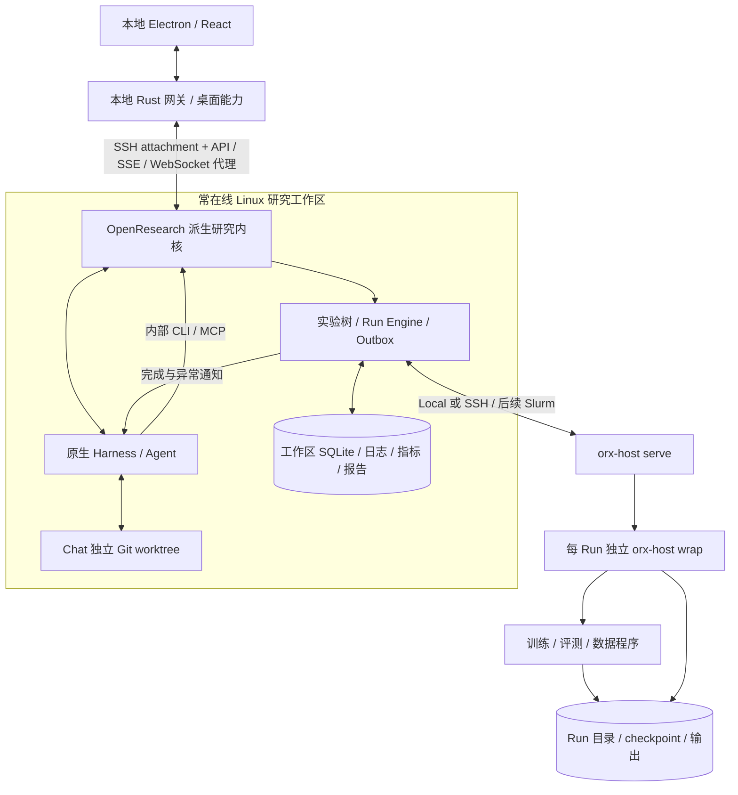

# 基于 OpenResearch 的智能体模型研发实施方案

日期：2026-11-08  
状态：实施基线；本文的新增能力均需按阶段验收，不能视为已经实现。  
目标：用户给出模型能力目标后，由 Agent 主导诊断、提出假设、修改代码、运行训练与评测、读取证据并继续迭代。

## 1. 架构决策与方案优先级

采用 **OpenResearch 研究内核的固定版本受控派生 + 现有 Electron 工作台 + 默认远程工作区**。

完整采用它的研究执行模型：Project → Chat/worktree → Experiment tree → commit snapshot → Run Engine → independent wrapper → receipts/logs/metrics → transactional outbox → Agent 下一回合。

实现策略优先直接集成可构建、可运行的 OpenResearch 内核及 CLI、host，保留其冻结协议和原生 Harness；避免按照架构文档另外手写一套简化研究引擎。初期内部命令保留 `orx` 及 `ORX_` 协议字段，产品界面使用 Buddy 名称。后续模块抽取只能在契约测试保护下进行。

现有 Electron/React 保留；现有 Rust Backend 逐步承担本地网关、桌面兼容和历史数据访问。远程研究工作区内，聊天、实验与 Run 的唯一权威来自研究内核，不并行维护另一套可写任务数据库或 Agent 回合系统。

本文件替代《本地项目与 GPU 服务器协同实施方案》中“先文件发布、后训练、最后远程工作区”的实施顺序，并覆盖《技术架构设计方案》中与本文件冲突的部署、Workflow 和阶段安排。旧文档继续作为历史设计及现有代码说明，不删除原有记录。

“完全参考”指研究内核、执行语义、恢复契约和 Agent 驱动方式保持一致；首版聚焦自有 Linux GPU 与 Codex，不要求同时接入论文社区、商业云计费、Overleaf 和所有云计算适配器。Unsloth、LlamaFactory、DataFlow 等作为可选实验负载，不作为第二套任务控制系统。

## 2. 源码基线与复用边界

本地参考仓库：`opensource/OpenResearch`。固定上游：`https://github.com/alphaXiv/OpenResearch.git`；基线 commit：`52a3ca22971f4042da4c73f1f3fca8e04aca9089`，本地包版本 `0.2.24`。实施以该 commit 为准，线上 main 的行为可能不同。

上游稳定版/开发版默认不启用新 Run Engine；本产品明确选择新 Engine 路径，测试和部署必须显式开启并验证。已有 OpenResearch 历史 supervisor 的兼容逻辑可保留在派生内核，不能因此在本产品为新 Run 再造第二条启动路径。

| 领域 | 直接依据 | 实施要求 |
| --- | --- | --- |
| 实验树与快照 | `arc/experiments.md`、`src/compute.rs`、`src/local/experiments.rs` | 继承固定运行契约，快照绑定 commit |
| 聊天与 Agent | `arc/agents.md`、`src/local/chat/`、`src/local/harness/` | 原生 Harness、回合租约、队列、恢复与权限 |
| Agent 研究规则 | `SYSTEM_PROMPT.md`、`agent-skills/orx-experiment-tree/` | 注入项目上下文、实验/结果/日志技能与证据引用 |
| 工作区与常驻服务 | `arc/remote.md`、`src/commands/up_remote.rs`、`remote_host.rs` | ensure/attach、SSH 网关、实例和协议验证 |
| 任务引擎 | `src/engine/` | Reconciler 单写、Observer、持久 handle、恢复与取消 |
| 执行宿主 | `crates/orx-host`、`crates/orx-host-proto` | serve 随通道，wrap 随任务，保留完整凭据语义 |
| 协议与持久状态 | `crates/orx-host-proto/FROZEN.md` | 文件名、phase/contact、历史字段、旧读写兼容 |
| 指标与结果 | `src/local/trackio.rs`、`arc/experiments.md` | 指标关联实验/Run，日志与报告作为证据 |
| 通知与继续研究 | `src/local/chat/`、`src/engine/reconcile.rs` | 状态和 Outbox 同事务，聊天空闲时交付 |

生产依赖不能指向当前被忽略的 `opensource/` 目录。固定源码、构建脚本、发布清单和必要补丁需形成受版本管理的依赖入口；本地参考 clone 仅作为开发缓存。采用的源码保留上游版权与 LICENSE，记录来源 commit、补丁及构建摘要。具体第三方文件的许可随源码清单保留。

## 3. 用户实际使用过程

1. 连接或打开一个研究工作区；远程工作区首次检测并安装研究内核，验证 Agent 和 Python/GPU 环境。
2. 打开服务器已有 Git 项目，或明确导入本地项目；选择服务器已有的数据和模型。无需先把全部数据搬到电脑。
3. 用户描述目标，例如“提高业务评测准确率，并控制训练 GPU 时间”。未知数据、指标和预算由 Agent 逐步澄清。
4. Agent 在自己的 worktree 检查代码，建立固定评测协议及 baseline，提交一次真实运行。
5. Agent 结束当前回合等待结果；后台独立执行，界面展示任务、日志、指标和观测时间。
6. 结果持久化后自动通知发起 Chat；Agent 读取真实日志和指标，解释差异，创建下一轮实验。
7. 达到目标、触及预算、需要权限或证据不足时进入明确状态，形成报告和可复现实验记录。

用户仍可查看代码、干预研究和手动运行实验，但不必逐次操作安装、发布、轮询、下载和复制结果。

## 4. 部署与所有权



首版研究内核、Agent 与 GPU 可在同一台 Linux 机器，执行使用 Local adapter，无需为了本机 GPU 再套一层 SSH。工作区主机与 GPU 主机分离时切换 SSH adapter；以后增加 Slurm 不改变 Agent 的实验模型。

| 对象 | 权威位置 | 本地退出后的行为 |
| --- | --- | --- |
| 桌面界面与网关 | 用户电脑 | 可以停止，不拥有远端任务 |
| Chat/Experiment/Run/Outbox | 所选工作区 Backend | 常驻工作区继续管理 |
| Agent 工具进程、原生会话与凭据 | 工作区所在机器 | 独立于本地 attachment；等待用户权限时保持待办 |
| Git 仓库和 Chat worktree | 所选工作区 | 版本固定，本地不持有另一份默认权威副本 |
| 训练进程与退出证据 | 计算节点的 wrapper | 独立于 SSH、Agent、工作区 Backend |
| 数据、权重与检查点 | 计算节点或已绑定资产存储 | 明确引用和传输，按需导出 |

必须分别区分“工作区连接”和“计算目标连接”，也区分“Agent 使用的推理模型”与“实验正在训练的模型”。在服务器运行 Agent 需要该服务器的安装、登录与网络条件，不能假定自动继承本地登录。

本地工作区模式保留为兼容选项；其电脑关机后仅已提交的远端训练继续，不承诺 Agent 自动开展下一轮。持续研究的默认入口为远程工作区。

## 5. 远程工作区生命周期与连接

按上游 remote-host 机制实现发现、安装、ensure、attach、detach 和显式 stop。

- 一份远端数据目录仅一个研究内核；启动锁与 Engine 锁共同防止双实例。SQLite 放节点本地支持锁的磁盘，不将 WAL 数据库默认置于 NFS。
- 远端服务默认 loopback；本地通过 SSH 转发和带 attachment 凭据的网关访问。网关代理 API、事件、文件及 WebSocket，不让 Renderer 持有远端 bearer token。
- 连接校验真实 instance、工作区、Dashboard/control 协议；host Hello 额外校验准确版本及二进制 SHA。端口打开不等于工作区已就绪。
- 本地断开只撤销 attachment，不能关闭远端内核、Agent 或 Run。服务消失显示事实，不静默创建另一个实例掩盖运行中断。
- Windows 采用上游 SSH service/持久认证机制，Unix 采用它已有的认证共享方式；认证失败进入 NeedsAuth，不自动反复尝试密码。
- 安装确认展示二进制、数据、缓存路径和具体版本；确认后执行，升级前检查活动和兼容性。更新 serve 不替换已运行 wrapper。
- stop 工作区必须展示会影响的 Agent、队列、权限和任务；复核活动改变则重新展示，不把“断开”实现为“停止”。

网关缓存键至少包含 workspace identity、instance、资源 ID 和 revision。重连对同一工作区查权威快照，切换工作区不复用另一个工作区的 project/chat/run ID。

## 6. Agent 主导的研究模型

### 6.1 实验树

Git 保存代码，工作区数据库保存实验父子关系、假设、说明、运行命令和结果引用。Chat 有独立 worktree；Run 运行归档，不触碰 Agent 的开发目录。

baseline 固定运行命令、环境和评测协议。并列假设是同一父节点的子节点；下一轮从上一轮有证据支持的候选继续。已回答问题的节点冻结，即便结果较差或为 NaN 也保留；启动失败、尚未回答问题的节点可修复代码后创建新 Run，不能重写旧 Run 的 commit。

```text
baseline：固定模型、数据划分、评测和训练入口
  ├─ 实验 A：学习率方案 A → Run A → 证据
  └─ 实验 B：学习率方案 B → Run B → 证据
        ├─ 实验 C：在 B 上调整数据配方 → Run C
        └─ 实验 D：在 B 上调整采样策略 → Run D
```

评测协议、数据切分、模型基座或比较口径变化时，记录新的 contract/lineage，必要时建立新 baseline；不能混入同一排行榜宣称提升。模型能力提升以固定验证/测试协议为证据，loss 降低本身不代表业务达标。

### 6.2 工具与上下文

Agent 使用内核 CLI 执行项目、实验、Run、日志和指标操作；MCP 采用上游能力提供的委派、订阅、提问和协作工具。不要假定每个 CLI 动作都有同名 MCP 工具。所有入口落到同一权威研究服务。

先接通现有 Codex 用户路径，再复用上游 Claude Code、OpenCode、ACP 等 Harness。能力按实际安装、认证、权限和协议宣告；不把不同引擎的原生事件伪装成相同协议。

每回合注入 workspace/project/chat 身份、worktree、当前目标、实验状态、计算默认值、产物目录与预算。按上游规则加载实验树、执行、日志和结果技能；接入模型训练/数据/评测配方时增加专项技能。

提交 Run 后结束回合，不用长时间阻塞 shell 等待训练。研究决策仍由 Agent 完成，服务端只负责执行事实、通知、资源与预算约束，不新增一个硬编码的“自研思考循环”或要求所有探索先填写 DAG。

### 6.3 回合与研究恢复

持久化 Chat 消息、输入队列、turn lease、native session、prompt delivery 状态。未知是否已交付的回合不能重放原请求；沿用 retry/continue 区分与用户恢复入口。原生会话丢失时用有界历史恢复，不声称原始上下文完整。

Run 完成通过 Outbox 触发新的结果分析回合，与恢复崩溃的旧回合分开。用户已停止研究或预算耗尽后保留通知，但不能据此自动启动新实验。权限等待、Agent 未认证和需要用户决策都有持久待办。

## 7. Run Engine 与执行协议

### 7.1 唯一执行路径

新 Run 只进入 OpenResearch 新 Engine：先持久化提交意图，再进行外部副作用。Reconciler 为 Run 状态单一写入者，Observer 提供证据，handle 负责重连后的定位，CLI/Renderer 不直接写 Run 状态。

首版实现并验收 Linux Local 和 SSH；Slurm 为后续适配器。保留 Backend 的 launch/recover/observe/cancel/logs 接口，不把训练框架 API 当作生命周期权威。

### 7.2 状态语义

| 维度 | 规则 |
| --- | --- |
| phase | 沿用内核 submitting、starting、running、done、failed、cancelled、lost；排队和 staging 另行展示，不能随意增加到冻结状态字段 |
| contact | live、unreachable、needs_auth、unreconciled、stopping；不因断线改变 phase |
| 训练子阶段 | 下载、准备数据、加载模型、训练、评测、保存；只是负载进度，不能改变退出事实 |
| 业务结论 | 可比较、提升、退化、不确定；独立于退出码和 phase |

主机识别包含 node、boot_id、pid/starttime。远端重启、PID 复用、共享目录上的其他节点均按真实证据判断。

### 7.3 wrapper 与至多一次启动

直接复用 host/proto 的 launch.json、wrapper.json、started、cancel.req、exit.json、cleanup.json 和锁契约。先写启动意图并固定摘要，独占 fsync 的 started 禁止第二次启动；started 存在不等于 payload 一定启动。

回复丢失时先 recover：Found 接回同一 handle；Absent 仅在有权威证据证明无任务且不会随后出现时允许原意图恢复；Unknown 保持 unreconciled。禁止用简单超时、PID 不见或缺一份文件来自动重跑。

取消保存意图，wrapper 实际停止并提交证据。残留进程保持 stopping/cleanup 义务，不能把按钮已点击标成“已停止”。从检查点继续是新 Run，显式关联源 Run/commit/checkpoint；不清除旧启动栅栏。

## 8. 结果通知与自动继续研究

Run 的 terminal/attention 事实、订阅和待通知记录在同一事务落库。Outbox 固定批次和 client_turn_id，失败后按该身份恢复，防止同一结果重复唤醒产生重复实验。

首版完成发起 Chat 的订阅和唤醒；后续接入其他 Chat/子 Agent 订阅。系统结果作为来源明确的数据交给 Agent，不能把负载日志当作系统指令。

Agent 在后续回合先核对 Run、代码版本、日志、评测和产物，再写结论、更新实验说明并决定子实验。通知已入队、已被 Harness 接收、分析已完成是不同事实，UI 分别展示失败位置。

“恰好一次”仅限上游的通知身份和交付去重契约，不承诺任意模型判断或工具副作用天然恰好一次。

## 9. 文件、环境与模型资产

默认远程工作区的仓库、worktree、实验、数据和模型在服务器。已有远端项目直接打开；本地项目明确导入，保留导入来源和 commit 映射，不复制 SQLite 或假定本地 Agent session 能在服务器原样续接。

Run 接收一个 commit 的不可变归档，在专属 repo/ 执行；复用内容摘要缓存和分块暂存。用户通常点击“运行实验”或授权 Agent 运行，准备、暂存、执行组成同一过程，无需另点“发布代码”。

当前 v1 文件发布记录只保留为历史快照/传输记录，不能转换成已运行实验；已发布目录不直接充当活跃 Run 的可写目录。

框架环境由固定依赖文件、显式 venv/容器及环境摘要描述；Chat 环境与 Run 环境可分开，Run 必须可从提交配方重建。训练与评测不能依赖 Agent 某次交互中临时安装的包。

数据与模型以绑定路径、内容/版本证据和可用性引用。优先引用服务器已有资产；大权重不经 Renderer，下载和导出为独立任务。检查点需要可恢复性验证，LoRA 记录基座、tokenizer、模板、adapter 和导出来源。

## 10. 监控与可观测性

沿用 OpenResearch 的运行事实、日志保全、Trackio 和 Agent 指标读取；GPU 时序与标准训练回调是本产品的负载扩展，不能声称上游 host 已自动提供所有训练指标。

| 证据 | 生产者 | 权威存储与消费 |
| --- | --- | --- |
| 启动、退出、取消、残留进程 | host/wrapper | 原子凭据 → Observer → Reconciler → Run |
| stdout/stderr 与诊断 | payload/wrapper | 计算节点 log/wrapper.log；按 FileIdent 与 byte offset 读取和保全 |
| loss、eval、吞吐、学习率等 | 训练框架回调/实验程序 | Trackio 或受版本管理的专项适配；Agent `metrics` 与图表 |
| GPU/CPU/内存/IO | 计算节点采集器或框架已有采集 | 带节点、GPU UUID、Run 映射、时间戳和采集状态的历史序列 |
| 报告、模型与检查点 | 实验程序与 Agent | 产物清单、摘要、Run/commit 来源与版本引用 |

同机运行优先工作区内可访问的 Trackio；跨计算节点时明确选择可达的指标服务或可回收的节点本地记录。不能把工作区的 127.0.0.1 指标 URL 原样交给另一台 GPU 节点，也不默认发布到外部 Space。

图表显示采集时间、数据缺口和降采样口径；无数据与零值分开。GPU 进程/多卡 rank 映射不能仅凭“当时显存增加”推断。loss、GPU 采样都不能单独将 Run 标记成功。

UI 的 SSE/WebSocket 是实时通知，断线后查询权威快照及持久指标；不将上游 SSE 当作可永久重放的遥测日志。日志换文件身份则重置，不拼接两个文件；无法获取也没有保留副本时返回明确不可用，不能显示空日志伪装成功。

结束任务仍有日志保全与产物回收义务。保全失败持续显示并重试，远端唯一副本在满足保留条件前不得清理。

## 11. 自主研究的授权与预算

首版采用可恢复的 ResearchSession 产品扩展，引用内核 Chat、实验和 Run，保存目标、评测契约、预算及停止条件；它不另行驱动一套模型循环。

用户可授权单实验、有限研究轮次或预算内持续研究。服务端按策略约束新 Run 的数量、并发、GPU、最长时间、模型调用额度和允许的路径/命令；不能仅在提示词中写预算。无法精确计量的项目展示口径和未知量，不伪造精确费用。

暂停研究只阻止新分析/新实验的自动调度；停止 Agent 回合、取消 Run、断开工作区、从 checkpoint 续跑分别操作。停止研究不默认杀掉所有已提交训练。

超预算、权限等待、环境不兼容、连续基础设施失败、评测不可比较或候选证据不足时，持久化原因及恢复入口。用户 steering 优先于后台结果分析，通知合并遵循 Chat 队列和交付契约。

多 Agent 按上游委派/订阅/权限继承接入，作为研究扩展；首个闭环先验收单 Agent，随后验证独立 worktree 的并行假设。共享 worktree 的 side chat 不能当作任意并发写文件安全保证。

## 12. 模块、API 与数据边界

| 部件 | 负责 | 不负责 |
| --- | --- | --- |
| Electron Main/Preload | 窗口、选择文件、启动/接入网关、通知 | 训练调度和结果判断 |
| 本地 Gateway | 工作区 attachment、原点代理、协议/实例检查、桌面兼容 | 写远端 Run DB、重建 Agent 循环 |
| Research Core | 原生 Chat/Harness、Git、实验、Engine、Outbox、权威 API | Renderer 的展示状态 |
| host serve/wrap | 接收不可变意图、执行与提供证据 | 基于聊天决定下一实验 |
| 训练/评测 adapter | 配方、环境、metrics/checkpoint 契约 | 宣称未查证的退出/取消事实 |

首阶段保留内核原生 API 和 SSE，并由网关适配现有 UI DTO。`POST /api/v2/runs` 等上游已有接口以固定源码为契约；Chat、实验、指标、事件和 attachment 的完整路径需在 M0 生成接口清单并验证，不凭本文虚构路径。

为先验证完整内核，M1 允许在 Electron 内提供独立的原生研究窗口，直接使用同一固定版本的上游 Dashboard，现有主界面和历史聊天继续保留。该窗口属于过渡接入，不表示旧聊天已迁移；项目、Agent、实验和远端连接均由该内核管理。完成原生用户闭环后再分批适配现有工作台，不能为提前统一外观裁掉恢复、权限或实验能力。

兼容 DTO 必须保留原生消息、Run/Chat 身份、phase/contact、未知字段和证据链接；不能用旧前端成功/失败两态抹掉不确定性。工作区资源查询全部携带工作区作用域。

ResearchSession、资产和训练专项字段采用内核扩展表/API；不得直接把现有 metadata.sqlite 表解释成 orx.db schema。不存在的历史任务不凭发布记录补造。模型/指标的业务索引引用同一 Run ID。

### 12.1 论文与 GitHub 仓库复现扩展

2026-11-08 补充，以下能力为待实施范围。产品支持业务目标、研究想法、论文与代码仓库等组合输入，保留四种目标入口并增加“复现研究”快捷入口。所有任务落到同一 Project/Chat/Experiment/Run，不另建复现引擎。

1. 获取并固定来源：论文原文版本及摘要、仓库 commit、关联代码与权重出处；PDF 解析保留页码、表格和章节引用，缺失或识别不确定的内容明确标记。
2. Agent 盘点方法、代码入口、依赖、数据、模型、评测及 GPU 条件；区分原文事实、README 声明、实现假设和已测结果。
3. 形成版本化复现约定：指定表格/实验/结论、比较口径、原报告值、容许偏差、重复要求、预算和允许替代条件。缺失条件按执行需要逐步补齐。
4. 通过内核提交最小试跑、baseline、正式复现和消融；标准框架与自定义代码共享不可变快照、环境证据、wrapper、日志和指标契约。
5. 结果经 Outbox 到达原 Chat，Agent 先核对证据，再修复、继续实验或报告；算法改进建立新分支，与原方法复现区分。

产品扩展保存 SourceMaterial、ReproductionContract、方法/代码映射、偏差与 Evidence/Finding，关联内核身份，不镜像可写 Run 状态。约定变更保留历史 revision，既有 Run 的代码和评测来源不被覆盖。逻辑字段及边界见 [技术架构设计方案第 19 节](技术架构设计方案.md#19-论文与代码仓库复现架构)。

工程跑通、方法实现、指标复现、结论验证分别判定。作者权重评测不代表重新训练复现；缩小规模或替代条件不自动代表论文指标可比。报告逐项说明已复现、未达到、不可比、证据不足与受条件限制的内容，并关联实际 Run、日志、指标和产物。研究可交付负面结果或可运行实现，不强制部署。

读取材料不自动授权执行仓库脚本。材料与日志作为数据处理；执行遵守现有授权、预算和隔离策略，不能利用第三方仓库指令扩大权限。解析材料、环境准备与下载有独立失败和恢复记录，未知依赖不通过伪造默认值掩盖。

## 13. 当前实现迁移

| 当前能力 | 迁移方式 |
| --- | --- |
| Electron 与聊天/工作台 UI | 保留组件，新增工作区作用域与内核适配 |
| 原生 Codex 接入 | 作为当前兼容路径保留；新研究工作区切到内核 Harness，完成消息/工具/权限/恢复验收后再切默认 |
| metadata.sqlite 本地项目与聊天 | 完整备份；历史本地工作区可读，导入新工作区需显式映射，不合并两份运行数据库 |
| SSH 配置、askpass 与探测 | 作为迁移输入和浏览兼容；统一到上游 workspace/compute 连接管理后避免双重认证与两套重试 |
| Python 只读文件协议 | 旧连接兼容入口；新工作区走内核文件 API，新训练执行不依赖这条 Python 通道 |
| 自研 trainerbuddy-host 发布协议 | 保留已部署记录与只读能力；新 Run 使用原生 orx-host/proto，不让两协议共写一个 Run 目录 |
| Git 快照、transfers 和发布 UI | 历史可查，迁为实验 staging/导入导出；从默认研究路径移除手动“先发布再训练”要求 |
| 尚未实现的 Workflow/训练面板 | 围绕实验树和 Run 构建，避免先实现一套独立 DAG 执行引擎 |

每个工作区显式标记 backend_kind/schema/capabilities。旧路径和新路径在迁移期间通过工作区入口隔离；同一新研究工作区只有一个权威内核。停止旧服务前检查它的活动，不自动删除仓库、worktree、快照或数据库。

## 14. 分阶段执行与验收

阶段仅是实现依赖，最终交付必须达到 M5 的真实 GPU 研究闭环；文档、编译成功或模拟任务不能代替最终验收。

| 阶段 | 具体交付 | 完成门槛 |
| --- | --- | --- |
| M0：固定内核与集成基线 | 可复现源码获取、commit 校验、补丁/许可记录；Linux headless/host 构建；API/协议清单；新 Engine 显式启用 | 真正启动固定版本内核并完成身份、工作区、项目及 Run API 冒烟；失败记录具体依赖，不以 fixture 冒充 |
| M1：工作区入口与常驻连接 | 本地 Gateway、远程安装/ensure/attach、协议检查、workspace 缓存隔离、远端项目与 Agent 环境入口 | Windows 桌面接入 Linux 工作区；关闭并重新打开桌面接回同一实例，远端项目仍在；认证失败不会反复尝试 |
| M2：Agent/实验/Run 基础闭环 | 原生 Codex、worktree、baseline/实验树、不可变快照、Local/SSH adapter、日志/退出/取消 | Agent 经 CLI 提交小实验；关闭窗口、断 SSH、重启 Backend 后核对同一 Run；不重复执行，无需手动发布 |
| M3：结果驱动继续研究 | 持久 Outbox、发起 Chat 订阅、日志/指标读取、ResearchSession 预算与暂停 | 实验完成自动到达 Chat，Agent 用结果创建第二轮；通知回复丢失或重启不会重复触发；暂停阻止新 Run |
| M4：模型训练与观测 | 一种真实训练配方、固定数据评测、Trackio、GPU 采集、checkpoint/续跑、训练/实验界面 | 真实 GPU 训练的 loss/eval/资源曲线与日志和产物可回溯；续跑为新 Run；多卡能力按具体框架验证 |
| M5：完整用户验收 | Windows → 用户 Linux GPU；baseline 与至少一轮候选比较；离线继续、故障注入和报告 | 关掉桌面后训练及已授权研究继续；重开可接回同一工作区，查看证据和迭代；未提升也必须真实报告 |
| M6：扩展 | 多 Agent、多计算目标、Slurm、更多训练/数据/评测配方 | 不破坏 M0–M5 的协议、历史数据与故障语义 |

M0–M3 可以用轻量可确定的实验验证研究机制；M4–M5 必须在真实 GPU 和实际模型上验收。没有用户环境的可用认证与项目/模型授权时继续完成独立实现与测试，并明确该项待实机，不读取或猜测凭据。

### 14.1 复现研究的分阶段交付

复现任务作为 M1–M5 的具体验收场景，不增加一条平行执行路线，也不改变已有阶段完成状态。

| 阶段 | 复现能力补充 | 验收证据 |
| --- | --- | --- |
| M1 | 论文/仓库材料入口、来源固定、远程项目导入和条件分析 | 原文定位、固定 commit、来源关联与缺失条件可查；材料不可访问有明确状态 |
| M2 | 复现约定、方法映射、仓库最小试跑与 baseline | Agent 经内核提交真实小实验；快照、环境、评测版本和日志可追溯 |
| M3 | 结果分析、偏差记录、自动下一轮及预算暂停 | 自动读取 baseline 证据并开展一次候选或消融；去重与暂停约束通过，报告引用真实结果 |
| M4 | 论文/仓库的真实 GPU 训练和评测 | 区分作者权重评测与重新训练；记录实际条件、重复口径、可比性、指标及产物 |
| M5 | 完整复现研究用户验收 | Windows 接入用户 Linux GPU，离线继续、接回同一工作区，交付目标逐项判定及可重建配方 |

用例顺序：先选择依赖明确、数据可获得、单卡可运行且指标明确的仓库；再验证论文＋关联官方仓库；最后验证只有论文、需要独立实现的任务。M0–M3 的轻量试验仅证明机制，不能标记真实模型复现完成。

专项验收覆盖：论文版本变化、错误论文/仓库关联、缺失权重或数据、公式/表格解析不确定、仓库安装失败、恶意材料指令、源码修复与算法改动混淆、评测协议变更、不可比结果、缩小规模、重复结果波动、负面结果和证据缺失。缺少数据时可以继续分析与准备，但不能宣称相应指标已复现。

## 15. 测试矩阵

| 场景 | 必须满足 |
| --- | --- |
| 固定版本与构建 | 无参考 clone 时可从受版本管理入口构建；版本、二进制摘要与协议一致 |
| 工作区切换 | 相同 project/chat/run 字符串在不同工作区不串用；旧请求拒绝或丢弃 |
| 同一数据目录二次启动 | 拒绝竞争内核，不能绕过 Engine 锁 |
| Agent 未发送/已接受/未知交付时崩溃 | 分别 retry/continue/待确认；不盲目重放工具副作用 |
| 实验并行和 worktree | 不修改用户 checkout；独立 Chat 编辑隔离；冻结实验不会被后续覆盖 |
| 提交回复丢失、启动前后崩溃 | 先持久意图、原 Run recover；started 永不授权重复启动 |
| SSH 断开和桌面退出 | wrapper 继续，phase 不因网络变为终态；远程 Chat 可按授权继续 |
| 远端 Backend 重启 | wrapper 和凭据存活；接回同一任务；未完成 Agent 回合按交付事实恢复 |
| GPU 重启/PID 复用/共享目录不同节点 | 正确使用 node/boot/starttime，不误杀或假定仍运行 |
| 离线取消/残留子进程 | 取消意图持久化，重连送达；未查证停止不标已停止 |
| 日志轮换/截断/大日志/采集失败 | 身份与偏移正确，保全义务持续，不伪装空内容 |
| Outbox 重启/重试/用户 steering | 固定批次去重、用户队列优先、结果不打断活跃回合 |
| 指标断流/多卡 rank/采样缺失 | 历史可查询且缺口明确；指标不直接决定 Run 终态 |
| 预算并发竞态/暂停/停止 | 新 Run 预留与预算核对原子化；不只依赖 Agent 自觉 |
| 模型评测 | 固定切分和版本，结果可比较；失败和未提升均保留真实证据 |
| 升级/旧 wrapper/未知字段 | 复用冻结 fixtures，旧任务可查；不支持的变体明确不兼容 |

复用上游契约和故障测试，保留实际 Engine/Host，仅替换外部模型、SSH/网络与云服务边界。最终必须追加真实 SSH 与 Linux/GPU 测试。桌面验收覆盖主入口、空状态、错误、窄窗口、重连和中文。

## 16. 实施清单与进度记录

- [x] M0：固定源码/构建/协议清单与真实内核冒烟；已额外验证 Git baseline、Local Run、重连和日志。
- [ ] M1：桌面网关、远程工作区与常驻连接。
- [ ] M2：Agent 提交与可靠 Run。
- [ ] M3：结果通知唤醒与有界研究。
- [ ] M4：真实训练和可观测性。
- [ ] M5：用户 GPU 研究闭环验收。
- [ ] M6：按需求接入扩展。
- [ ] 复现研究：材料入口、来源/复现约定、方法映射、偏差与证据报告；按第 14.1 节分阶段验收。

执行过程将把实际变更、命令、验收结果和阻塞条件写入 `reports/desktop/openresearch-core-implementation.md`。阶段完成必须以实际可观察行为为证据；本方案保存不代表新增功能已实现。

## 17. 参考资料

本地固定源码是实施依据：

- [研究执行](opensource/OpenResearch/arc/experiments.md)
- [远程工作区与宿主](opensource/OpenResearch/arc/remote.md)
- [Chat、Harness、权限及恢复](opensource/OpenResearch/arc/agents.md)
- [存储、worktree 与锁](opensource/OpenResearch/arc/storage.md)
- [冻结协议](opensource/OpenResearch/crates/orx-host-proto/FROZEN.md)
- [研究系统提示](opensource/OpenResearch/SYSTEM_PROMPT.md)
- [实验树操作规则](opensource/OpenResearch/agent-skills/orx-experiment-tree/SKILL.md)
- [Trackio 接入](opensource/OpenResearch/src/local/trackio.rs)
- [源码许可](opensource/OpenResearch/LICENSE)

上游资料用于核对，不以浮动 main 替换实施基线：[仓库](https://github.com/alphaXiv/OpenResearch)、[固定版本实验架构](https://github.com/alphaXiv/OpenResearch/blob/52a3ca22971f4042da4c73f1f3fca8e04aca9089/arc/experiments.md)、[固定版本远程架构](https://github.com/alphaXiv/OpenResearch/blob/52a3ca22971f4042da4c73f1f3fca8e04aca9089/arc/remote.md)。
