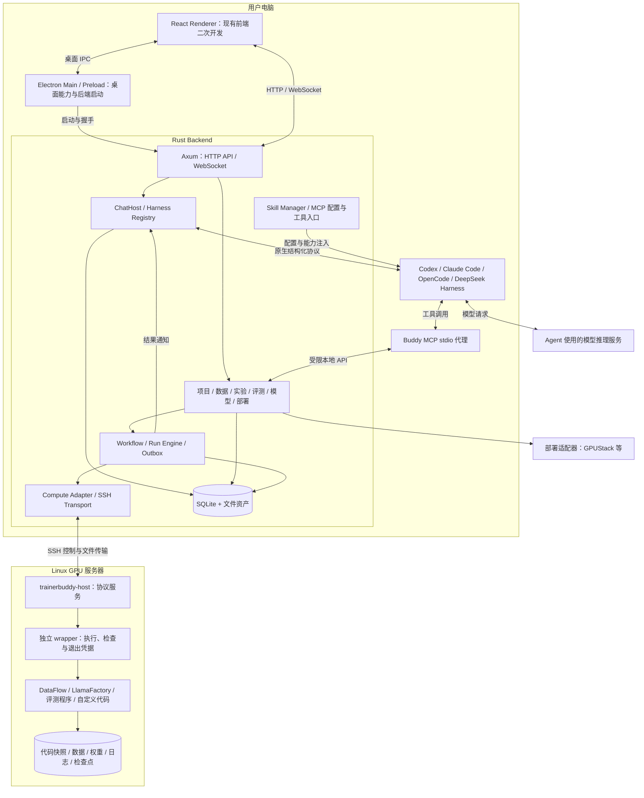

# uTrainerBuddy 技术架构设计方案

日期：2026-11-06  
状态：架构设计稿，供实现与评审使用；本文中的接口、命令和目录为设计约定，未表示已经实现。  
产品依据：[产品定位与实施方案](产品定位与实施方案.md)。

配套交互设计：[UI 交互设计方案](UI交互设计方案.md)，覆盖页面线框、智能体协作、数据/训练/评测监控及交互验收。

## 1. 已确定的架构方向

根据用户要求，确定以下技术边界：

1. 桌面端使用 Electron，在现有 `frontend/desktop` 上二次开发。
2. Backend 使用 Rust，独立进程运行，管理业务状态、Agent 会话和远端任务。
3. 复用 Codex、Claude Code、OpenCode、DeepSeek Harness 的 Agent 循环与工具执行能力，通过 Harness 适配层接入。
4. 训练与评测可以经 SSH 提交到 GPU 服务器，借鉴 OpenResearch 的快照、远端执行宿主和运行恢复机制。
5. 支持 Skill、MCP 服务及能力扩展，统一管理产品内置能力与用户扩展。

总体采用“Electron 桌面工作台 + Rust 模块化单体后端 + 外部 Agent 引擎 + Rust 远端执行宿主”。首版不拆微服务，不自研通用模型推理与工具循环，不在 Electron 主进程运行训练控制业务。

基本交互链路为：

> Electron → Rust Backend → Harness Adapter → 外部 Agent 引擎。

执行闭环为：

> Agent → Buddy MCP 工具或 CLI → Rust Backend → Compute Adapter → GPU 服务器执行宿主 → 数据处理、训练、评测 → 结果回到 Backend → 通知 Agent 分析。

产品工作流保证状态和交付顺序；外部 Agent 负责推理、方案设计与代码操作。Backend 不再实现一套重复的通用 Agent 循环。

## 2. 总体架构



图中的 MCP 代理调用 Backend 的应用服务，不直接访问数据库。部署适配器管理长期服务，与一次性训练 Run 分开。

## 3. 部署位置与进程生命周期

### 3.1 首版：本地工作区，远程 GPU 执行

| 组件 | 默认位置 | 生命周期与责任 |
| --- | --- | --- |
| Electron Renderer / Main | 用户电脑 | 展示、桌面集成、后端启动与连接 |
| Rust Backend | 用户电脑 | 会话、元数据、任务控制、恢复与结果通知 |
| 外部 Agent 引擎进程 | 工作区所在机器，首版为用户电脑 | 由 Harness 管理；执行工具并连接所选模型服务 |
| Agent 模型推理服务 | 云端或另行配置的模型服务 | 与 Agent 进程、训练模型分别配置 |
| Rust 远端宿主与 wrapper | GPU 服务器 | 独立持有训练进程和退出结果，不依赖桌面连接 |
| Python 训练/数据处理环境 | GPU 或数据处理节点 | 按任务镜像或环境运行，不嵌入 Backend |

必须区分“研发 Agent 使用的模型”和“本项目正在训练或部署的模型”，它们可以完全不同。

关闭窗口默认可隐藏到托盘；显式退出桌面应用时，本地 Backend 和本产品启动的 Agent 进程有序停止，远端已经接受的训练继续。不得在退出清理中顺带取消远端任务。重启后由 Backend 重新发现和核对任务。

本地电脑关机期间，已提交任务可运行，远端记录结果；需要 Agent 决策的下一轮研究不会自动发生。预先持久化并由远端执行的固定步骤可以继续，但不等于离线自主研究。

### 3.2 后续：远程工作区

需要持续自动迭代时，在常在线 Linux 主机运行同一 Rust Backend 和 Agent；Electron 通过 SSH 隧道访问该工作区。控制主机不必有 GPU，计算后端仍可选择其他机器。

工作区绑定自己的数据目录、Agent 安装与凭据。切换工作区不表示数据库双向同步，也不自动迁移本地项目。首版先定义 `workspace_id` 和工作区作用域，后续再实现远程工作区。

## 4. 技术选型

| 范围 | 选型 | 说明 |
| --- | --- | --- |
| 桌面 | Electron + 现有 React / TypeScript / Vite 前端 | 保留已有桌面与聊天组件，增加模型研发工作区 |
| 后端 | Rust + Tokio + Axum + tower | 模块化单体，异步 API、事件、子进程与连接管理 |
| 序列化与契约 | serde / serde_json + JSON Schema / OpenAPI | 生成前端类型，进行运行时校验 |
| 元数据 | SQLite WAL + rusqlite | 专用数据库线程/actor 执行同步 SQL，不阻塞 Tokio 工作线程 |
| HTTP 客户端 | reqwest + rustls | 调用 OpenCode、模型服务和部署 API |
| 观测与 CLI | tracing、clap | 结构化日志、诊断与无界面入口 |
| 代码版本 | 系统 Git，通过参数数组调用 | worktree、commit、archive 与来源关系 |
| 远端通信 | 系统 OpenSSH + 版本化宿主协议 | 复用用户 SSH 配置、密钥、agent 和跳板机能力 |
| 远端宿主 | 独立 Rust 二进制 `trainerbuddy-host` | 优先复用或适配 OpenResearch 的相关设计与实现 |
| 业务负载 | 固定版本 Python 环境或容器镜像 | DataFlow、LlamaFactory、评测依赖分别隔离 |
| 大型资产 | 本地/远端文件目录，后续可扩展对象存储 | 权重和数据不写入 SQLite，不默认下载到桌面 |

依赖版本在实际实现时验证并锁定；以上是技术方向，不承诺任意版本组合兼容。Rust 控制面不需要为训练框架引入进程内 Python 绑定。

## 5. Electron 与现有前端二次开发

### 5.1 当前可复用基础

本地静态检查确认：

- 已有 Electron 构建配置、`src/index.ts` 主进程和 `src/preload/main.ts`。
- 主进程入口说明原后端进程管理已被移除，不能把现有壳视为已接通 Backend。
- 已有 HTTP/WebSocket、IPC bridge、聊天、设置、Agent 类型与 Skill 相关代码。
- 现有页面主要为 conversation、settings、guid、login、team、cron，缺少数据集、实验、评测与部署工作区。
- 存在旧产品命名与后端假设，须梳理实际调用，不能只改品牌和端口。

上述为源码检查，未启动前端或执行构建。

### 5.2 进程边界与通信

Renderer 的业务请求统一走 Rust HTTP API，实时事件走 WebSocket；系统文件选择、窗口、通知和启动配置使用最小化 preload IPC。现有业务 bridge 逐步收敛至新 API，可暂设兼容映射，避免一次性重写全部 UI。

Electron Main 只管理后端启动、握手、健康状态与退出，不维护聊天和训练业务状态。Backend 启动时绑定 `127.0.0.1` 动态端口，通过专用管道向 Main 返回协议版本、端口和实例标识；日志写 stderr，不与握手混用。连接凭据经私有通道交付，不能写 URL 或公开日志。

新增 BackendLifecycleManager：定位打包二进制 → 启动 → 握手 → 健康检查 → 通知 Renderer → 崩溃恢复与诊断。对“连接已有服务”和“本产品新建服务”区分所有权，不能退出时杀掉用户已有服务。

### 5.3 工作区界面

采用“聊天 + 结构化工作区”组合，提供项目目标、数据、实验、评测、模型、服务、算力与扩展视图。四种入口为提升指标、适配业务、从零构建、探索方向；不要求模型、数据和评测目标全部填好才能创建项目。

在聊天中展示可点击的任务、数据版本、模型与评测卡片，用户可查看对应证据，不依赖模型口头报告执行状态。

明确配置 contextIsolation、禁用 Renderer Node 集成，并验证 sandbox 与当前 preload 兼容性。现有 HTML/webview 预览需要单独检查来源和隔离，不能获得 Backend 凭据或原生 IPC 权限。参考 [Electron 安全建议](https://www.electronjs.org/docs/latest/tutorial/security)。

### 5.4 UI 交互设计与现有组件扩展

采用左侧项目与会话、中间 Harness Agent 对话、右侧上下文工作台。中心始终保留单个主对话和输入框，数据、训练与评测对象在右侧检查，不通过业务导航替换会话。右侧按计划、运行、资产、记录组织，可调宽、收起、跟随会话或固定观察对象；密集内容按需进入独立详情窗口。顶部提供当前项目、会话与工作台入口，底部汇总长期任务；窄窗口侧栏转抽屉。

现有 Layout/Router、聊天消息、工具调用组、提问/权限、文件差异、预览和通知可复用结构；业务接口、状态映射及旧后端假设需对齐 Rust 契约。沿用项目级 ProjectPanelHost 跨同项目会话保留的结构，在右侧宿主新增数据、训练、评测、模型与服务检查器；概览和任务中心作为汇总入口，算力与扩展作为项目设置。常规展开预览不隐藏中心聊天。

UI 的对象卡片与任务中心引用同一 Run/Workflow 身份。Backend 提供权威快照，聊天文本不写入任务运行状态。输入框明确当前项目、引擎、对象引用与队列；能力不足时显示原因，不模拟实时输入或训练暂停。

导航状态（会话、对象、Tab、固定、宽度）与 Run 状态分开存储。切换会话恢复草稿与引用，右侧未固定时跟随，已固定时保留原对象并标明来源。打开对象只更新 UI；显式引用才将限定证据带入 Agent 输入。切换引擎只影响后续回合，历史事件保留原运行身份。关闭或折叠面板不会取消任务。

详情页固定展示执行阶段、联系状态、最近确认、进度口径和可执行操作。指标未知、过期、采集缺失与零值分别表达；执行完成、证据完整与业务达标分别建模。通用任务组件共享状态文案，专属数据/训练/评测页面共享证据链接。

停止 Agent 回合、暂停 Workflow 后续调度、取消 Run 与从检查点新建续跑分别使用明确入口。取消按钮显示已请求/待连接/停止已确认；进入页面、点击按钮和改变本地 UI 状态不能直接改写远端事实。

图表时间段、日志片段与样本可以作为有界证据引用交给 Buddy。路由、Tab、查询过滤与对象 ID 支持深链和恢复；跨工作区缓存隔离。完整交互规则和示例见 [UI 交互设计方案](UI交互设计方案.md)。

## 6. Rust Backend 的模块边界

| 模块 | 责任 |
| --- | --- |
| API / Event Gateway | 版本化 HTTP、WebSocket、鉴权、错误映射与事件订阅 |
| Workspace / Project | 工作区归属、业务目标、研究问题、约束与缺口 |
| ChatHost | 正式聊天记录、输入队列、回合租约、原生会话映射 |
| Harness Registry | 引擎探测、会话执行、事件归一化、能力发现 |
| Skill Manager | 技能版本、项目绑定、原生加载配置与兼容报告 |
| MCP Integration | 产品工具服务、用户 MCP 配置及引擎注入 |
| Dataset Service | 来源、配方、样本审核、版本、血缘与数据质量 |
| Experiment Service | 假设、对照关系、配置、预算、Run 与证据 |
| Workflow / Run Engine | 持久步骤、提交、观察、取消、恢复、通知 |
| Compute / Transport | 环境预检、资源检查、快照传输与后端生命周期适配 |
| Evaluation / Model / Deployment | 评测协议与报告、模型注册、服务发布和回滚 |
| Observability / Attention | 指标采集与索引、范围查询、阶段进度、时间线、告警与待办 |
| Storage / Credential / Diagnostics | 元数据、文件资产、凭据引用、日志与迁移 |

业务域模块位于同一 Backend 内，复用应用服务。HTTP、CLI 和 MCP 都调用同一入口，不各写一套提交或取消逻辑。

## 7. 外部 Agent 引擎接入

### 7.1 接入原则

直接复用外部引擎的推理、工具循环与上下文管理。Rust 负责启动或连接引擎、发送输入、处理事件、映射权限请求和恢复会话。优先结构化协议，不以解析终端彩色文本作为正式接口。

| 引擎 | Rust 首选接入路径 | 设计边界 |
| --- | --- | --- |
| Codex | `codex app-server`，stdio 双向结构化协议 | 按选定版本生成/固定协议类型，处理 thread、turn、事件和请求响应 |
| Claude Code | headless CLI 的结构化输入/输出；参考本地 OpenResearch stream-json 适配 | Rust 直接管理子进程；具体审批、输入和恢复能力按版本验证 |
| OpenCode | `opencode serve`，HTTP API + SSE 事件，由 Rust reqwest 调用 | 不要求引入 JS SDK；服务需明确凭据和所有权 |
| DeepSeek Harness | 单独实现适配器，按官方版本选择 headless/插件/服务协议 | 官方仓库已定位，但本轮未完成协议核验；不能先假定兼容 ACP 或其他引擎接口 |

Codex 官方文档支持以 App Server 嵌入产品；Claude Code 文档提供 CLI 程序化调用；OpenCode 提供 headless HTTP 服务。这些是接入依据，不代表四种引擎已通过产品集成测试。[Codex App Server](https://learn.chatgpt.com/docs/app-server)、[Claude Code 程序化调用](https://code.claude.com/docs/en/headless)、[OpenCode Server](https://docs.opencode.ai/docs/server/)

DeepSeek Harness 官方仓库说明其采用插件架构且处于开发预览，适配时应固定版本并设置独立契约测试。本方案暂以 `deepseek-ai/deepseek-harness` 为目标项目。[官方仓库](https://github.com/deepseek-ai/deepseek-harness)

### 7.2 统一适配契约

以下为 Rust 领域接口设计意图，非上游原生 API：

```text
detect()                       -> 安装、版本、登录与可用性
capabilities()                 -> 明确支持/不支持的能力
start_session(context)         -> 原生会话定位信息
resume_session(handle)         -> 恢复结果或不可恢复原因
send_input(session, input_id)  -> 交付状态
observe(session)               -> 标准化事件流
answer_request(request_id)     -> 权限/提问的原生响应
interrupt_turn(session)        -> 中断 Agent 回合
close_session(session)         -> 关闭本产品拥有的进程
```

能力包括流式输出、会话恢复、中途输入、提问、审批、Skill、MCP、上下文压缩、文件变更与使用量。接口存在不等于所有引擎都实现；UI 根据能力显示，不能将排队输入伪装成实时 steering。

正式聊天记录保存在 Backend，原生 session ID 用于引擎恢复。切换引擎时转交项目状态、已完成动作与证据摘要，建立新的原生会话；不保证不同引擎的私有上下文无损互通。

输入交付状态至少分为未发送、已接受、明确拒绝和结果不明。崩溃后不可简单重发结果不明的输入，以免重复提交任务。中断 Agent 回合、取消 Workflow、停止训练 Run 是三个独立操作。

### 7.3 工作目录与进程隔离

每个修改代码的会话使用项目 worktree 或明确绑定的工作目录；提交实验前冻结 commit。worktree 只隔离文件现场，不等于权限沙箱，也不保证多个会话不修改共享外部资源。

引擎发现和配置采用项目作用域或专用配置目录；保持用户已有登录流程，不复制令牌进项目，不静默改写全局配置。不同引擎对配置目录的支持不同，分别验证。

Windows 使用合适的进程组/Job Object 管理本地引擎清理，Linux/macOS 使用对应进程机制。不能把本地进程树清理规则套到已提交的远端训练。

## 8. Skill 与 MCP

### 8.1 Skill 是可版本化的方法资产

产品内置技能可覆盖需求澄清、评测设计、数据诊断、DataFlow 配方、训练计划、实验分析与部署验收。每次任务记录技能版本或内容摘要。

维护一份产品技能源，由各 Harness 适配到原生发现路径和配置；不假设目录、frontmatter、自动发现和附加资源在四个引擎中完全相同。不支持原生 Skill 时可提供显式说明与工具入口，但需标注为兼容方式。

技能指导研究方法；字段校验、预算、状态转换、数据版本冻结和任务提交去重由 Rust 执行，不能仅靠提示词。

### 8.2 产品内置 MCP 工具服务

设计 `trainerbuddy mcp` 为 stdio MCP 代理，连接指定 Backend 实例，调用同一应用服务。引擎作为 MCP Client 启动代理；Backend 是业务状态的唯一写入入口。

工具按业务命名，例如：

```text
project.inspect
dataset.inspect / dataset.run_recipe / dataset.publish
experiment.create
run.submit / run.inspect / run.cancel / run.read_logs
evaluation.submit / evaluation.compare
artifact.list
model.register
deployment.create / deployment.inspect / deployment.rollback
```

耗时调用返回 task_id 或 run_id，不保持一个 MCP 调用等待数小时。完成后由 Outbox 通知对应会话。工具名称和命令为拟定接口，实际实现时生成 schema 并固定契约。

MCP 标准传输包含 stdio 和 Streamable HTTP；首版本地工具使用 stdio，远程服务按需支持 Streamable HTTP。MCP 不是训练调度器，也不要求将所有内部模块都拆成 MCP 服务。[MCP 传输规范](https://modelcontextprotocol.io/specification/2025-11-25/basic/transports)

### 8.3 用户扩展服务与执行权限

Backend 保存用户 MCP 服务的作用域、命令/URL、能力、健康状态和凭据引用，再按引擎格式注入。stdio 子进程通常由引擎启动和管理；Backend 记录所有权，不重复启动或无差别终止。

产品 MCP 使用会话/项目作用域凭据，服务端校验工具权限；凭据不能放入模型提示词。Streamable HTTP 的凭据流按服务支持方式实现，不假定所有服务共用同一种认证。

通过产品管理的任务拥有预算、快照和恢复保证。若研究模式允许 Agent 原生 shell、直接 SSH 或第三方 MCP 绕过产品执行入口，其操作不自动受 Run Engine 管理。需要由原生工具权限限制或明确标记为外部未托管操作，不能仅凭 Skill 宣称已完全管控。

## 9. GPU 服务器通信与执行

### 9.1 首版选择 SSH

| 方式 | 采用阶段 | 适用范围 |
| --- | --- | --- |
| OpenSSH + stdio 宿主协议 + 文件传输 | 首版主路径 | 本地/实验室/企业 GPU 服务器，兼容现有 SSH 接入 |
| SSH 隧道 + HTTP | 后续远程工作区或已有服务 | 在隧道内访问工作区 Backend 或受保护服务 |
| HTTPS + 明确认证 | 后续集群服务 | 已有集中部署和服务身份管理的环境 |
| Slurm / Kubernetes 调度适配 | 需求明确后 | 队列资源和多节点任务；SSH 只负责接入时不替代调度器 |

SSH 是传输，调度适配器是执行生命周期。Compute 层接口统一为 preflight、stage、launch、recover、observe、cancel、read_logs、collect_artifacts，后续扩展不改变产品业务 API。

系统 OpenSSH 优先复用 SSH config、known_hosts、密钥代理和跳板配置。首次主机身份、认证失败与网络失败分别处理；Windows 不假定具备 Unix ControlMaster，需单独验证连接复用与交互认证。

### 9.2 Rust 远端宿主

拟提供两个角色：

- `trainerbuddy-host serve`：通过 SSH stdio 接收版本化 RPC，检查环境、暂存任务、读取状态和日志。
- `trainerbuddy-host wrap`：每个 Run 的独立执行所有者，持有进程、取消处理和退出凭据。

`serve` 断开后 `wrap` 及其负载继续运行。分离启动、文件描述符、会话和进程树行为必须经真实 SSH 断连验证；不能仅使用一个普通 SSH shell 命令或 tmux 会话就声称满足可靠任务协议。

宿主使用独立 Rust 二进制，按目标 Linux 架构发布并检查校验和；不要求 GPU 服务器安装完整 Electron 或 Agent 引擎。训练程序仍使用固定 Python 环境或容器。

复用 OpenResearch 时，应明确选择经验证的引擎路径和 host 协议，不把旧 supervisor 与新 Engine 的行为混用。本方案优先移植/适配所需模块，不将 OpenResearch 的桌面、账户和所有云后端整体接入。

### 9.3 提交与结果回收

1. 用户或 Agent 调用结构化提交入口，携带幂等键。
2. Backend 校验项目、数据和模型版本、资源、预算、运行环境及评测协议。
3. 固定代码 commit，生成摘要校验的快照和 RunSpec；未提交修改先明确处理，不偷偷混入快照。
4. 数据库记录提交意图、Run ID 和快照标识，再执行外部提交。
5. 暂存代码与缺失资产，校验文件，生成最终远端路径映射。
6. 宿主按 Run ID 和 spec 摘要接受任务，重复相同请求接管原任务，不同请求冲突；回复丢失时 recover 查证。
7. wrapper 启动负载，记录运行身份、日志和退出凭据，Backend 持续观察。
8. 完成后登记产物与评测报告，持久化通知会话；Agent 读取证据后决定下一步。

结果目录可包含 `launch.json`、`identity.json`、`exit.json`、`stdout.log`、`metrics.jsonl` 和 `artifacts.json`。具体格式单独版本化，原子写入与恢复条件需要协议测试。

GPU 资源首版通过受管任务的预留记录协调，并检查实时占用；单纯探测空闲显存不能避免其他用户同时抢卡，也不等于硬隔离。需要强资源保证时使用容器设备约束和调度器能力。

### 9.4 数据与权重传输

代码快照、少量配置优先传输；数据和权重通过 AssetRef 引用远端已有文件、受管缓存或对象存储，不默认每次从桌面上传。资产记录归属工作区/主机、内容摘要、大小、可用性与引用关系。

明确区分本地路径、远端路径和逻辑资产 ID；Windows 的 `D:\...` 路径不能直接成为 Linux 训练路径。上传采用临时文件、校验、原子发布；大文件传输独立限流，不阻塞取消和状态请求。

默认回收报告、必要日志、指标和产物清单；权重和大型检查点可留在远端，按需下载或交给部署后端。产物尚未保全时不得自动删除唯一远端副本。

## 10. 状态、工作流与恢复

### 10.1 Run 状态与连接状态分开

| 维度 | 拟定状态 |
| --- | --- |
| phase：执行阶段 | queued、staging、submitting、starting、running、succeeded、failed、cancelled、lost |
| contact：观察状态 | live、unreachable、needs_auth、unreconciled |
| 取消与清理 | cancel_requested、stop_confirmed、cleanup_pending，独立记录 |

退出码 0 只表示程序执行成功，业务达标另由 EvaluationReport 表达。请求取消立即持久化，但只有收到停止证据后才能宣称任务已停止；无法查证时保留不确定性和待清理义务。

### 10.2 Workflow 与 Agent 回合分离

Workflow 保存步骤、依赖、配置、状态、子 Run 和失败处理。首版支持模板化有向无环依赖；研究迭代通过新增有界轮次或新 Workflow 表达，不依赖聊天内存中的无限循环。

DataFlow 负责单个数据配方内部执行，Run Engine 负责外部作业生命周期；不能把 DataFlow 的字段依赖图直接当作产品级调度器。

事务 Outbox 将状态变更与待通知事件一起持久化；通知按固定 ID 去重，聊天空闲时触发后续分析。保证范围是通知交付与状态一致性，不扩大为任意工具副作用恰好一次。

### 10.3 重点故障语义

| 故障 | 期望行为 |
| --- | --- |
| Renderer 刷新或窗口关闭 | 重新订阅/查询，Backend 任务状态不丢失 |
| Backend 崩溃或升级 | 读取持久 Run 和 handle，查证后接管，不盲目重交 |
| SSH 中断 | 训练继续；标记联系不上，恢复后核对凭据 |
| 启动成功但回复丢失 | 按 Run ID 查找；结果不明则 unreconciled |
| 写入启动栅栏后未真正启动 | 保留可诊断的不确定结果，不能为追求自动恢复重复启动 |
| 用户取消时离线 | 保存取消意图；明确提示尚未确认停止，重连后处理 |
| GPU 主机重启 | 用主机启动身份与执行凭据识别；按训练框架检查点另建续跑 Run |
| Agent 进程退出 | 会话可恢复；已提交远端任务不随 Agent 退出而取消 |
| 日志或产物回收失败 | 保留待回收义务与可操作错误，不伪装为空结果 |

自动续跑与原任务重复提交分别管理。训练框架的检查点恢复需通过具体负载适配器验证，不能仅由任务宿主推断支持。

## 11. 数据、训练、评测与部署接入

| 负载类型 | 执行方式 | Backend 管理的结果 |
| --- | --- | --- |
| DataFlow 数据配方 | 独立 Python 环境/容器，按契约运行选定算子 | 样本状态、质量报告、来源关系和候选数据版本 |
| 标准训练 | LlamaFactory 等固定版本环境 | 训练配置、检查点、模型和指标 |
| 自定义研究 | 冻结代码快照 + 显式环境/入口 | 改动、运行记录与证据，不假定使用标准框架 |
| 效果评测 | OpenCompass 或自定义评测负载 | 固定评测协议、逐样本结果、汇总与可比性 |
| 推理发布 | Deployment Adapter 调用 GPUStack 等 | 服务 ID、实际部署产物、健康、流量与回滚信息 |

DataFlow 内部检查点、样本账本属于负载恢复机制；Backend 只重试受契约支持的步骤，不把外层 Run 重试视为自动获得样本级恢复。数据、Prompt、模型或解析器变化后应新建执行身份或拒绝续跑。

训练输出先注册 ModelVersion，再对实际导出产物评测并发布。Deployment 是长期资源，训练取消或桌面退出不得自动删除线上服务。LoRA 模型应绑定基座、tokenizer、聊天模板与适配器版本。

## 12. 数据模型与文件存储

核心实体建议包括：Workspace、Project、ResearchQuestion、Hypothesis、Conversation、AgentSession、DatasetVersion、RecipeVersion、Experiment、Workflow、Run、Asset、ModelVersion、EvaluationProtocol、EvaluationReport、Deployment、ComputeTarget、SkillBinding、McpBinding、OutboxEvent。

关键约束：

- 已提交 RunSpec 和已发布数据版本不可原地改写；后续变化创建新版本。
- Run 关联代码、数据、模型、环境与技能配置的快照；大文件保存引用和摘要。
- Conversation 与原生 AgentSession 分开，允许引擎切换后新建原生会话。
- Run 关联请求幂等键和原生任务 handle，状态由控制层统一推进。
- 日志独立文件保存，SQLite 保存索引和进度，不逐行吞入数据库。
- 指标高频序列按 Run 分块落盘并建立查询索引；告警、待办、采集游标和重要事件持久化，保留策略与采样口径显式记录。
- 权限与状态事件使用事务；数据库版本迁移、备份和工作区单实例锁统一管理。

拟定目录：

```text
<workspace-data>/
  metadata.sqlite
  projects/<project-id>/repo/
  worktrees/<conversation-id>/
  snapshots/<digest>/
  datasets/<dataset-version-id>/manifest.json
  runs/<run-id>/
  artifacts/
  skills/
  engine-configs/
  logs/
```

凭据放在操作系统凭据存储或受限文件中，数据库仅保留引用。数据目录独立于安装目录和源码目录，升级不覆盖用户资产。

## 13. API 与事件契约

首版建议提供以下业务资源，路径为拟定版本接口：

```text
GET  /api/v1/health
GET  /api/v1/capabilities
POST /api/v1/projects
POST /api/v1/conversations/{id}/inputs
POST /api/v1/requests/{id}/answers
POST /api/v1/dataset-jobs
POST /api/v1/datasets/{id}/publish
POST /api/v1/experiments
POST /api/v1/runs
GET  /api/v1/runs/{id}
POST /api/v1/runs/{id}/cancel
GET  /api/v1/runs/{id}/logs
POST /api/v1/evaluations
POST /api/v1/deployments
GET  /api/v1/events                 WebSocket Upgrade
```

API 使用统一错误结构 `code/message/details/retryable`，记录 request_id。耗时创建返回身份与当前状态，提交接受不等于任务已经启动。

事件 envelope 至少包含 event_id、workspace_id、entity_id、type、occurred_at 和 payload；按需附带 conversation_id、turn_id、run_id。终态与重要业务事件持久化；高频文本增量和日志可使用有界缓存。断线或序号缺口时客户端重新查询权威快照，不承诺无限事件重放。

聊天事件归一化为消息增量、工具开始/完成、文件变更、提问、审批、回合结束与错误；保留必要原生标识用于诊断。不可获取的模型内部推理不作为统一能力要求。

### 13.1 长任务观测采集与存储

增加 Observability Service，负责阶段进度、指标规范化、历史查询、时间线、采集游标、告警与待办。三种来源分别管理：负载结构化指标、宿主资源采样、引擎/运行控制事件。

负载适配器将训练 step、loss、验证结果、数据计数或评分进度写入明确契约；兼容日志解析需记录解析器版本和来源，不能由前端正则猜测运行状态。宿主资源与单任务资源分别标记，不把整卡占用自动归因于一个训练进程。

远端 wrapper 及其管理的采集器在 SSH 断开后继续写指标和日志；Backend 重连按文件身份与游标读取。无采集能力的时间段保留缺口，不补造历史值。重要状态与通知通过事务记录，采样数据通过幂等记录身份或确定性游标避免重复。

首版指标采用按 Run 的追加分块文件、查询索引和窗口聚合，SQLite 保存索引、元数据及告警，不把每个采样点当聊天消息。原始序列与低分辨率聚合分层保留，明确清理条件；超出本地规模后再评估专用时序后端，不将外部监控平台作为首版前提。

指标点至少包含 run_id、series_id、metric_name、value、unit、step或源时间、received_at、source、worker/rank及质量标记。原始 rank 指标与聚合值分开，声明聚合方式。任务快照包含 revision、observed_at 与能力；阶段进度声明分母是否已知和输入/输出计数口径。

### 13.2 观测 API、事件与前端数据流

补充拟定接口：

```text
GET  /api/v1/tasks
GET  /api/v1/runs/{id}/progress
GET  /api/v1/runs/{id}/metrics
GET  /api/v1/runs/{id}/events
GET  /api/v1/runs/{id}/checkpoints
GET  /api/v1/dataset-jobs/{id}/records
GET  /api/v1/evaluations/{id}/results
GET  /api/v1/attention-items
POST /api/v1/attention-items/{id}/ack
GET  /api/v1/workspaces/current/changes
```

metrics 支持 series、时间/step范围、粒度和点数上限；日志支持文件身份、游标、源与范围；样本和评测结果服务端分页筛选。对象身份与证据引用连接曲线、日志、配置和样本。

WebSocket 推送重要变化、缓存失效提示及有界增量；大表格、历史曲线、日志通过查询拉取，不能全量广播到每个页面。前端先查询快照再订阅，revision/事件序列发现缺口后重新核对；HTTP可用而事件中断时可降级查询，Backend不可达时显示只读缓存和最近确认时间。

复用前端 SWR 管理对象快照，独立有界缓存管理高频序列，按 workspace/project/run及版本隔离。日志与样本虚拟化和分页；后台标签与隐藏窗口降低渲染频率，但采集继续。曲线库在指标种类、极值保留降采样和长期内存验证后确定。

初始设计值：资源约5–10秒采样，可见曲线约2–5秒合并刷新，关键阶段变化尽快推送；实际根据任务规模验证调整。长时间窗降采样保留异常极值，原始点按策略可查；这些数值为设计目标，不是已测性能。

### 13.3 告警、Agent 分析与桌面通知

告警由明确规则产生，保存首次/最近发生、对象、严重性、证据、确认与解决状态。按 Run/原因去重与去抖，认证失败、提交未知、停止未确认等保留可操作待办；用户确认收到不改变实际故障状态。

高频指标不直接触发模型调用。仅在重要事件、已配置策略或用户选择证据后通知 Buddy 诊断；诊断任务有调用预算。自动停止等动作必须依赖明确策略及负载能力，不能根据模型文字判断直接推进任务终态。

通知默认应用内，按用户授权使用 Electron 系统通知；点击深链到任务或请求。Backend停止期间不承诺本地持续告警，重连汇总离开期间变化；全天候告警及研究迭代需远程工作区。通知展示失败不能丢失应用内待办。

## 14. 安全、资源与发布边界

本地 API 仍需实例认证、Host/Origin 检查和精确的跨域策略；loopback 不等于只会被本产品调用。WebSocket 握手采用经验证的一次性票据或受保护会话方案，避免把长期凭据放进查询字符串。

文件接口校验规范化路径及符号链接后的访问范围，归档解包防止路径穿越。日志、RunSpec 和错误信息不包含密钥。SSH 远端命令采用固定入口与结构化输入，避免把模型生成文本拼接成 shell 控制命令；研究负载代码与控制协议分别处理。

项目预算包括并发、GPU 数、运行时长、数据生成调用量及估算费用。可强制的限制由调度、wrapper 和供应商能力执行；费用估算不能被宣称为精确的计费上限。

首版应用支持 Windows 桌面与 Linux GPU 后端作为主验收组合，其他桌面平台按可用环境验证。独立分发 Rust Backend 与 Linux Host 二进制；引擎优先探测用户安装和登录，不假定四家可执行文件、依赖及账户均随产品安装完成。

Desktop、Backend、Host、Harness 协议及 Skill bundle 各自记录版本，连接时检查能力与最低兼容版本。数据库迁移失败不静默重建；回滚必须考虑迁移兼容性与仍在运行的远端任务。

## 15. 建议代码组织

```text
frontend/desktop/                 现有 Electron + React，继续二次开发
backend/
  Cargo.toml                     Rust workspace
  crates/
    buddy-app/                   API、启动、CLI、应用组合
    buddy-domain/                领域模型与不变量
    buddy-store/                 SQLite、迁移、Outbox
    buddy-harness/               四类 Agent 适配与能力表
    buddy-runner/                Workflow / Run Engine / Compute
    buddy-host-proto/            版本化控制协议与磁盘契约
    buddy-host/                  Linux serve / wrap
    buddy-integrations/          数据、训练、评测与部署适配
    buddy-extensions/            Skill 与 MCP
  migrations/
  tests/
skills/                          产品技能源
recipes/                         经过验证的数据与训练配方
contracts/                       导出的 API / 事件 / schema
```

以上为逻辑边界与目标目录，可以先在较少 crate 中按模块实现，再按依赖与测试需求拆分；不为目录结构预先引入额外部署进程。

## 16. 实施顺序与验收

| 阶段 | 实现范围 | 验收重点 |
| --- | --- | --- |
| A：桌面与 Rust 骨架 | Backend 启动握手、SQLite、健康、API/事件、现有 UI 接口迁移 | 安装后能启动，状态和错误可见，重启后项目保留 |
| B：Agent 与扩展 | Harness 公共契约、先完成 Codex 一条链路，再接 Claude Code/OpenCode；DeepSeek 先做协议验证 | 流式消息、提问/审批、会话恢复、内置 Skill/MCP 与能力降级 |
| C：远程任务闭环 | SSH、Host、快照、Run、日志、取消、恢复与通知 | 真实远端任务在断网/退出后继续，重启后可核对和接管 |
| D：数据到评测 | 一条 DataFlow 配方、审核与版本、LoRA 训练、独立评测 | 样本对应和血缘正确，数据/模型/评测证据绑定 |
| E：服务与研究扩展 | 模型注册、部署回滚、自定义研究、其余引擎正式支持 | 实际产物验收、长期服务独立、研究实验可追踪 |

四种引擎属于目标支持范围，分阶段交付不代表取消其中任何一种。每种适配器具备版本化能力表与独立验收；未通过的能力不在 UI 中宣称可用。

UI 和观测能力随阶段交付：A/B 增加项目入口、任务中心、Buddy对象卡片与未完成请求恢复；C 增加通用任务详情、日志、最后确认与断线体验；D 增加数据样本审核、训练指标与检查点、评测中间结果与覆盖率；E 增加服务监控与研究对比。详细P0/P1/P2及场景见配套UI方案。

观测验收还包括乱序/重复采样、时钟偏差、数据过期、日志截断/轮转、部分评测、图表原始值与降采样极值、前端长期内存有界、后台渲染节流及通知去重。没有指标的负载必须显示能力缺失，不能伪造零值或百分比。

实现时必须覆盖的故障验证包括：提交回复丢失、重复提交、SSH 断连、Backend 崩溃、离线取消、日志回收中断、GPU 主机重启、Agent 输入交付不明、配置变化后的数据恢复，以及旧版本 Host 连接。

Rust 侧运行格式、静态检查与相关接口/状态机测试；集成侧使用真实数据库和任务控制链路，替换不可控外部服务；SSH 生存性和实际 GPU 训练需要单独实机验收。本文仅设计，不声称这些验证已通过。

## 17. 仍需技术验证的事项

1. DeepSeek Harness 的固定版本及可嵌入协议，Skill/MCP、会话恢复与审批事件的实际能力。
2. OpenResearch 可复用模块的依赖边界、所选 Engine/Host 路径及版本兼容范围。
3. Windows 上四类 Agent 的安装、路径、原生协议和进程回收；SSH 认证与跳板机行为。
4. 第一条 DataFlow 配方与训练/评测环境的依赖锁定和资源开销。
5. GPUStack 接入版本、LoRA/导出模型格式和实际部署验收。

这些是实现前后的验证项，不改变用户已确定的 Electron、Rust Backend、外部 Agent、远程 GPU 和 Skill/MCP 方向。

## 18. 设计依据与参考

- [产品定位与实施方案](产品定位与实施方案.md)。
- [UI 交互设计方案](UI交互设计方案.md)：页面线框、协作流程、长任务观测与交互验收。
- [OpenResearch 项目深度解读](OpenResearch项目深度解读.md)、[实验与计算架构](opensource/OpenResearch/arc/experiments.md)。
- [OpenResearch Harness 接口](opensource/OpenResearch/src/local/harness/mod.rs)、[Claude 适配](opensource/OpenResearch/src/local/harness/claude.rs)、[Codex 适配](opensource/OpenResearch/src/local/harness/codex.rs)、[OpenCode 适配](opensource/OpenResearch/src/local/harness/opencode.rs)。
- [DataFlow 模块报告](reports/DataFlow/模块深度解读报告.md)、[算子索引](reports/DataFlow/算子完整索引.md)。
- [现有 Electron 主进程](frontend/desktop/src/index.ts)、[preload](frontend/desktop/src/preload/main.ts)、[HTTP 桥接](frontend/desktop/src/common/adapter/httpBridge.ts)。
- [Axum 官方 API 文档](https://docs.rs/axum/latest/axum/)、[Tokio 官方站点](https://tokio.rs/)。

本方案基于本地源码静态查看及 2026-11-06 查询的官方资料；上游原生协议变化需要通过锁版本和契约测试处理。架构建议与已实现能力分别管理。
